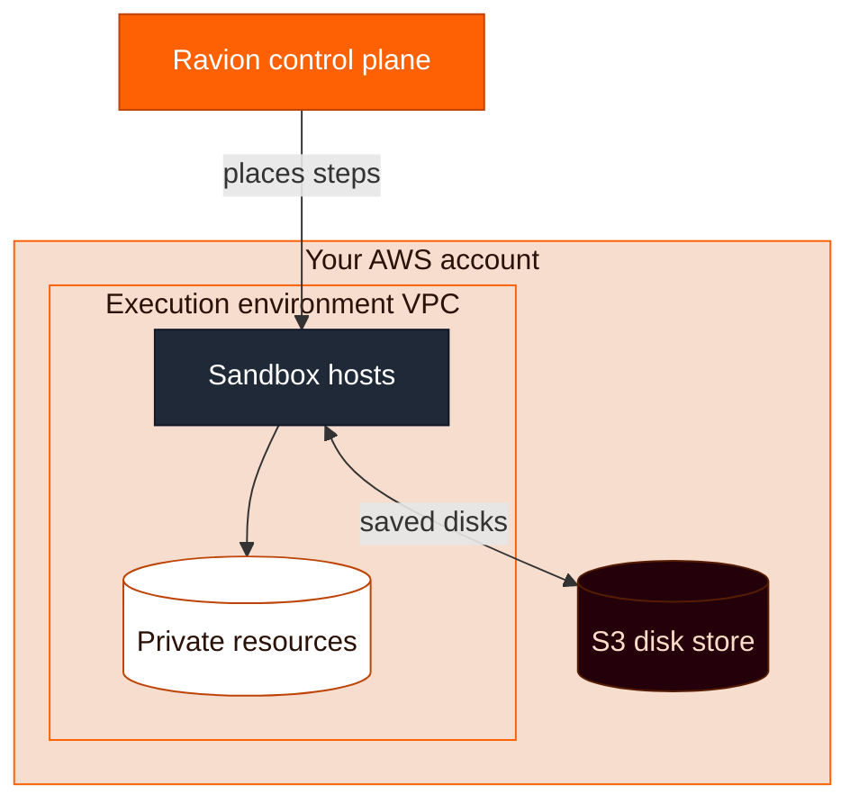
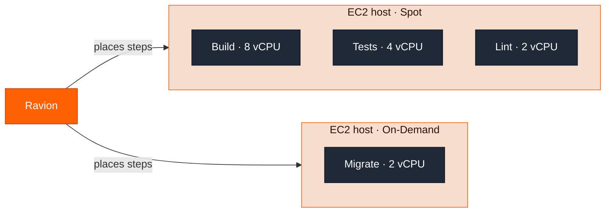
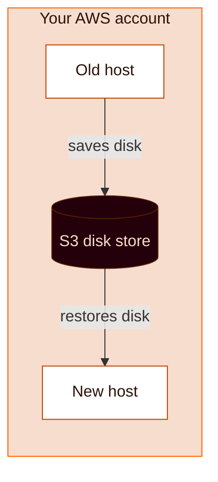
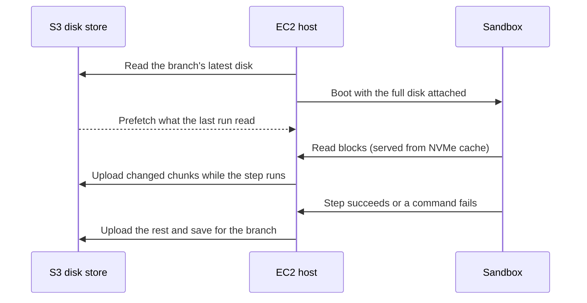

A sandbox runs one pipeline step or module build in its own [Firecracker](https://firecracker-microvm.github.io/) microVM, on EC2 hosts in your AWS account.

You set the CPU, memory and disk a step needs. Ravion launches, packs, scales and retires the hosts. On a running host, a sandbox boots in one to two seconds, and the [disk cache](#disk-cache) brings back the whole disk from the last saved run.

## How the fleet works

Each execution environment gets its own set of sandbox hosts, in its VPC and subnets. The first step that runs with `type: sandbox` sets them up. There's nothing to provision.

Everything runs in your AWS account. Sandboxes can reach private resources in the VPC, and saved disks stay in an S3 bucket in your account. Hosts connect out to Ravion, so they need no inbound ports.



One host runs many sandboxes at once. Each sandbox is a separate VM with its own kernel, network namespace, CPU, memory and disk.



- **Placement.** Ravion puts a step on a running host with room, preferring the host that last ran it, since that host already has its disk cached.
- **Scale up.** When no host has room, Ravion launches one sized for the waiting steps. When a pipeline run starts, Ravion plans hosts for the whole run up front, so later steps don't wait for a launch.
- **Spot.** [Interruptible steps](#interruptible-steps-and-spot-hosts) can run on Spot hosts. Other steps only run on On-Demand hosts.
- **Scale down.** Ravion shuts down a host once it's empty. If the remaining hosts don't have room for what's coming next, it waits 40 seconds first. Running steps always finish.

### Host lifecycle

Hosts are disposable. Saved disks live in an S3 bucket in your AWS account, so you lose no cache when a host goes away. The next host restores the disk from S3.



| Host storage | When a host is idle | Trade-off |
| --- | --- | --- |
| **Ephemeral** (default) | Terminated | No idle charges. The next step after a quiet period waits for a new host. |
| **Persistent** | On-Demand hosts are stopped and keep their disks. Spot hosts are terminated. | Woken hosts still have their local cache. Retained disks incur storage charges. |

For faster starts after quiet periods, you can keep a few hosts on hand: running in ephemeral mode, or stopped in persistent mode. See [Sandbox settings](#sandbox-settings).

## Why sandboxes are fast

A cold CI job spends much of its time getting back to where the last one was: installing tools, restoring caches and pulling Docker layers. A sandbox skips that. It boots in one to two seconds with the whole disk from the last saved run already attached.

### The whole disk is the cache

When `disk_cache` is on, Ravion saves the sandbox's entire root disk when a step succeeds or one of its commands fails. You don't list cache paths. Everything the step left behind comes back next time:

- Packages installed with `apt`, `setup` actions or install scripts
- `node_modules`, `~/.cache`, `~/.m2`, Go and Cargo build caches, `.next/cache`, `.turbo`
- Docker images, layer cache and BuildKit `RUN --mount=type=cache` directories in `/var/lib/docker`
- Your git checkout, so the next clone only fetches new commits

### Restores stream instead of downloading

A saved disk is stored as 2 MiB chunks, zstd-compressed and named by their content hash. A restore doesn't download the disk first:

1. The sandbox boots right away with the full disk attached. Its writes go to its own copy-on-write layer.
2. When the sandbox reads a block, the host serves it from its local NVMe cache. On a miss, it fetches only that chunk from S3 and checks it against its hash.
3. In the background, the host prefetches the chunks the previous run read, in the order it read them.

The size of the disk doesn't change the boot time, and the step rarely waits on S3.

### Saves upload only what changed

While the step runs, the host uploads changed chunks in the background. When the step succeeds or one of its commands fails, only the remaining chunks are left to upload. Ravion does not save a disk when a step is cancelled, times out, runs out of disk, or loses its host. Unchanged chunks are never uploaded again, and empty chunks cost nothing.



### The VM runs at host speed

Each sandbox's memory is backed by 2 MiB huge pages, and the guest kernel is tuned to avoid costly exits to the hypervisor. CPU- and memory-heavy work such as compiling and package installs runs close to bare-host speed. On instance types with local NVMe, the sandbox disks and chunk cache use it instead of EBS.

### Compared with other CI caches

| | GitHub Actions cache | Blacksmith sticky disks | Ravion sandboxes |
| --- | --- | --- | --- |
| **What's kept** | Paths you list, plus Docker layers you export | Docker builder state and directories you mount | The entire VM disk |
| **Restore** | Download and extract the archive before the job continues | Mount a saved disk per cache key | Boot right away; stream blocks as they're read |
| **Save** | Compress and upload the archive under a new key | Commit the disk at the end of the job | Upload changed chunks, mostly during the run |
| **Where it lives** | GitHub's cache service | Blacksmith's storage | S3 in your AWS account |
| **Setup** | Cache keys and paths per job | Actions and cache keys per workload | `disk_cache: auto` |

With path-based caches, anything you don't list starts over on every run, including system packages, toolchains and files outside those paths. A sandbox keeps everything.

## Why sandboxes are cheap

Hosts run in your AWS account, so you pay AWS directly at your own rates. Ravion keeps that bill low:

- **Spot for interruptible steps.** Spot capacity costs much less than On-Demand. [Interruptible steps](#interruptible-steps-and-spot-hosts) run on Spot, with On-Demand as the fallback. If AWS reclaims a Spot host in its first hour, [AWS doesn't charge for that host's usage](https://docs.aws.amazon.com/AWSEC2/latest/UserGuide/billing-for-interrupted-spot-instances.html), and Ravion reruns the step on another host.
- **Many sandboxes per host.** Each step gets exactly the CPU and memory it asks for, on a shared host, instead of a whole instance per job.
- **Whole-run planning.** When a pipeline run starts, Ravion estimates each step's duration from its recent successful runs. It packs short steps beside long ones, holds room for the steps due next, and launches hosts only for work that won't fit. Hosts stay busy, and steps don't wait for capacity.
- **No idle hosts.** Ravion shuts down empty hosts as soon as the rest of the fleet can handle what's next. By default, nothing runs between pipeline runs.

## When to use sandboxes

Use sandboxes for pipeline steps and module builds by default, including builds, tests, migrations and other scripted tasks.

Use `ec2` or `ec2-spot` [infrastructure](/pipelines/config-reference/step-infrastructure#stepinfrastructure) only when you need a custom AMI or a dedicated EC2 instance. See [EC2 runners](/pipelines/step-types#ec2-runners) for what those images include.

## What runs inside a sandbox

Every sandbox boots the same x86_64 Ubuntu 24.04 image. It has the apt packages [GitHub's `ubuntu-24.04` runner image](https://github.com/actions/runner-images/blob/main/images/ubuntu/Ubuntu2404-Readme.md) installs, such as git and Git LFS, build-essential, Clang 18 (`clang-18`, `lld-18`, `lldb-18`, `clang-format-18` and `clang-tidy-18`), `zip`, `rsync`, `wget`, `brotli`, `sqlite3` and the PostgreSQL client. It also has GitHub CLI (`gh`), Node.js 24, Docker with Docker Compose, the AWS CLI, `jq`, `yq`, ccache, sccache and Bazelisk (as `bazel`). Like GitHub's images, `apt-get install` doesn't ask for confirmation.

The image is still much smaller than GitHub's hosted runner images. Their `ubuntu-latest` also comes with several versions each of Node.js, Python, Java, Go, Ruby and .NET, plus browsers, databases and cloud tools. The sandbox image doesn't. If a step needs something missing, install it natively:

- System packages with `apt-get`, for example `apt-get update && apt-get install -y python3-pip`. Steps run as root.
- Language versions with the usual `setup-*` actions in GitHub Actions jobs, or with version managers and install scripts in pipeline steps.
- Anything else by downloading its binary or installer in a command.

With `disk_cache` on, what you install usually stays for later runs — only runs that can write the cache save their disk. See [Disk cache](#disk-cache).

Docker starts in the background when the sandbox boots, and the first `docker` command waits for it. Tools that talk to Docker another way, such as Testcontainers or a Docker SDK, must wait for the daemon themselves.

## Get started

<Steps>
  <Step title="Update your AWS permissions">
    Sandboxes require AWS account role policy **1.0.52 or later**.

    1. Go to [**Settings / AWS accounts**](https://app.ravion.com/org/settings/aws-accounts) and open the account.
    2. Click **Update AWS Permissions** and follow the steps to update the CloudFormation stack.

    From the CLI, run `ravion aws account policy-diff <aws-account-id>` to review the change. Then apply it with `aws cloudformation update-stack` and a template URL from `ravion aws account cloudformation-template-url <aws-account-id>`.
  </Step>
  <Step title="Update modules with a build step">
    This applies to module builds only. Modules that build your code, such as `rvn-ecs-web`, `rvn-lambda` or `rvn-aws-static`, need a version released on or after October 10, 2026; older versions only build on EC2. Modules without a build step, such as `rvn-stack`, need no update, and pipeline steps run in sandboxes regardless of module versions.
  </Step>
  <Step title="Run pipeline steps or module builds in sandboxes">
    Set [pipeline steps](#pipeline-steps) to `type: sandbox`. New [module builds](#module-builds) use sandboxes by default; switch existing modules that still use EC2.
  </Step>
</Steps>

## Pipeline steps

Set the step's `infrastructure.type` to `sandbox`. Any step with an `infrastructure` block can run in a sandbox, including `custom`, `build:image` and `build:static`.

Replace `ci-builders` with the ID or given ID of your execution environment. To create one, go to [**Settings / Execution environments**](https://app.ravion.com/org/settings/execution-environments).

```yaml
- id: run_tests
  name: Run tests
  type: custom
  source:
    type: git
    repo: https://github.com/my-org/my-repo
    branch: main
  commands:
    - npm ci
    - npm test
  infrastructure:
    type: sandbox
    execution_environment_id: ci-builders
    cpu: 4
    memory: 16
    disk: 40
    disk_cache: auto
    interruptible: true
```

| Field | Required | Default | What it does |
| --- | --- | --- | --- |
| `execution_environment_id` | One target | None | ID or given ID of the execution environment to run in. |
| `aws_account_id` + `region` | One target | None | Run in this account and region's execution environment instead. See [Limits](#limits-and-caveats). |
| `cpu` | Yes | None | vCPUs for the sandbox, or `auto`. See [Automatic sizing](#automatic-sizing). |
| `memory` | Yes | None | Memory in GiB, or `auto`. |
| `disk` | No | 8 | GiB of host disk reserved for what the sandbox writes, or `auto`. |
| `disk_cache` | No | `off` | Keep the sandbox's disk between runs. See [Disk cache](#disk-cache). |
| `interruptible` | No | `false` | Allow Spot hosts, and rerun the step from the start if its host is lost. See [Interruptible steps](#interruptible-steps-and-spot-hosts). |

Sandboxes don't take `instance_size`, `ami` or `storage`. See [SandboxStepInfrastructure](/pipelines/config-reference/step-infrastructure#sandboxstepinfrastructure) for the full schema.

### Automatic sizing

<Note>
  Automatic sizing is in preview. [Contact support](/contact-support) to share feedback.
</Note>

Set `cpu`, `memory` or `disk` to `auto` and Ravion sizes the sandbox from the step's earlier runs. `auto` needs `interruptible: true` on the same step; a step without it must set fixed values, and the pipeline won't save otherwise.

- The first run gets 4 vCPU, 16 GiB of memory and 40 GiB of disk.
- Every run teaches Ravion what the step needs. Sizes grow fast when a step needs more, come down gradually when it needs less, then settle. Sizes are learned per pipeline step and execution environment.
- If a step runs out of memory or disk, Ravion gives it more and retries it in the same pipeline run, up to twice per step. The step's log shows each retry.
- If Java (`java.lang.OutOfMemoryError: Java heap space`) or Node (`JavaScript heap out of memory`) runs out of heap, Ravion gives the step more memory and retries it. If it happens again, the heap limit is probably set in your command with `-Xmx` (Java) or `--max-old-space-size` (Node), so raise it there.
- Sizes never go above what the largest host type in your execution environment can fit.

The step's log shows the size Ravion picked and why. For GitHub Actions jobs, see [Automatic sizing](/github-actions/runners#automatic-sizing).

## Module builds

New module builds use sandboxes by default. See [Build infrastructure](/modules/build#build-infrastructure) to configure builds or switch an existing module from EC2.

## Sandbox settings

Go to [**Settings / Execution environments**](https://app.ravion.com/org/settings/execution-environments), choose the environment, then open **Config / Sandboxes**.

<Tip>
  We recommend keeping the defaults. We're still tuning them for everyone, and any setting you leave at its default picks up each improvement automatically. If something is slow, costs more than you expect, or doesn't fit your workload, send us feedback with `ravion feedback "<what you noticed>"`. See [Report bugs and feedback](/report-bugs-and-feedback).
</Tip>

| Setting | Default | What it does |
| --- | --- | --- |
| **Machine types** | Automatic | Leave empty to let Ravion choose. Add types only to restrict the choice or customize host disks. |
| **Host storage** | Ephemeral | See [Host lifecycle](#host-lifecycle). |
| **Use spot hosts for interruptible steps** | On | Lets [interruptible steps](#interruptible-steps-and-spot-hosts) run on Spot hosts. |
| **Idle hosts to keep running** (ephemeral) / **Stopped hosts to retain** (persistent) | None | Hosts kept for faster starts. **Fixed** keeps a set number. **Peak** matches your busiest minute. **Rolling average** matches your average daily peak. Running hosts incur compute charges. |
| **Delete stopped hosts after (minutes)** | 1440 | Persistent only. Deletes stopped hosts outside the retained reserve. |

To stop using sandboxes, switch your steps and module builds back to EC2. Running `ravion execution-environment update <id> --sandboxes null` removes the hosts, but the next sandbox step sets them up again.

## Track cost and hosts

Go to [**Settings / Execution environments**](https://app.ravion.com/org/settings/execution-environments) and choose the environment.

**Usage** shows what the environment cost in a billing period, or any date range up to 93 days. It covers pipeline steps, module builds and GitHub Actions jobs, on sandboxes and EC2:

- **Cost**: a daily chart and totals for compute, disk and storage, network, and Ravion pipeline minutes. AWS amounts are estimates.
- **Time to start**: median and p95 time spent waiting for capacity and starting the sandbox or runner.
- **By pipeline**: step runs, minutes, AWS cost and Ravion cost for each pipeline. Expand a pipeline to see its steps. GitHub Actions jobs are under **GitHub Actions Runner**, by repository and then workflow.
- **By instance type**: hours, compute cost and Spot savings for each EC2 instance type.

Costs show up about an hour after steps run.

**Sandbox hosts** shows the hosts running now: how many jobs and sandboxes are running, vCPU in use, and whether each host is busy, idle, booting, disconnected or parked. Each host lists its instance type, Spot or On-Demand market and Availability Zone, with CPU and memory charts. Hover a chart to see what was running on the host at that time and what each step reserved.

To list an environment's hosts from the terminal, run `ravion execution-environment sandbox-hosts <id>`.

## Interruptible steps and spot hosts

`interruptible: true` means a step can be stopped partway and started over. Builds, tests and lint usually can.

- Interruptible steps can run on Spot hosts, or on spare room on On-Demand hosts. Ravion tries several Spot instance types and Availability Zones, then falls back to On-Demand.
- If an interruptible step loses its host, Ravion reruns it from the start on another host. The last retry always runs On-Demand.
- If a step that isn't interruptible loses its host, the step fails.

Leave `interruptible` off for steps with side effects that aren't safe to repeat, such as database migrations and deploys.

## Choose a region

Spot is where most of the savings come from. Each Availability Zone that offers the sandbox instance types (`c8id`, `m8id`, `r8id`, `i7i` and `i7ie`) is another Spot pool for Ravion to try before falling back to On-Demand. A region with more of these zones is more likely to find Spot capacity.

These regions offer every sandbox instance type. They're ordered by how many Availability Zones offer those types, then by price:

| Region | Availability Zones | Notes |
| --- | --- | --- |
| `us-east-1` | 5 | Recommended default. Most zones, and closest to GitHub. |
| `us-west-2` | 4 | |
| `us-east-2` | 3 | |
| `eu-central-1` | 3 | |
| `ap-northeast-1` | 3 | |
| `ap-south-1` | 3 | |
| `ap-southeast-2` | 3 | |
| `eu-north-1` | 2 to 3 | |
| `ca-central-1` | 2 | |

Other regions offer fewer sandbox types. For example, `eu-west-1` and `eu-west-2` have no `c8id`, and most other regions only have `i7i` and `i7ie`.

Choose for Spot capacity first, not for where your team is. CI jobs mostly talk to GitHub and package registries, and an extra region hop barely changes job time.

Pick a region close to your data instead when:

- **Jobs move a lot of data to AWS resources in another region.** For example, pushing images to ECR, or reading from S3 buckets or test databases. AWS charges for [data transfer between regions](https://aws.amazon.com/ec2/pricing/on-demand/), about $0.01 to $0.02 per GB between US regions, and each request takes longer.
- **Your GitHub is hosted in another region**, such as GitHub Enterprise Cloud with data residency in the EU, Australia or Japan.
- **Compliance rules** require builds to stay in a region.

## Disk cache

`disk_cache` controls whether a sandbox keeps its disk between runs. See [Why sandboxes are fast](#why-sandboxes-are-fast) for how it works.

| Value | What it does |
| --- | --- |
| `off` | Start from the base image every run. Default for pipeline steps. |
| `auto` | Keep this step's own disk, named by its git source and step. Needs a git `source`. |
| A key, such as `web-deps` | Share one disk across every step in the repository that uses the key. The last eligible run to finish saves it. Keys are up to 64 lowercase letters, digits, `.`, `_` or `-`. |

A run restores the disk saved for its branch. If there's none, it uses the pull request's base branch, then the repository's default branch. A step saves its disk to its own branch when it succeeds or one of its commands fails. It does not save when cancelled, timed out, out of disk, or when its host is lost.

To start a run on clean disks, pass `--no-cache` to `ravion pipeline run create` or `ravion pipeline run retry`.

### Delete cached state

To remove cached state after a compromised dependency or a bad build, open [**Settings / Execution environments**](https://app.ravion.com/org/settings/execution-environments), select the environment, then open **Config / Cache**.

Choose an option from the **Delete cache** button and confirm:

- **Delete cache** pauses new sandbox jobs and lets running jobs finish before clearing their caches.
- **Kill all jobs & delete cache** stops running jobs in this execution environment before clearing their caches.

Both options delete saved disk snapshots, Ravion-hosted Actions cache, and host-local caches by replacing the sandbox hosts, including stopped persistent hosts. This affects every repository using the execution environment. It does not delete deployed images, ECR build caches, your Terraform infrastructure, or caches stored by GitHub itself.

New sandbox jobs resume after cleanup completes. If cleanup fails, they stay paused; resolve the reported problem and retry. Update the connected AWS account's permissions if prompted.

<Warning>
  Deleting caches cannot be undone. Fix or remove a compromised dependency before running jobs again; deleting its cached files does not make the dependency safe or revoke exposed credentials.
</Warning>

## Shared build cache for pipeline steps

Private pipeline sandbox steps with a [git source](#pipeline-steps) automatically use a shared build cache, independently of `disk_cache`. Ravion configures Go builds through `GOCACHEPROG`. If you already use [sccache](https://github.com/mozilla/sccache), Rust builds use the shared cache through `SCCACHE_WEBDAV_ENDPOINT`. [Turborepo](https://turborepo.com/docs/core-concepts/remote-caching) uses it as its remote cache through `TURBO_API` and `TURBO_TOKEN`.

Ravion scopes cache entries to the repository and branch, and reads from the repository's default branch when the branch has no entry. Pipeline steps share entries with that repository's [GitHub Actions jobs](/github-actions/caching).

Your own `GOCACHEPROG`, sccache or `TURBO_*` settings take precedence. To turn off one of these caches for a step, set `RAVION_GO_CACHE_PROG=off`, `RAVION_SCCACHE=off` or `RAVION_TURBO_CACHE=off` in its environment. The shared build cache does not apply inside [container instructions](#what-runs-inside-a-sandbox) or Docker builds.

## Limits and caveats

- **Account and region targets.** With `aws_account_id` and `region`, Ravion uses that account and region's execution environment, and creates one in the default VPC if none exists. Use `execution_environment_id` to choose the network.
- **Step size.** A step's `cpu`, `memory` and `disk` must fit an instance type available in your region. If you restrict **Machine types**, include one large enough.
- **Cold starts.** With no reserve, a step after an idle period waits for a new host to launch. Keep idle hosts running, or use persistent hosts, to shorten the wait.
