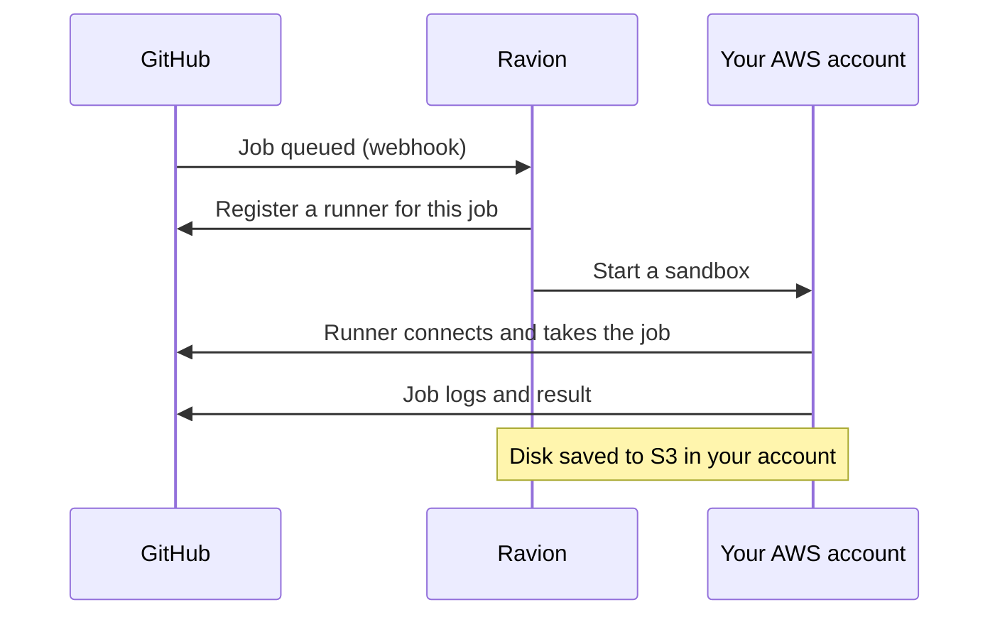
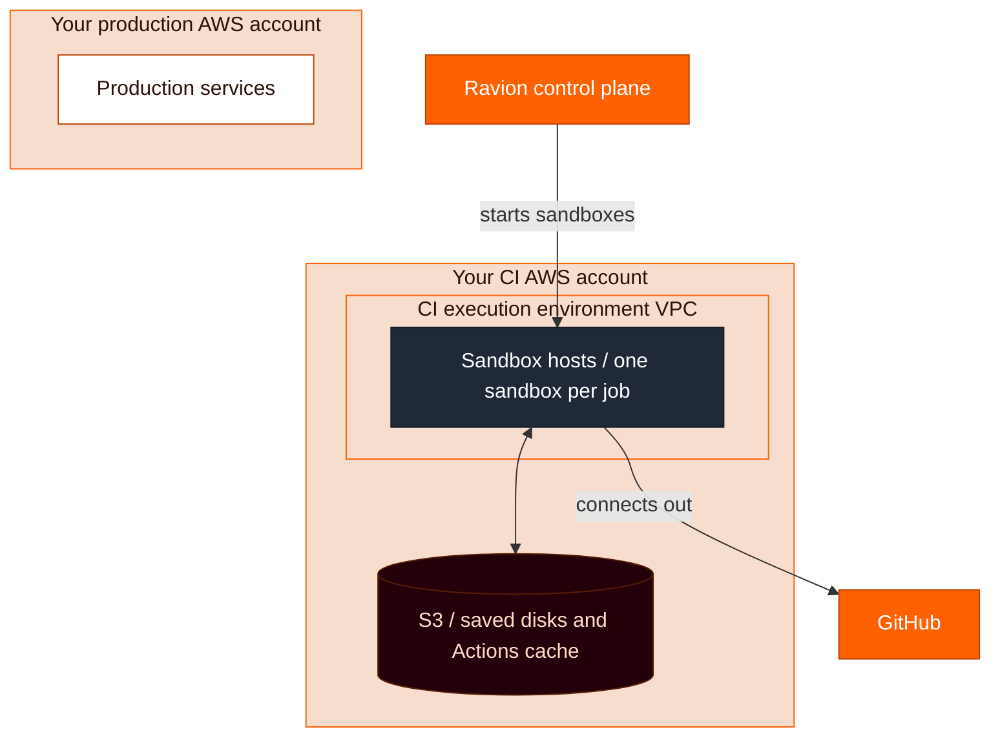

<Note>
  GitHub Actions runners are in private preview. [Contact support](/contact-support) to request access.
</Note>

Ravion runs your GitHub Actions jobs on machines in your AWS account. Change a job's `runs-on` to a Ravion label, and Ravion starts a fresh runner for that one job, in the execution environment the label names.

```yaml
jobs:
  test:
    runs-on: ravion/ee=ci-builders/type=sandbox/cpu=4/memory=16/id=${{ github.run_id }}-${{ github.run_attempt }}-test-${{ strategy.job-index || 0 }}
    steps:
      - uses: actions/checkout@v4
      - run: npm ci
      - run: npm test
```

<Tip>
  Use `type=sandbox` for your jobs. Sandboxes boot in seconds, keep the whole disk between runs, and pack many jobs onto each host. Use `type=ec2` only when a job needs ARM or a whole EC2 instance. Avoid `type=ec2-spot`: if AWS reclaims the instance, GitHub fails the job.
</Tip>

## How it works

1. GitHub sends Ravion a webhook when a job with a `ravion/...` label is queued.
2. Ravion registers a just-in-time runner for that job only, and starts a sandbox or EC2 instance for it in your execution environment.
3. The runner picks up the job, runs it, and is removed when the job ends. Each job gets a fresh runner. On sandboxes, its disk starts from an earlier run's saved disk unless you set `disk_cache=off`. See [Disk cache](#disk-cache).



Runners run in your execution environment's VPC, so jobs can reach private resources in it, such as databases, without exposing them to GitHub. They connect out to GitHub and Ravion, so they need no inbound ports.



Sandbox jobs run on the same autoscaling fleet as sandbox pipeline steps. See [Sandboxes](/concepts/sandboxes) for how hosts are placed, scaled, cached and priced.

## Requirements

- **GitHub App.** The Ravion GitHub App is installed on a GitHub **organization** and connected to your Ravion organization. Runners register at the organization level, so personal accounts aren't supported.
- **AWS account.** Your AWS account is connected in [**Settings / AWS accounts**](https://app.ravion.com/org/settings/aws-accounts). Sandboxes require AWS account role policy **1.0.52 or later**. See [Update your AWS permissions](/concepts/sandboxes#get-started).
- **Execution environment.** Create one in that AWS account in [**Settings / Execution environments**](https://app.ravion.com/org/settings/execution-environments). Ravion doesn't create it for you. Its given ID is the label's required `ee` value, and a job whose `ee` doesn't match an execution environment fails. The first sandbox job sets up the environment's sandbox hosts, so there's nothing else to provision.

### Use a dedicated execution environment

Run GitHub Actions in its own execution environment, not the one your production services use. Ideally, put it in a separate AWS account, or at least a different region, from production.

CI jobs run code from every branch and from third-party actions. A separate environment keeps those jobs in their own VPC, away from production resources. A separate AWS account also keeps AWS permissions and service quotas apart, so a busy CI day can't use up capacity production needs.

Ravion creates a runner group named **Ravion** in your GitHub organization the first time it registers a runner. The group is available to all private repositories in the organization.

## Labels

A Ravion label starts with `ravion/` and is a list of `key=value` segments separated by `/`. It must be the job's only label, so don't combine it with `self-hosted` or other labels.

### Sandbox

```yaml
runs-on: ravion/ee=ci-builders/type=sandbox/cpu=4/memory=16/disk=60/interruptible=true/id=${{ github.run_id }}-${{ github.run_attempt }}-test-${{ strategy.job-index || 0 }}
```

| Key | Required | Default | What it does |
| --- | --- | --- | --- |
| `ee` | Yes | None | Given ID of the execution environment to run in. |
| `type` | Yes | None | `sandbox`. |
| `cpu` | Yes | None | vCPUs for the sandbox. |
| `memory` | Yes | None | Memory in GiB. |
| `disk` | No | 10 GiB per vCPU, at least 14 GiB | GiB of host disk reserved for what the job writes. |
| `disk_cache` | No | `auto` | Keep the job's disk between runs. See [Disk cache](#disk-cache). |
| `interruptible` | No | `false` | Allow Spot hosts, and rerun the job from the start on a new host if its host is lost. See [Interruptible steps](/concepts/sandboxes#interruptible-steps-and-spot-hosts). |
| `id` | Yes | None | A value that makes the label unique to one job. See [Unique labels](#unique-labels). |

Mark jobs that are safe to run twice as `interruptible=true`, such as tests, lint and builds. Leave it off for jobs that publish, deploy or push.

Sandboxes boot an x86_64 Ubuntu 24.04 image. See [What runs inside a sandbox](/concepts/sandboxes#what-runs-inside-a-sandbox). Install anything else with `setup-*` actions or `run` steps; with the disk cache on, what you install stays for later runs.

### EC2

```yaml
runs-on: ravion/ee=ci-builders/type=ec2/instance_size=c7i.2xlarge/disk=100/id=${{ github.run_id }}-${{ github.run_attempt }}-test-${{ strategy.job-index || 0 }}
```

| Key | Required | Default | What it does |
| --- | --- | --- | --- |
| `ee` | Yes | None | Given ID of the execution environment to run in. |
| `type` | Yes | None | `ec2` for On-Demand, or `ec2-spot` for Spot. |
| `instance_size` | Yes | None | EC2 instance type. List several in order of preference with `+`, such as `c7i.2xlarge+c6i.2xlarge`. Don't mix x86_64 and ARM types. |
| `disk` | No | None | Root volume size in GiB. |
| `id` | Yes | None | See [Unique labels](#unique-labels). |

EC2 runners start a whole instance per job, boot Amazon Linux 2023, and have no disk cache. If AWS reclaims an `ec2-spot` instance, GitHub fails the job.

### Unique labels

GitHub can hand a queued job to any idle runner whose labels match. Every job needs an `id` that is unique to it, so a runner Ravion started for one job never picks up another. Build it from the run ID, the run attempt, the job's name and its matrix index:

```yaml
jobs:
  test:
    strategy:
      matrix:
        shard: [1, 2, 3]
    runs-on: ravion/ee=ci-builders/type=sandbox/cpu=4/memory=16/id=${{ github.run_id }}-${{ github.run_attempt }}-test-${{ strategy.job-index || 0 }}
```

### Invalid labels

When a label in a private repository is invalid, Ravion fails the job, and the job's annotation says which key is wrong. A job whose labels include anything besides its Ravion label stays queued.

## Disk cache

On sandboxes, `disk_cache=auto` is the default. When a job ends, Ravion saves the sandbox's whole disk, and the job's next run starts with it: packages, installed tools, `node_modules`, Docker layers and your checkout. See [Why sandboxes are fast](/concepts/sandboxes#why-sandboxes-are-fast).

| Value | What it does |
| --- | --- |
| `auto` | Keep this job's own disk, named by its repository, workflow and job. |
| A key, such as `web-deps` | Share one disk across every job in the repository that uses the key. |
| `off` | Start from the base image every run. |

- With `auto`, a run restores the disk saved for its branch. If there's none, it uses the pull request's base branch, then the repository's default branch. It saves to its own branch.
- A run saves its disk when the job succeeds, or runs to its end and fails. A job that's canceled, loses its host, or writes past its `disk` limit saves nothing.
- On the default branch, only runs from triggers GitHub trusts for caches, such as `push`, `schedule` and `workflow_dispatch`, save. Runs from `pull_request_target`, `issue_comment` or `workflow_run` only read.
- A key shares one disk across branches, so only runs from those trusted triggers save to it, on any branch.
- A job with GitHub's `cache-mode: read` or `cache-mode: none` never saves its disk.
- Pull requests from forks never restore or save a disk.

On sandboxes, the sandbox host serves the Actions cache (`actions/cache` and `setup-*` caching), and stores it in S3 in your AWS account.

## Public repositories

Jobs from public repositories, including pull requests from forks, run only on sandboxes, and only when you allow them:

1. Go to [**Settings / Execution environments**](https://app.ravion.com/org/settings/execution-environments), choose the environment, then open **Config / Sandboxes**.
2. Turn on **Allow public repositories**.

Each public repository gets its own runner group, and its jobs run without a disk cache. Jobs from public repositories with an invalid label, or that ask for EC2, stay queued.

## Next steps

<CardGroup cols={2}>
  <Card title="Sandboxes" icon="box" href="/concepts/sandboxes">
    How the sandbox fleet, disk cache and Spot hosts work.
  </Card>
  <Card title="Sandbox settings" icon="sliders" href="/concepts/sandboxes#sandbox-settings">
    Machine types, idle hosts and host storage.
  </Card>
</CardGroup>
