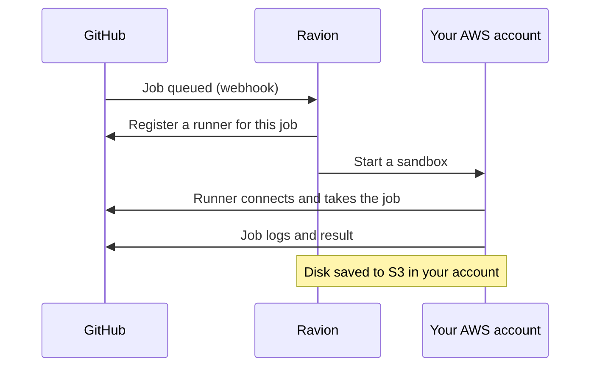
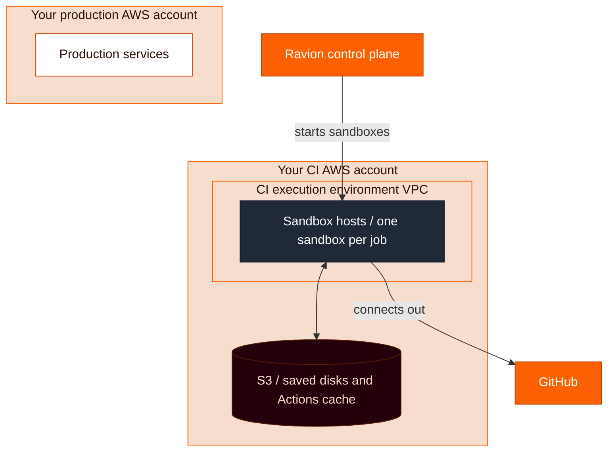

<Note>
  GitHub Actions runners are in private preview. [Contact support](/contact-support) to request access.
</Note>

Ravion runs your GitHub Actions jobs on machines in your AWS account. Change a job's `runs-on` to a Ravion label, and Ravion starts a fresh runner for that one job, in the execution environment the label names.

```yaml
jobs:
  test:
    runs-on: ravion/ee=github-actions/type=sandbox/cpu=4/memory=16/id=${{ github.run_id }}-${{ github.run_attempt }}-test-${{ strategy.job-index || 0 }}
    steps:
      - uses: actions/checkout@v4
      - run: npm ci
      - run: npm test
```

<Tip>
  Use `type=sandbox` for your jobs. Sandboxes boot in seconds, keep the whole disk between runs, and pack many jobs onto each host. Use `type=ec2` only when a job needs ARM or a whole EC2 instance. Avoid `type=ec2-spot`: if AWS reclaims the instance, GitHub fails the job.
</Tip>

## How it works

1. GitHub sends Ravion a webhook when a job with a `ravion/...` label is queued.
2. Ravion registers a just-in-time runner for that job only, and starts a sandbox or EC2 instance for it in your execution environment.
3. The runner picks up the job, runs it, and is removed when the job ends. Each job gets a fresh runner. On sandboxes, its disk starts from an earlier run's saved disk unless you set `disk_cache=off`. See [Disk cache](/github-actions/caching#disk-cache).



Runners run in your execution environment's VPC, so jobs can reach private resources in it, such as databases, without exposing them to GitHub. They connect out to GitHub and Ravion, so they need no inbound ports.



Sandbox jobs run on the same autoscaling fleet as sandbox pipeline steps. See [Sandboxes](/concepts/sandboxes) for how hosts are placed, scaled, cached and priced.

## Startup time

In our benchmarks, these are the p50 times for a sandbox job, from GitHub queueing it to its first step:

| Host state | Time (p50) |
| --- | --- |
| Host already running | ≈ 7–9 s |
| Parked host woken | ≈ 35 s |
| New host launched | ≈ 40 s |

Public-repository jobs take a few seconds longer.

For private repositories, Ravion takes the job only once its sandbox is up, so while a host boots the job shows **Queued** in GitHub, not **In progress**. Public-repository jobs are taken right away for identity checks, so they show **In progress** while the host boots.

To avoid boot waits after quiet periods, keep hosts on hand with [sandbox settings](/concepts/sandboxes#sandbox-settings).

## Requirements

- **GitHub App.** The Ravion GitHub App is installed on a GitHub **organization** and connected to your Ravion organization. Runners register at the organization level, so personal accounts aren't supported.
- **AWS account.** Your AWS account is connected in [**Settings / AWS accounts**](https://app.ravion.com/org/settings/aws-accounts). Sandboxes require AWS account role policy **1.0.52 or later**. See [Update your AWS permissions](/concepts/sandboxes#get-started).
- **Execution environment.** Create one in that AWS account in [**Settings / Execution environments**](https://app.ravion.com/org/settings/execution-environments). Ravion doesn't create it for you. Its given ID is the label's required `ee` value, and a job whose `ee` doesn't match an execution environment fails. The first sandbox job sets up the environment's sandbox hosts, so there's nothing else to provision.

### Use a dedicated execution environment

Run GitHub Actions in its own execution environment, not the one your production services use. Ideally, put it in a separate AWS account, or at least a different region, from production. To pick the region, see [Choose a region](/concepts/sandboxes#choose-a-region).

CI jobs run code from every branch and from third-party actions. A separate environment keeps those jobs in their own VPC, away from production resources. A separate AWS account also keeps AWS permissions and service quotas apart, so a busy CI day can't use up capacity production needs.

Ravion creates a runner group named **Ravion** in your GitHub organization the first time it registers a runner. The group is available to all private repositories in the organization.

## Labels

A Ravion label starts with `ravion/` and is a list of `key=value` segments separated by `/`. It must be the job's only label, so don't combine it with `self-hosted` or other labels.

### Sandbox

```yaml
runs-on: ravion/ee=github-actions/type=sandbox/cpu=4/memory=16/disk=60/interruptible=true/id=${{ github.run_id }}-${{ github.run_attempt }}-test-${{ strategy.job-index || 0 }}
```

| Key | Required | Default | What it does |
| --- | --- | --- | --- |
| `ee` | Yes | None | Given ID of the execution environment to run in. |
| `type` | Yes | None | `sandbox`. |
| `cpu` | Yes | None | vCPUs for the sandbox. |
| `memory` | Yes | None | Memory in GiB. |
| `disk` | No | 10 GiB per vCPU, at least 14 GiB | GiB of host disk reserved for what the job writes. |
| `disk_cache` | No | `auto` | Keep the job's disk between runs. See [Disk cache](/github-actions/caching#disk-cache). |
| `interruptible` | No | `false` | Allow Spot hosts, and rerun the job from the start on a new host if its host is lost. See [Interruptible steps](/concepts/sandboxes#interruptible-steps-and-spot-hosts). |
| `id` | Yes | None | A value that makes the label unique to one job. See [Unique labels](#unique-labels). |

Mark jobs that are safe to run twice as `interruptible=true`, such as tests, lint and builds. Leave it off for jobs that publish, deploy or push.

### EC2

```yaml
runs-on: ravion/ee=github-actions/type=ec2/instance_size=c7i.2xlarge/disk=100/id=${{ github.run_id }}-${{ github.run_attempt }}-test-${{ strategy.job-index || 0 }}
```

| Key | Required | Default | What it does |
| --- | --- | --- | --- |
| `ee` | Yes | None | Given ID of the execution environment to run in. |
| `type` | Yes | None | `ec2` for On-Demand, or `ec2-spot` for Spot. |
| `instance_size` | Yes | None | EC2 instance type. List several in order of preference with `+`, such as `c7i.2xlarge+c6i.2xlarge`. Don't mix x86_64 and ARM types. |
| `disk` | No | None | Root volume size in GiB. |
| `id` | Yes | None | See [Unique labels](#unique-labels). |

EC2 runners start a whole instance per job, boot Amazon Linux 2023, and have no disk cache. If AWS reclaims an `ec2-spot` instance, GitHub fails the job.

### The runner image

Sandbox jobs boot an x86_64 Ubuntu 24.04 image. It has the apt packages [GitHub's `ubuntu-24.04` runner image](https://github.com/actions/runner-images/blob/main/images/ubuntu/Ubuntu2404-Readme.md) installs, such as git and Git LFS, build-essential, `zip`, `rsync`, `wget`, `brotli`, `sqlite3` and the PostgreSQL client. It also has GitHub CLI (`gh`), Node.js 24, Docker with Docker Compose, the AWS CLI, `jq` and `yq`. Like GitHub's images, `apt-get install` doesn't ask for confirmation. See [What runs inside a sandbox](/concepts/sandboxes#what-runs-inside-a-sandbox).

The image is still much smaller than GitHub's hosted runner images. Their `ubuntu-latest` also comes with several versions each of Node.js, Python, Java, Go, Ruby and .NET, plus browsers, databases and cloud tools. The Ravion image doesn't. If a job needs something missing, install it natively in a `run` step:

- System packages with `apt-get`, for example `apt-get update && apt-get install -y python3-pip`. Jobs run as root.
- Language versions with the usual `setup-*` actions, such as `actions/setup-node`, `actions/setup-python` or `actions/setup-java`.
- Anything else by downloading its binary or installer.

With the disk cache on, what you install usually stays for later runs. Only runs whose trigger can write the cache save their disk, so some jobs install on every run. See [Disk cache](/github-actions/caching#disk-cache).

<Note>
  Runners are in private preview. If a job hits a problem you can't explain — a tool that won't install, a missing kernel feature, or anything unexpected — [contact support](/contact-support).
</Note>

### Unique labels

GitHub can hand a queued job to any idle runner whose labels match. Every job needs an `id` that is unique to it, so a runner Ravion started for one job never picks up another. Build it from the run ID, the run attempt, the job's name and its matrix index:

```yaml
jobs:
  test:
    strategy:
      matrix:
        shard: [1, 2, 3]
    runs-on: ravion/ee=github-actions/type=sandbox/cpu=4/memory=16/id=${{ github.run_id }}-${{ github.run_attempt }}-test-${{ strategy.job-index || 0 }}
```

### Invalid labels

When a label in a private repository is invalid, Ravion fails the job, and the job's annotation says which key is wrong. A job whose labels include anything besides its Ravion label stays queued.

## Public repositories

Jobs from public repositories, including pull requests from forks, run only on sandboxes, and only when you allow them:

1. Go to [**Settings / Execution environments**](https://app.ravion.com/org/settings/execution-environments), choose the environment, then open **Config / Sandboxes**.
2. Turn on **Allow public repositories**.

Each public repository gets its own runner group, and its jobs run without a disk cache. Jobs from public repositories with an invalid label, or that ask for EC2, stay queued.

## Next steps

<CardGroup cols={2}>
  <Card title="Caching" icon="database" href="/github-actions/caching">
    Disk cache, Actions cache and artifacts.
  </Card>
  <Card title="Sandboxes" icon="box" href="/concepts/sandboxes">
    How the sandbox fleet, disk cache and Spot hosts work.
  </Card>
  <Card title="Sandbox settings" icon="sliders" href="/concepts/sandboxes#sandbox-settings">
    Machine types, idle hosts and host storage.
  </Card>
</CardGroup>
