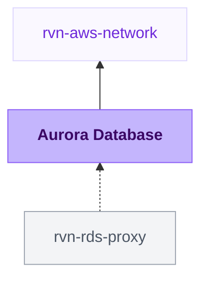

{/* Generated by scripts/sync-module-catalog.mjs from the Ravion module catalog. Do not edit by hand. */}

**Type:** `rvn-aurora` / **Latest version:** `1.6.0`

## Dependencies and consumers

_Every dependency input can be specified manually to reference existing external infrastructure rather than a Ravion module. Set the dependency input to `null` and set its mapped inputs directly; see [Use existing infrastructure instead of a module reference](/config-as-code/project-config-file#use-existing-infrastructure-instead-of-a-module-reference)._

## Readme

Creates and manages an Amazon Aurora cluster. Supports Aurora PostgreSQL and Aurora MySQL with provisioned or Serverless v2 capacity.

### Overview

Use this module when an application needs a managed, highly available relational database cluster in AWS. It provisions an Aurora cluster with writer and reader instances, subnet placement, security group access, backups, monitoring, optional reader autoscaling, and optional advanced Aurora features.

Aurora PostgreSQL and Aurora MySQL are supported. Choose the engine major version and, when needed, a minor version for exact engine pinning. Choose provisioned instances for predictable capacity or Serverless v2 when the workload needs capacity that scales in Aurora Capacity Units.

### Use cases

| Scenario | Benefit |
| --- | --- |
| Application database | Create a private Aurora cluster attached to an existing Ravion VPC network. |
| Production database | Enable deletion protection, automated backups, final snapshots, Performance Insights, and CloudWatch alarms. |
| Read-heavy workload | Add reader instances and optionally scale them with reader autoscaling. |
| Variable workload | Use Serverless v2 capacity to scale compute between configured ACU limits. |
| Cross-region database | Configure global database settings and write forwarding where supported by the selected engine. |

### Networking

Select a VPC network first. Ravion maps the network's AWS account, region, VPC ID, and private and public subnet IDs into this module. Aurora requires at least two subnets in different Availability Zones, and private subnets are the normal choice for application databases. AWS places cluster instances across the Availability Zones of the selected subnets.

Public access is disabled by default, and the DB subnet group uses the private subnet IDs. When Publicly accessible is enabled, the DB subnet group switches to the public subnet IDs because AWS requires public subnets for public database access. Changing this setting after creation replaces the DB subnet group and the cluster.

Keep public access disabled for production databases and allow access through security group IDs from application services or controlled CIDR blocks. You can create a module-managed security group or attach an existing one.

### Capacity modes

Provisioned capacity uses a fixed DB instance class for the writer and, by default, for readers. Serverless v2 uses Aurora Capacity Units; set the minimum and maximum ACUs to control the scaling range. The module uses `db.serverless` for cluster instances when Serverless v2 is selected.

### Availability and readers

Reader settings live together in the Readers section. Choose the number of reader instances, an optional separate reader instance class, and an optional default failover promotion tier. Readers default to 0; add at least one reader in another Availability Zone for production failover.

Reader autoscaling can adjust the number of read replicas based on CPU utilization and, optionally, database connections. Configure min and max reader capacity carefully because autoscaling can increase cost.

### Credentials and security

Master password management in AWS Secrets Manager is enabled by default, so AWS creates and stores the master password for the cluster. Before importing a cluster whose existing password is managed outside Secrets Manager, disable password management and enable Preserve existing master password. Leaving password management enabled causes AWS to generate a new master password. Preservation verifies that the named cluster already exists in AWS, preventing a new cluster from reaching AWS without any source of master credentials. Provide a Secrets Manager KMS key ARN when you need a customer-managed key for a managed secret.

To keep the master password in a secret you name, for example under a prefix that External Secrets Operator or another reader is already allowed to read, turn off password management and set Master password secret name. Ravion then generates the password, writes it to the cluster and to the named secret as `username`, `password`, `engine`, `port` and `dbname` keys, and keeps it out of Terraform state and plan files. AWS never rotates this password. Increment Master password version to set a new one. Switching an existing cluster to a named secret changes its master password in place and does not replace the cluster.

Storage encryption is enabled by the Terraform module. Provide a storage KMS key ARN when you need a customer-managed key for cluster storage. IAM database authentication and the Aurora Data API HTTP endpoint are optional.

### Availability, backups, and maintenance

Aurora creates a writer instance and the configured number of reader instances. Backup retention defaults to 7 days and must be at least 1 day for Aurora. Final snapshots and deletion protection are enabled by default to reduce accidental data loss.

Maintenance windows, automatic minor upgrades, major version upgrades, and immediate apply are configurable. Major version upgrades and immediate changes are opt-in because they can affect database availability.

Aurora MySQL exposes backtrack and local write forwarding settings. Aurora PostgreSQL exposes global write forwarding according to this module's Terraform validation.

### Observability

Performance Insights is enabled by default with 7 days of retention. Enhanced monitoring can be enabled by setting a monitoring interval.

CloudWatch alarms monitor CPU utilization, freeable memory, database connections, cluster storage capacity, and read/write IOPS. Aurora MySQL uses remaining volume space (default 100 GiB); PostgreSQL uses volume bytes used (default 115 TiB, configurable for the engine storage limit). Both storage alarms support Serverless v2. IOPS alarms use the cluster maximum to cover writers and readers, including autoscaled readers. Tune the default 1000 IOPS thresholds to the workload. Storage periods are at least 5 minutes, and IOPS periods at least 1 minute, matching metric resolution. Supply alarm action ARNs to receive notifications. The freeable memory alarm threshold is entered in MiB in Ravion and converted to bytes for Terraform.

CloudWatch log exports offer engine-specific log types: postgresql for Aurora PostgreSQL, or audit, error, general, and slowquery for Aurora MySQL. Each enabled log type is shown on the module Logs tab.

The Ravion UI charts Aurora CloudWatch metrics for CPU utilization, freeable memory, database connections, serverless capacity and ACU utilization, storage used, read and write latency, replica lag, buffer cache hit ratio, commit latency, deadlocks, network throughput, and volume IOPS.

### Connection pooling

Enable RDS Proxy to place a managed connection pool in front of the cluster. The proxy authenticates with the Secrets Manager master user secret by default, requires TLS, and allows the same security group and CIDR sources configured for the cluster. Pool sizing, idle timeouts, session pinning, IAM authentication, and custom auth secrets are configurable in the Connection pooling section.

Creating the proxy does not change how applications reach the cluster. Update your application connection string to the proxy endpoint output to route traffic through the pool.

### Configuration

| Field | Required | Default | Notes |
| --- | --- | --- | --- |
| VPC network | Yes | None | Supplies AWS account, region, VPC ID, and private and public subnet IDs. |
| Name slug | Yes | Project and environment given IDs | Name of the Aurora cluster and prefix for related resources. |
| Engine | Yes | Aurora PostgreSQL | Aurora PostgreSQL and Aurora MySQL are supported. |
| Engine major version | Yes | None | Use values such as 16 for Aurora PostgreSQL or 8.0 for Aurora MySQL. |
| Engine minor version | No | Blank | For PostgreSQL, 4 becomes 16.4. For MySQL, 3.08.0 becomes 8.0.mysql_aurora.3.08.0. |
| Capacity mode | Yes | Provisioned instances | Choose provisioned instances or Serverless v2. |
| Instance class | Yes for provisioned | db.t4g.medium | Writer DB instance class for provisioned capacity. |
| Min and max capacity | Yes for Serverless v2 | 1 to 4 ACUs | Serverless v2 scaling bounds. |
| Reader count | No | 0 | Number of reader instances. Add readers for high availability and read scaling. |
| Database name | No | Blank | Creates an initial database on new clusters when provided. |
| Username | Yes for new clusters | dbadmin | Master database user. |
| Manage password in Secrets Manager | No | true | Stores generated master credentials in AWS Secrets Manager. Disable before importing an externally managed password. |
| Preserve existing master password | No | false | Verifies the cluster exists in AWS and leaves its externally managed password unchanged. |
| Master password secret name | No | - | Generates the master password and stores it in a Secrets Manager secret with this name. Requires password management off. |
| Master password version | No | 1 | Increment to set a new generated master password. |
| Publicly accessible | No | false | Switches the DB subnet group to public subnets. Leave disabled unless public database access is intentional. |
| Security group creation | No | true | Creates ingress rules from allowed security groups and CIDRs. |
| Backup retention days | No | 7 | Aurora requires at least 1 day. |
| Deletion protection | No | true | Helps prevent accidental deletion. |
| Performance insights | No | true | Enables AWS Performance Insights. |
| CloudWatch alarms | No | true | Adds CPU, memory, connection, storage capacity, and read/write IOPS alarms. |
| CloudWatch log exports | No | Engine-based when unset | PostgreSQL: postgresql; MySQL: error only; other engines: none. An explicit empty list disables exports. Slow-query exports require slow_query_log in the parameter group. |
| RDS Proxy | No | false | Creates an RDS Proxy connection pool in front of the cluster. |
| Global database | No | false | Create or join an Aurora global database. |
| Activity stream | No | false | Enables Database Activity Streams with a required KMS key. |
| Tags | No | Blank | Merged with Ravion standard tags. |

### Advanced configuration

Use cluster parameter groups for cluster-level engine settings and DB parameter groups for instance-level engine settings. The Misc section holds less common cluster features: Database Activity Streams, custom endpoints for reader or any-instance routing, and IAM role associations that attach feature-specific IAM roles for capabilities such as S3 import, S3 export, or Lambda invocation.

Use advanced Terraform variables for one-off overrides not represented directly in the UI. Values in advanced Terraform variables override generated variables.

Terraform settings let you override the OpenTofu version, Terraform execution environment inherited from the VPC network, and Ravion state backend workspace name.

### Design decisions

Aurora clusters are placed in private subnets by default through the VPC network reference. Secrets Manager password management, encryption at rest, Performance Insights, final snapshots, and deletion protection default on because they are safer defaults for long-lived databases.

The module keeps primary database, capacity, networking, backup, and monitoring choices visible while placing engine-specific, autoscaling, parameter group, global database, activity stream, custom endpoint, IAM association, and Terraform settings behind focused advanced controls.

### Learn more

- [Amazon Aurora documentation](https://docs.aws.amazon.com/AmazonRDS/latest/AuroraUserGuide/CHAP_AuroraOverview.html)
- [Aurora DB instance classes](https://docs.aws.amazon.com/AmazonRDS/latest/AuroraUserGuide/Concepts.DBInstanceClass.html)
- [Aurora Serverless v2](https://docs.aws.amazon.com/AmazonRDS/latest/AuroraUserGuide/aurora-serverless-v2.html)
- [Aurora global databases](https://docs.aws.amazon.com/AmazonRDS/latest/AuroraUserGuide/aurora-global-database.html)
- [Aurora monitoring](https://docs.aws.amazon.com/AmazonRDS/latest/AuroraUserGuide/CHAP_Monitoring.html)
- [Terraform source](https://github.com/ravionhq/modules/tree/rvn-aurora@1.6.0/database/aurora)

## Inputs reference

All inputs for `rvn-aurora` version `1.6.0`. Use the `name` shown for each field as the input key in module config.

- [Inputs: Inputs to global database](/module-definitions/catalog/rvn-aurora/inputs-inputs) — Inputs, Database, Version, Capacity, Storage & cluster, Network access, Connection pooling, Readers, Credentials & authentication, MySQL settings, Backups, Maintenance, Parameter groups, Monitoring, CloudWatch alarms, Global database
- [Inputs: Misc to terraform settings](/module-definitions/catalog/rvn-aurora/inputs-misc) — Misc, Terraform settings
