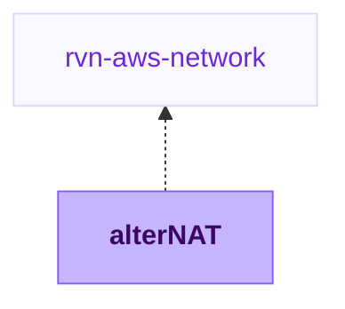

{/* Generated by scripts/sync-module-catalog.mjs from the Ravion module catalog. Do not edit by hand. */}

**Type:** `rvn-aws-alternat` / **Latest version:** `0.1.3`

## Dependencies and consumers

_Every dependency input can be specified manually to reference existing external infrastructure rather than a Ravion module. Set the dependency input to `null` and set its mapped inputs directly; see [Use existing infrastructure instead of a module reference](/config-as-code/project-config-file#use-existing-infrastructure-instead-of-a-module-reference)._

## Readme

Highly available alterNAT instances that replace NAT gateway data processing charges and fail over to a NAT gateway automatically.

### Overview

A NAT gateway charges $0.045 for every GB it processes, on top of its hourly charge. For workloads that pull images, sync artifacts, or call external APIs heavily, that per-GB charge becomes the largest networking line item. An alterNAT instance has no per-GB charge, but a single instance is a single point of failure.

This module runs [alterNAT](https://github.com/chime/terraform-aws-alternat), Chime's open-source high-availability alterNAT instance design:

- **alterNAT instances** in Auto Scaling groups carry your private subnets' internet traffic
- **A connectivity tester** in each availability zone checks internet access through its alterNAT instance every minute
- **Automatic failover** moves the route to a NAT gateway when an alterNAT instance fails a check or terminates, so egress is never lost
- **Automatic restore** moves the route back to the alterNAT instance once it is healthy again

It works with any VPC: pick a Ravion VPC network, or choose **Enter values manually** and enter the VPC and subnet IDs of a VPC created elsewhere.

 Terraform source: [ravionhq/modules/networking/alternat](https://github.com/ravionhq/modules/tree/rvn-aws-alternat@0.1.3/networking/alternat)

### Use cases

| Scenario | alterNAT helps by... |
| --- | --- |
| High NAT gateway data processing charges | Moving egress to alterNAT instances, which have no per-GB charge |
| Keeping a NAT gateway as a safety net | Failing over to it automatically, so it carries traffic only during failures |
| Existing VPCs created outside Ravion | Discovering route tables from subnet IDs, and reusing the VPC's NAT gateway |
| Partner IP allowlists | Using pre-allocated Elastic IPs for alterNAT instances |

### When it pays off

| Monthly egress | NAT gateway data processing | alterNAT (2 × c7gn.medium + EC2 endpoint) |
| --- | --- | --- |
| 1 TB | ~$46 | ~$115 |
| 5 TB | ~$230 | ~$115 |
| 20 TB | ~$920 | ~$115 |

Both sides exclude internet data transfer, which AWS bills the same either way. The fallback NAT gateway's hourly charge (~$33/month) applies to both. Below roughly 2.5 TB a month, a NAT gateway is usually cheaper. alterNAT figures assume us-west-2 on-demand pricing: two alterNAT instances, their Elastic IPs, and the EC2 interface endpoint in two zones.

### How alterNAT instances are placed

You list public and private subnets; the module works out the rest:

1. It finds the route table of every private subnet (the VPC's main route table for subnets without an explicit association).
2. With **high availability** on, every availability zone that has its own private route table gets an alterNAT instance in its first public subnet, serving only that zone. Traffic never crosses zones.
3. Private route tables shared across zones (for example a Ravion VPC network without NAT gateway high availability) are served by one alterNAT instance.
4. With high availability off, one alterNAT instance serves every private route table.

alterNAT then owns the `0.0.0.0/0` route in those route tables. A route table that public subnets also use is rejected at plan time, since replacing its Internet Gateway route would cut the alterNAT instances off from the internet.

### Failover

| Fallback NAT gateway | Behavior | Extra cost |
| --- | --- | --- |
| Existing (default) | Fails over to the VPC's public NAT gateway. With several, each alterNAT instance uses the one in its own public subnet unless you pick one. | None |
| Create | Creates a standby NAT gateway next to each alterNAT instance | ~$33/month each |

Failover keeps connectivity but not connections: established TCP connections through a failed alterNAT instance are dropped, as they are when an instance reaches its lifetime and is replaced. Clients that retry recover immediately.

While failed over, traffic leaves from the NAT gateway's public IP. **Add both the alterNAT instance and NAT gateway IPs to any partner allowlist.**

### Using it with a Ravion VPC network

The VPC network manages its private route tables' `0.0.0.0/0` route to its NAT gateway. After alterNAT takes over that route, the next VPC network deploy points it back at the NAT gateway. With **Restore to alterNAT instance** on (the default), alterNAT moves it back within a minute. To avoid the round trip entirely, turn off the VPC network's NAT gateway and set **Fallback NAT gateway** to **Create**.

### Configuration

| Field | Required | Default | Description |
| --- | --- | --- | --- |
| VPC network | No | - | Ravion network to take over egress for, or Enter values manually |
| AWS account / Region | Yes | From network | Where the VPC is |
| VPC ID | Yes | From network | VPC whose egress moves to alterNAT instances |
| Public / private subnet IDs | Yes | From network | Where alterNAT instances run / whose egress they carry |
| Name slug | Yes | \{project\}-\{env\}-\{module\} | Prefix for all resources, unique per account and region |
| High availability | No | true | One alterNAT instance per availability zone |
| Instance type | Yes | c7gn.medium | Architecture of the AMI follows the type |
| Elastic IP allocation IDs | No | New Elastic IPs | One per alterNAT instance, for stable public IPs |
| Instance lifetime (days) | No | 14 | 0 never replaces instances |
| Fallback NAT gateway | Yes | existing | Reuse the VPC's NAT gateway, or create standby ones |
| Restore to alterNAT instance | No | true | Return traffic to a recovered alterNAT instance |
| Connectivity check URLs | No | example.com, google.com | Fail over only when all are unreachable |
| EC2 interface endpoint | No | true | Lets failover work while internet egress is down |
| S3 / DynamoDB gateway endpoint | No | false | Free endpoints that keep that traffic off alterNAT and NAT gateways |
| Systems Manager access | No | true | Required for restore |

### Design decisions

- **Official alterNAT, pinned:** The module wraps [`chime/alternat/aws`](https://registry.terraform.io/modules/chime/alternat/aws) at a pinned version rather than forking it.
- **No container image to build:** The Lambda functions deploy as zip packages built from the alterNAT source; they need only boto3, which the Lambda runtime provides.
- **Graviton by default:** alterNAT instances default to `c7gn.medium` and the Lambda functions run on arm64. The AMI architecture follows the instance type, so x86 types also work.
- **Discovery over configuration:** Route tables are found from subnet associations, not from routes, so discovery is unaffected by alterNAT rewriting routes.
- **Encrypted root volumes** and IMDSv2-only instance metadata.
- **Names derived from the name slug:** Lambda functions, IAM roles, and Auto Scaling groups carry the slug, so several VPCs in one account can each run alterNAT.

### Learn more

- [alterNAT](https://github.com/chime/terraform-aws-alternat) — Design, failure modes, and benchmarks
- [NAT gateway pricing](https://aws.amazon.com/vpc/pricing/) — Hourly and data processing charges
- [NAT instances](https://docs.aws.amazon.com/vpc/latest/userguide/VPC_NAT_Instance.html) — AWS guide to the NAT instances alterNAT builds on
- [EC2 network bandwidth](https://docs.aws.amazon.com/AWSEC2/latest/UserGuide/ec2-instance-network-bandwidth.html) — Internet bandwidth limits per instance size

## Inputs reference

All inputs for `rvn-aws-alternat` version `0.1.3`. Use the `name` shown for each field as the input key in module config.

<ResponseField name="network" type="$ref:rvn-aws-network">
  **VPC network.** Ravion network to take over egress for, or Enter values manually for any other VPC.

  - Immutable after creation
</ResponseField>

Set `network` to `null`.
Mapped inputs for `network`: set these keys alongside `network`, not inside it, when supplying existing infrastructure instead of a module reference.

<ResponseField name="section_aws" type="section">
  **AWS account & region.**
</ResponseField>

<ResponseField name="aws_account_id" type="string" required>
  **AWS account.**

  - Default: `<< ref.input.aws_account_id >>`
  - Immutable after creation
</ResponseField>

<ResponseField name="aws_region" type="string" required>
  **Region.**

  - Default: `<< ref.input.aws_region >>`
  - Immutable after creation
</ResponseField>

<ResponseField name="execution_environment_id" type="string">
  **Terraform execution environment.** Override the VPC, subnet, and security group for Terraform runners. Must use the same AWS account as selected above.

  - Default: `<< ref.input.execution_environment_id >>`
</ResponseField>

<ResponseField name="section_vpc" type="section">
  **VPC.**
</ResponseField>

<ResponseField name="vpc_id" type="string" required>
  **VPC ID.**

  - Default: `<<ref.stack.output.vpc_id>>`
  - Immutable after creation
</ResponseField>

<ResponseField name="public_subnet_ids" type="string_array" required>
  **Public subnet IDs.** alterNAT instances run here, one in the first public subnet of each availability zone they serve.

  - Default: `<<ref.stack.output.public_subnet_ids>>`
</ResponseField>

<ResponseField name="private_subnet_ids" type="string_array" required>
  **Private subnet IDs.** Subnets whose internet egress moves to the alterNAT instances. Their route tables are found automatically.

  - Default: `<<ref.stack.output.private_subnet_ids>>`
</ResponseField>

### alterNAT instances

<ResponseField name="name" type="string" required>
  **Name slug.** Name prefix for all resources. Must be unique in the AWS account and region.

  - Default: `<<project.given_id>>-<<environment.given_id>>-<<module.given_id>>`
  - Immutable after creation
  - Pattern: `^[a-z0-9]([a-z0-9-]{0,26}[a-z0-9])?$` — 1-28 lowercase letters, numbers, and hyphens. Start and end with a letter or number.
</ResponseField>

<ResponseField name="high_availability_enabled" type="boolean">
  **High availability.** One alterNAT instance per availability zone with its own private route table, so no traffic crosses zones. Turn off to run a single alterNAT instance for every route table.

  - Default: `true`
</ResponseField>

<ResponseField name="nat_instance_type" type="string" required>
  **Instance type.** Network-optimized Graviton (`c7gn`, `c6gn`) types give the most bandwidth per dollar. Instances under 32 vCPUs are capped at 5 Gbps to the internet.

  - Default: `c7gn.medium`
</ResponseField>

<ResponseField name="nat_instance_eip_allocation_ids" type="string_array">
  **Elastic IP allocation IDs.** One per alterNAT instance, to keep public IPs stable for partner allowlists. Leave empty to allocate new Elastic IPs.
</ResponseField>

<ResponseField name="max_instance_lifetime_days" type="number">
  **Instance lifetime (days).** Replaces each alterNAT instance on this schedule to pick up the latest AMI, dropping its open connections. 0 never replaces.

  - Default: `14`
  - Min: `0`
  - Max: `365`
</ResponseField>

### Failover

<ResponseField name="fallback_nat_gateway_mode" type="string" required>
  **Fallback NAT gateway.** Where traffic goes while an alterNAT instance is unhealthy.

  - Default: `existing`
  - Allowed values: `existing` (Use the VPC's existing NAT gateway), `create` (Create a standby NAT gateway per alterNAT instance)
</ResponseField>

<ResponseField name="fallback_nat_gateway_id" type="string">
  **Fallback NAT gateway ID.** Leave empty to use the VPC's only NAT gateway, or the one in each alterNAT instance's public subnet.

  - Shown when: `{"fallback_nat_gateway_mode":"existing"}`
</ResponseField>

<ResponseField name="fallback_nat_gateway_eip_allocation_ids" type="keyvalue">
  **Standby NAT gateway Elastic IP allocation IDs.** Keyed by availability zone, for example `us-west-2a`. Leave empty to allocate new Elastic IPs.

  - Shown when: `{"fallback_nat_gateway_mode":"create"}`
</ResponseField>

<ResponseField name="nat_restore_enabled" type="boolean">
  **Restore to alterNAT instance.** Moves traffic back to an alterNAT instance as soon as it recovers, instead of when it is replaced. Requires Systems Manager access.

  - Default: `true`
</ResponseField>

<ResponseField name="connectivity_check_urls" type="string_array">
  **Connectivity check URLs.** Checked every minute from each availability zone. Traffic fails over only when all of them are unreachable.

  - Default: `["https://www.example.com","https://www.google.com"]`
</ResponseField>

### VPC endpoints

<ResponseField name="ec2_endpoint_enabled" type="boolean">
  **EC2 interface endpoint.** Lets failover reach the EC2 API while internet egress is down. About $7/month per availability zone. Turn off only if the VPC already has one with private DNS.

  - Default: `true`
</ResponseField>

<ResponseField name="s3_gateway_endpoint_enabled" type="boolean">
  **S3 gateway endpoint.** Free. Keeps S3 traffic, including ECR image layers, off alterNAT and NAT gateways. S3 bucket policies that allowlist your alterNAT or NAT gateway IPs stop matching. Leave off if the VPC already has one.

  - Default: `false`
</ResponseField>

<ResponseField name="dynamodb_gateway_endpoint_enabled" type="boolean">
  **DynamoDB gateway endpoint.** Free. Keeps DynamoDB traffic off alterNAT and NAT gateways. Leave off if the VPC already has one.

  - Default: `false`
</ResponseField>

### Access

<ResponseField name="allowed_cidr_blocks" type="string_array">
  **Allowed CIDR blocks.** The VPC's own CIDR blocks are always allowed. Add peered VPC ranges that egress through this VPC.
</ResponseField>

<ResponseField name="allowed_security_group_ids" type="string_array">
  **Allowed security groups.** Members may route through the alterNAT instances, in addition to the VPC's CIDR blocks.
</ResponseField>

<ResponseField name="ssm_enabled" type="boolean">
  **Systems Manager access.** Session Manager access to the alterNAT instances, with no SSH keys or open ports.

  - Default: `true`
</ResponseField>

<ResponseField name="nat_instance_key_name" type="string">
  **SSH key pair name.** Prefer Systems Manager access.
</ResponseField>

### Instance customization

<ResponseField name="cloudwatch_agent_enabled" type="boolean">
  **CloudWatch agent.** Publishes per-interface network metrics. Custom metrics are billed.

  - Default: `false`
</ResponseField>

<ResponseField name="nat_instance_ami_id" type="string">
  **Custom AMI ID.** Leave blank for the latest Amazon Linux 2023 minimal AMI for the instance type's architecture.
</ResponseField>

<ResponseField name="nat_instance_user_data_pre_install" type="text">
  **User data before setup.** Runs as root on each alterNAT instance before alterNAT configures it.
</ResponseField>

<ResponseField name="nat_instance_user_data_post_install" type="text">
  **User data after setup.** Runs as root on each alterNAT instance after alterNAT configures it.
</ResponseField>

### Misc

<ResponseField name="tags" type="keyvalue">
  **Tags.** A map of tags to assign to all resources. Default tags are `Owner`, `ProjectGivenId`, `EnvironmentGivenId`, `ModuleGivenId`, `ModuleId`
</ResponseField>

### Terraform settings

<ResponseField name="opentofu_version" type="string">
  **OpenTofu version override.** Override the environment's default version for this module
</ResponseField>

<ResponseField name="ravion_state_backend_workspace" type="string">
  **Ravion Terraform workspace name.** Override Terraform state backend workspace name. Defaults to project + environment + module given ids.

  - Immutable after creation
</ResponseField>

<ResponseField name="terraform_plan_default_policies_enabled" type="boolean">
  **Include default plan policies.** Turn off to plan with only the policies below instead of the default read-only policies. Requires at least one policy below.

  - Default: `true`
</ResponseField>

<ResponseField name="terraform_plan_iam_policy_arns" type="string_array">
  **Terraform plan IAM policies.** IAM managed policy ARNs for the Terraform plan runner role. Without default policies, allow s3:CreateBucket, s3:PutObject, s3:GetObject, and s3:ListBucket on the ravion-terraform-plans-\<AWS account number> bucket in this account.

  - Default: `[]`
</ResponseField>

<ResponseField name="terraform_apply_default_policies_enabled" type="boolean">
  **Include default apply policies.** Turn off to apply and destroy with only the policies below instead of AdministratorAccess. Requires at least one policy below.

  - Default: `true`
</ResponseField>

<ResponseField name="terraform_apply_iam_policy_arns" type="string_array">
  **Terraform apply IAM policies.** IAM managed policy ARNs for the Terraform apply runner role. Without default policies, allow s3:CreateBucket, s3:PutObject, s3:GetObject, and s3:ListBucket on the ravion-terraform-plans-\<AWS account number> bucket in this account.

  - Default: `[]`
</ResponseField>

<ResponseField name="advanced_terraform_variables" type="object">
  **Advanced Terraform variables.** Optional raw Terraform variable overrides for advanced module inputs or one-off overrides. Values here override the generated variables above.

  - Default: `{}`
</ResponseField>
