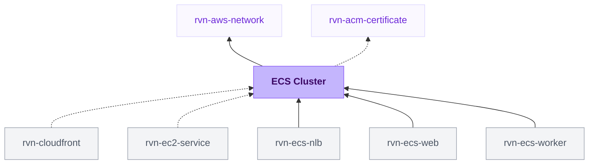

{/* Generated by scripts/sync-module-catalog.mjs from the Ravion module catalog. Do not edit by hand. */}

**Type:** `rvn-ecs-cluster` / **Latest version:** `2.3.2`

## Dependencies and consumers

_Every dependency input can be specified manually to reference existing external infrastructure rather than a Ravion module. Set the dependency input to `null` and set its mapped inputs directly; see [Use existing infrastructure instead of a module reference](/config-as-code/project-config-file#use-existing-infrastructure-instead-of-a-module-reference)._

## Readme

Production-ready AWS ECS cluster with Fargate, Fargate Spot, optional EC2 capacity, and shared load balancers.

### Overview

Amazon ECS (Elastic Container Service) runs containerized workloads on AWS. This module creates an ECS cluster inside your selected VPC and configures the capacity providers and shared load balancers that services can use.

The ECS cluster module provides:

- **Fargate and Fargate Spot** capacity providers for serverless containers
- **Optional EC2 capacity** with an Auto Scaling Group and managed ECS capacity provider
- **Public and private Application Load Balancers** for HTTP and HTTPS services
- **Public and private Network Load Balancers** for TCP/UDP and static IP use cases
- **CloudWatch Container Insights** dashboard metrics for production visibility

Terraform source: [ravionhq/modules/compute/ecs_cluster](https://github.com/ravionhq/modules/tree/rvn-ecs-cluster@2.3.2/compute/ecs_cluster)

### Use cases

| Scenario                       | ECS cluster helps by...                                          |
| ------------------------------ | ---------------------------------------------------------------- |
| Running web apps and APIs      | Providing Fargate capacity and shared ALBs for HTTP traffic      |
| Reducing compute cost          | Allowing services to use Fargate Spot or EC2 Spot capacity       |
| Hosting private services       | Creating internal load balancers reachable only inside the VPC   |
| Running TCP/UDP workloads      | Creating Network Load Balancers for non-HTTP protocols           |
| Operating production workloads | Enabling Container Insights metrics for tasks, services, and EC2 |
| Supporting custom runtimes     | Adding EC2 capacity when workloads need host-level control       |

### Capacity providers

#### Fargate

Fargate runs containers without managing EC2 instances. It is the simplest option for most web apps, APIs, workers, and scheduled tasks.

#### Fargate Spot

Fargate Spot uses spare AWS capacity at a lower cost. It is best for interruptible workloads such as queues, batch jobs, background workers, and services that can tolerate replacement tasks.

#### EC2 capacity

EC2 capacity creates an Auto Scaling Group and ECS capacity provider for tasks that need host-level control, custom AMIs, SSH access, special networking, or lower long-running compute costs.

Select an **EC2 instance type** to enable EC2 capacity. Leave it blank for a Fargate-only cluster.

### Load balancers

#### Public application load balancer

Creates an internet-facing Application Load Balancer for services that should receive public HTTP or HTTPS traffic, such as websites, public APIs, and webhook endpoints.

Use the public ALB for:

- Websites and browser apps
- Public APIs
- Webhooks
- HTTP/HTTPS traffic with host or path routing

#### Private application load balancer

Creates an internal Application Load Balancer for services reachable only inside the VPC or private network, such as internal APIs, admin tools, and service-to-service traffic.

Use the private ALB for:

- Internal APIs
- Admin dashboards
- Backend services
- Private HTTP/HTTPS routing

For either ALB, the selected Certificate is the default HTTPS certificate. Use Additional certificate ARNs to attach more ACM certificates to the same listener through SNI.

#### Network load balancers

Use Network Load Balancers for TCP/UDP workloads, static IP requirements, very high-throughput connections, or protocols that do not need HTTP routing. For normal web apps and HTTP APIs, prefer an Application Load Balancer.

### Observability

Container Insights collects ECS cluster, service, and task CPU, memory, network, and storage metrics in CloudWatch. The module dashboard includes:

- CPU and memory used
- Running task and service counts
- Network received and sent
- Storage read and write
- EC2 container instance count
- EC2 instance CPU, memory, running task, and reserved capacity metrics

Metrics appear only after tasks are running in the cluster. EC2-specific charts appear only when EC2 capacity exists and the required Container Insights instance metrics are available.

Container Insights also feeds the service running-task alarms, which use the `RunningTaskCount` metric, so keep it enabled when services alarm on task count.

Default log retention (days) is exposed as a stack output. Every ECS service that references this cluster inherits it as its log group retention unless the service sets its own value in its Compliance section.

### Compliance

CloudWatch alarms for load balancer 5xx, target 5xx, and target response time are enabled by default on both ALBs. Thresholds, evaluation periods, and SNS actions are shared by both.

Load balancer alarms cover the ALB-level metrics only. Per-service health, such as unhealthy targets and per-service error rates, is alarmed from each ECS service's own Compliance section. Network Load Balancers have no alarms in this module.

### Configuration

| Field                 | Required | Default              | Description                                                   |
| --------------------- | -------- | -------------------- | ------------------------------------------------------------- |
| VPC network           | Yes      | —                    | Existing VPC, subnets, AWS account, and region                |
| ECS cluster name      | Yes      | `{project}-{env}`    | Name prefix for ECS and load balancer resources               |
| Container insights    | No       | `enhanced`           | Collect enhanced task, service, cluster, and EC2 metrics in CloudWatch |
| Default log retention (days) | No | `90`              | Log retention inherited by ECS services in this cluster        |
| Create load balancer CloudWatch alarms | No | `true` | Adds 5xx and response time alarms on both ALBs               |
| Fargate               | No       | `true`               | Allow services to use Fargate capacity                        |
| Fargate Spot          | No       | `true`               | Allow services to use lower-cost interruptible Fargate Spot   |
| EC2 instance type     | No       | —                    | Enables EC2 capacity when selected                            |
| Public load balancer  | No       | `true`               | Create an internet-facing ALB                                 |
| Private load balancer | No       | `false`              | Create an internal ALB                                        |
| Public NLB            | No       | `false`              | Create an internet-facing Network Load Balancer               |
| Private NLB           | No       | `false`              | Create an internal Network Load Balancer                      |
| Tags                  | No       | Environment, Project | Custom tags applied to all resources                          |

### EC2 capacity settings

| Field                           | Description                                             |
| ------------------------------- | ------------------------------------------------------- |
| Minimum EC2 host instances      | Keep enough spare instance capacity for all ECS services; start around 2x the total desired tasks |
| Maximum EC2 host instances      | Must fit 2x the total maximum tasks across all ECS services, or deployments can fail             |
| Root volume size                | Root EBS volume size for ECS instances                  |
| Additional security groups      | Extra security groups attached to ECS instances         |
| Spot instances                  | Use Spot instances in the EC2 Auto Scaling Group        |
| Spot instance types             | Additional instance types for mixed Spot capacity       |
| Custom AMI ID                   | Custom ECS AMI; blank uses the latest ECS-optimized AMI |
| Key pair name                   | EC2 key pair for SSH access                             |
| Managed scaling                 | Let ECS scale the Auto Scaling Group to match task demand |
| Managed scaling target capacity | Spare capacity target for ECS managed scaling           |

### Design decisions

This ECS cluster follows AWS ECS production patterns:

- **Fargate-first defaults:** Fargate and Fargate Spot are enabled so services can start without managing instances
- **EC2 opt-in:** EC2 capacity is created only when an instance type is selected
- **Shared load balancers:** Cluster-level ALBs and NLBs can be reused by services in the environment
- **Private subnet placement:** ECS tasks and EC2 capacity use private subnets from the selected VPC
- **Public ingress by default:** Public ALBs use Terraform's default internet ingress unless overridden in Terraform
- **Private ingress by default:** Private ALBs use Terraform's default RFC1918 private CIDR ranges and no IPv6 ingress unless overridden
- **Enhanced Container Insights:** Enhanced production metrics are collected by default for operational visibility

### Learn more

**Amazon ECS**

- [Amazon ECS Developer Guide](https://docs.aws.amazon.com/AmazonECS/latest/developerguide/) — Official documentation
- [Fargate capacity providers](https://docs.aws.amazon.com/AmazonECS/latest/developerguide/fargate-capacity-providers.html) — Fargate and Fargate Spot behavior
- [Amazon ECS capacity providers](https://docs.aws.amazon.com/AmazonECS/latest/developerguide/cluster-capacity-providers.html) — Capacity provider strategy and EC2 integration

**Load balancing and observability**

- [Application Load Balancers](https://docs.aws.amazon.com/elasticloadbalancing/latest/application/introduction.html) — HTTP/HTTPS load balancing
- [Network Load Balancers](https://docs.aws.amazon.com/elasticloadbalancing/latest/network/introduction.html) — TCP/UDP and static IP load balancing
- [ECS Container Insights](https://docs.aws.amazon.com/AmazonECS/latest/developerguide/cloudwatch-container-insights.html) — CloudWatch metrics and dashboards

## Inputs reference

All inputs for `rvn-ecs-cluster` version `2.3.2`. Use the `name` shown for each field as the input key in module config.

- [Inputs](/module-definitions/catalog/rvn-ecs-cluster/inputs) — Inputs, ECS cluster, Managed domains, Capacity providers, EC2 capacity, EC2 volume, Public application load balancer, Private application load balancer, Network load balancers, Compliance, Misc, Terraform settings
