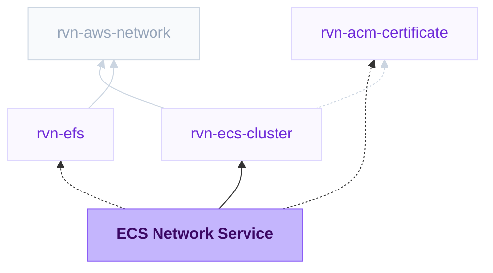

{/* Generated by scripts/sync-module-catalog.mjs from the Ravion module catalog. Do not edit by hand. */}

**Type:** `rvn-ecs-nlb` / **Latest version:** `2.3.2`

## Dependencies and consumers

_Every dependency input can be specified manually to reference existing external infrastructure rather than a Ravion module. Set the dependency input to `null` and set its mapped inputs directly; see [Use existing infrastructure instead of a module reference](/config-as-code/project-config-file#use-existing-infrastructure-instead-of-a-module-reference)._

## Readme

### Rolling deployment success

Rolling deploys always use AWS early success: by default, 100% of desired new tasks must be healthy and old tasks drain in the background. **Wait for old tasks to drain** selects blocking cleanup. Alarm bake time still applies. The success percentage must be at least **Minimum healthy percent**; lower the availability floor explicitly before choosing a lower threshold. Remaining tasks scale in the background and deployment rollback monitoring ends at ECS success.

Network Load Balanced ECS service for exposing one to five TCP, UDP, or TLS ports through an ECS cluster Network Load Balancer.

### Overview

The ECS Network Service module creates an ECS service in an existing Ravion ECS cluster and attaches it to a public or private Network Load Balancer. Select an ECS cluster, choose how the container image is built or supplied, configure one or more NLB listeners and shared target group health checks, and Ravion provisions the service, target groups, listeners, IAM roles, security group, ECR repository when needed, and autoscaling settings.

The module is intentionally focused on Layer 4 services behind a Network Load Balancer. Use ECS Web Service for HTTP host and path routing through an Application Load Balancer.

Terraform source: [ravionhq/modules/compute/ecs_service](https://github.com/ravionhq/modules/tree/rvn-ecs-nlb@2.3.2/compute/ecs_service)

### Use cases

| Scenario                         | ECS Network Service helps by...                                  |
| -------------------------------- | --------------------------------------------------------------- |
| Exposing a public TCP service    | Creating a listener on the public cluster Network Load Balancer |
| Hosting an internal protocol     | Routing traffic through the private cluster Network Load Balancer |
| Serving UDP workloads            | Registering UDP container ports and target groups               |
| Terminating TLS at the NLB       | Creating a TLS listener with an ACM certificate                 |
| Passing TLS through to the task  | Using TLS target protocol for encrypted backend traffic         |
| Serving multiple network ports   | Attaching several listeners and container ports to one ECS service |
| Deploying existing containers    | Pulling an image from a public or private registry              |
| Tuning production capacity       | Combining Fargate, Fargate Spot, or EC2 with autoscaling        |
| Running release tasks            | Running pre-deploy or post-deploy ECS tasks with the app image  |

### Cluster and networking

An ECS cluster is required. The cluster reference supplies the cluster ARN, VPC ID, public and private subnet IDs, Network Load Balancer ARNs, NLB security groups, capacity provider names, AWS account, region, and execution environment.

Use Public network service when the service should be reachable through the public Network Load Balancer. Turn it off for internal services that should use the private Network Load Balancer.

Use Run in private subnets for most production services. Private subnets keep tasks off the public internet and route outbound traffic through NAT or equivalent egress. Turning it off runs tasks in public subnets and assigns public IPs.

NLB ingress CIDRs controls which IPv4 CIDR blocks can reach every public listener. It defaults to `0.0.0.0/0`. Private NLB ingress CIDRs applies when Public network service is off and defaults to the RFC 1918 private ranges: `10.0.0.0/8`, `172.16.0.0/12`, and `192.168.0.0/16`.

### Build and image options

| Build source                 | When to use it                                                   |
| ---------------------------- | ---------------------------------------------------------------- |
| Railpack                     | Let Ravion detect the app stack and build an image from source with Railpack |
| Dockerfile                   | Build from a Dockerfile in the selected repository               |
| Pull from image registry     | Deploy an existing image from Docker Hub, GHCR, ECR, or registry |
| Managed ECR repository       | Push an image from a pipeline to the ECR repository managed by Ravion |

For Railpack and Dockerfile builds, provide Git repository, Git branch, and optionally Source base path. Ravion pushes built images to the service ECR repository and deploys by image digest.

Railpack settings let you optionally pin the Railpack version and override install, build, and start commands. Leave them blank to use Railpack defaults and autodetection.

For Pull from image registry, provide the image repository without the tag. At deploy time, provide the tag to use. Use Registry credentials secret ARN for private registries that require ECS repository credentials. Use Start command to override the image default CMD when the image needs a different service command.

For Managed ECR repository, Ravion creates and manages the service ECR repository. Push the image from a pipeline `build:image` step, then provide its tag or digest at deploy time.

### Listeners and target groups

The service requires at least one listener. Each listener creates an NLB listener, a target group, an ECS load balancer attachment, and the required security group ingress. Configure Listener port for the port clients connect to and Container port for the port the app listens on inside the ECS task.

Listener ports and container ports must be unique, and an ECS service supports at most five listeners. Ravion sets the `PORT` runtime environment variable from the first listener's Container port.

| Listener protocol | Use it for                                      | Target behavior                                      |
| ----------------- | ----------------------------------------------- | ---------------------------------------------------- |
| TCP               | Plain TCP protocols and TLS passthrough by app  | Sends TCP traffic to the container port              |
| UDP               | UDP protocols                                   | Sends UDP traffic to the container port              |
| TLS               | TLS termination or re-encryption at Layer 4     | Uses TLS certificate settings and TLS target protocol |

Each TLS listener requires its own ACM certificate module reference. TLS SSL policy defaults to `ELBSecurityPolicy-TLS13-1-2-2021-06`. TLS ALPN policy is optional; leave it as None unless clients need a specific ALPN behavior. TLS target protocol controls traffic from the NLB to the ECS task: use TCP when the NLB terminates TLS, or TLS when the task should receive encrypted backend traffic.

Source IP stickiness is off by default. Enable it when repeat traffic from the same source IP should stay on the same task when possible.

### Health checks

Health checks default to TCP, which is the safest default for generic Layer 4 workloads. Use HTTP or HTTPS only when the container exposes an HTTP-compatible health endpoint.

| Field                            | Default | Description                                                    |
| -------------------------------- | ------- | -------------------------------------------------------------- |
| Health check protocol            | TCP     | Protocol the target group uses for health checks               |
| Health check path                | /       | HTTP path checked when protocol is HTTP or HTTPS               |
| Success codes                    | 200-399 | HTTP status codes treated as healthy                           |
| Interval (secs)                  | 30      | Seconds between checks                                         |
| Timeout (secs)                   | 10      | Seconds to wait for a response                                 |
| Healthy threshold                | 3       | Successful checks needed to mark a target healthy              |
| Unhealthy threshold              | 3       | Failed checks needed to mark a target unhealthy                |
| Health check grace period (secs) | 0       | Startup window where ECS ignores load balancer health failures |
| Deregistration delay (secs)      | 300     | Seconds to drain in-flight traffic before deregistration       |

Increase the grace period for services with slow startup. Lower the deregistration delay only when fast replacement is more important than giving existing connections time to drain.

### Capacity and runtime

Choose one primary Capacity provider:

| Capacity provider | Best for                                                       |
| ----------------- | -------------------------------------------------------------- |
| Fargate           | Simple serverless containers and predictable network services  |
| Fargate spot      | Lower-cost services that can tolerate task interruption        |
| EC2               | Workloads that need cluster EC2 capacity or host-level control |

You can add secondary providers with Also use Fargate, Also use Fargate spot, and Also use EC2. Mixed strategies can reduce cost or increase placement flexibility, but each enabled provider must exist on the selected cluster.

For Fargate and Fargate Spot, App size defaults to 2 vCPU and 4 GB memory. App ephemeral storage uses the AWS default of 20 GiB unless you increase it to 21-200 GiB. For EC2 capacity, App vCPU defaults to 1.5 and App memory in GB defaults to 3.5; leave spare CPU and memory on each EC2 instance for the ECS agent and system processes.

CPU architecture defaults to x86_64 for broad compatibility. Choose ARM64 only when the image and native dependencies support it.

### Autoscaling

Autoscaling is enabled by default with one minimum task and three maximum tasks. For production, start with at least two minimum tasks when availability matters. When autoscaling is disabled, Desired tasks controls how many tasks the ECS service keeps running.

| Field                     | Default | Description                                   |
| ------------------------- | ------- | --------------------------------------------- |
| Autoscaling               | true    | Enables ECS service target tracking           |
| Minimum tasks             | 1       | Lower bound for running tasks                 |
| Maximum tasks             | 3       | Upper bound for running tasks                 |
| Desired tasks             | 1       | Running tasks when autoscaling is disabled    |
| CPU target (%)            | 70      | Average CPU utilization target                |
| Memory target (%)         | 80      | Average memory utilization target             |
| Scale-in cooldown (secs)  | 300     | Delay before another scale-in action          |
| Scale-out cooldown (secs) | 300     | Delay before another scale-out action         |
| Scale in                  | true    | Allows autoscaling to reduce task count       |

Scheduled scaling actions and custom metric scaling policies are available for advanced capacity patterns.

### Application configuration

Use Runtime environment variables for plain container environment values. Ravion also sets PORT from the first listener's Container port.

Use Runtime secrets for sensitive values. Secrets are injected into the ECS task from SSM Parameter Store or Secrets Manager using name and value_from objects.

Stop timeout (secs) controls how long ECS waits after sending SIGTERM to the app container before sending SIGKILL. The default is 30 secs; Fargate allows up to 120 secs.

Use Build environment variables for values needed during image builds. Values can be plain strings or references loaded from Parameter Store or Secrets Manager. For Dockerfile builds, enable Inject environment variables in Dockerfile to pass those values as Docker build arguments.

### Persistent storage

Enable the EFS file system setting, select a Ravion EFS module, and set the EFS mount path. Ravion adds the task volume, mounts it into the app container, attaches the file system's client security group to the service so NFS traffic is allowed, and mounts through the file system's access point when one is enabled. Sidecars mount the same file system through their Mount points setting with `efs` as the source volume.

EFS volumes work with Fargate and EC2 Linux tasks and keep data across task replacement. Transit encryption is enabled by default. Enable EFS IAM authorization to authorize file system access with the task role; the task role must allow elasticfilesystem:ClientMount, plus elasticfilesystem:ClientWrite or elasticfilesystem:ClientRootAccess as needed.

### Deployment

ECS Network Service uses rolling deployments. ECS replaces tasks in place while every listener continues routing through its target group. Blue/green, Linear, and Canary are not available because native ECS traffic shifting accepts one production listener and cannot shift several NLB listeners together.

Deployments update the ECS service task definition with the selected image, generated container definition, awslogs or FireLens configuration, runtime platform, environment variables, secrets, and capacity-provider-compatible task settings.

The deploy-time Image value depends on the build source:

| Build source                 | Deploy image value                                |
| ---------------------------- | ------------------------------------------------- |
| Railpack or Dockerfile       | Image digest such as sha256:...                   |
| Pull from image registry     | Tag for the configured repository, such as latest |
| Managed ECR repository       | Tag or digest in the service ECR repository       |

Run pre-deploy command and Run post-deploy command start optional one-off ECS tasks before or after each deployment. These commands use the deployed app image, the app container name, the configured task role and execution role, the selected capacity provider strategy, service subnets, service security groups, runtime environment variables, and runtime secrets. Leave either toggle disabled to skip that hook and hide its settings.

Use pre-deploy commands for work that must complete before the service updates, such as database migrations. Use post-deploy commands for work that should happen after a successful deployment, such as cache warming. Commands are ECS command argument arrays. For shell behavior, use `/bin/sh`, `-lc`, and your shell command as separate arguments.

### Logging and observability

CloudWatch logging is enabled by default and appears in the Logs tab. Enable FireLens log routing when app logs should also go to destinations such as Datadog, Splunk, Firehose, OpenSearch, or S3. Keep CloudWatch output enabled unless logs should go exclusively to an external destination.

The Metrics tab includes common ECS service metrics plus Network Load Balancer target group health metrics for the first listener. Additional listener target groups are available through the stack outputs for external dashboards and alarms.

### Compliance

The Compliance section holds log retention and CloudWatch alarms.

Log retention (days) defaults to the value configured on the ECS cluster's Compliance section, so one cluster setting keeps every service consistent. Set a value here to override it for this service. Use 0 to retain logs indefinitely.

CloudWatch alarms are enabled by default for average CPU utilization, average memory utilization, and running task count. Because the service owns its target groups, it also alarms on unhealthy targets in every listener target group. Network Load Balancers themselves have no alarms.

The running task alarm uses the Container Insights `RunningTaskCount` metric and stays silent when Container Insights is disabled on the cluster. Every alarm treats missing data as not breaching and must breach for the configured number of consecutive periods before it fires. Add SNS topic ARNs as Alarm actions and OK actions to be notified.

### Configuration

| Field                            | Required | Default                  | Description                                      |
| -------------------------------- | -------- | ------------------------ | ------------------------------------------------ |
| Cluster                          | Yes      | -                        | Existing rvn-ecs-cluster module instance         |
| Service name                     | Yes      | \{project\}-\{env\}-\{module\} | Name for the ECS service and related resources   |
| Public network service           | No       | true                     | Use the public NLB; turn off for the private NLB |
| Run in private subnets           | No       | true                     | Run tasks in private subnets without public IPs  |
| Build source                     | Yes      | dockerfile               | Dockerfile, Railpack, Managed ECR repository, or Pull from image registry |
| Git repository                   | Yes*     | -                        | Required for Railpack and Dockerfile builds      |
| Git branch                       | Yes*     | -                        | Required for Railpack and Dockerfile builds      |
| Source base path                 | No       | .                        | Path from repository root to source code         |
| Image repository                 | Yes*     | -                        | Required for image registry deployments          |
| Start command                    | No       | []                       | Command arguments overriding image CMD           |
| Listeners                        | Yes      | TCP 80 to 3000           | One or more NLB listener and container port mappings |
| Listener port                    | Yes      | 80                       | Unique NLB port for each listener                |
| Listener protocol                | Yes      | TCP                      | TCP, TLS, or UDP for each listener               |
| Container port                   | Yes      | 3000                     | Container port targeted by each listener         |
| TLS certificate                  | Yes*     | -                        | Required for each TLS listener                   |
| TLS SSL policy                   | No       | ELBSecurityPolicy-TLS13-1-2-2021-06 | SSL policy for each TLS listener        |
| TLS ALPN policy                  | No       | None                     | Optional ALPN behavior for each TLS listener     |
| TLS target protocol              | Yes*     | TCP                      | Backend protocol for each TLS listener           |
| NLB ingress CIDRs                | No       | 0.0.0.0/0                | CIDRs allowed to reach the public NLB listener   |
| Private NLB ingress CIDRs        | No       | RFC 1918 ranges          | CIDRs allowed to reach the private NLB listener  |
| Health check protocol            | Yes      | TCP                      | TCP, HTTP, or HTTPS target group health checks   |
| Health check path                | Yes*     | /                        | Required for HTTP and HTTPS health checks        |
| Source IP stickiness             | No       | false                    | Keep source IPs on the same task when possible   |
| Capacity provider                | Yes      | fargate                  | Primary service capacity provider                |
| App size                         | No       | 2 vCPU, 4 GB             | Fargate task CPU and memory                      |
| App ephemeral storage (GiB)      | No       | 20                       | Fargate task ephemeral storage                   |
| App vCPU                         | Yes*     | 1.5                      | Required for EC2 capacity                        |
| App memory in GB                 | Yes*     | 3.5                      | Required for EC2 capacity                        |
| CPU architecture                 | No       | X86_64                   | x86_64 compatibility or ARM64 cost optimization  |
| ECS exec                         | No       | false                    | Enable ECS Exec for debugging containers         |
| Autoscaling                      | No       | true                     | Enable CPU and optional memory target tracking   |
| Desired tasks                    | Yes*     | 1                        | Number of tasks when autoscaling is disabled     |
| FireLens log routing             | No       | false                    | Route app logs through a Fluent Bit sidecar      |
| Run pre-deploy command           | No       | false                    | Enable a task before each deployment             |
| Run post-deploy command          | No       | false                    | Enable a task after each successful deployment   |
| Additional security groups       | No       | []                       | Extra security groups attached to ECS tasks      |
| Allowed CIDR blocks              | No       | []                       | Direct service access in addition to load balancer traffic |
| Sidecars                         | No       | []                       | Additional containers in the ECS task            |
| EFS file system                  | No       | false                    | Mount an EFS file system into the app container |
| EFS mount path                   | Yes*     | /mnt/efs                 | App container path for the referenced file system |
| Log retention (days) | No | Cluster default | Overrides the CloudWatch log retention inherited from the cluster |
| Create CloudWatch alarms | No | true | Adds CPU, memory, running task, and unhealthy host alarms |
| Unhealthy hosts alarm threshold | No | 0 | Unhealthy targets in any service target group |
| CPU alarm threshold (%) | No | 80 | Average service CPU utilization |
| Memory alarm threshold (%) | No | 80 | Average service memory utilization |
| Minimum running tasks | No | 1 | Alarms when fewer tasks are running |
| Alarm actions | No | [] | ARNs notified on ALARM, such as an SNS topic |
| Tags                             | No       | Standard Ravion tags     | Additional tags applied to resources             |
| Advanced Terraform variables     | No       | \{\}                       | Raw lower-level overrides for exceptional cases  |
| OpenTofu version override        | No       | Ravion default           | Override the OpenTofu version for the stack      |
| Ravion Terraform workspace name  | No       | \{project\}-\{env\}-\{module\} | Override the state backend workspace name        |

*Conditionally required based on each listener protocol, health check protocol, build type, autoscaling mode, or capacity provider.

### Design decisions

- The module always models a Layer 4 service behind a Network Load Balancer. HTTP host and path routing are intentionally outside this module definition.
- Listeners are created by the service stack on one selected public or private cluster NLB, so each ECS Network Service owns all of its listener ports.
- Deployments are rolling-only because native ECS traffic shifting cannot shift multiple NLB listeners as one deployment.
- The first listener supplies the `PORT` environment variable and the target group shown in the built-in healthy and unhealthy host metrics.
- Tasks default to private subnets even for public network services. The NLB is public; the tasks remain private when the VPC has NAT or equivalent egress.
- Health checks default to TCP because the module supports non-HTTP protocols.
- Built images are pushed to an ECR repository created with the service stack. Managed ECR repository lets a pipeline push images to that repository without a module build config. Pull from image registry lets teams bring their own image pipeline.
- The service uses the autoscaling minimum when autoscaling is enabled and the Desired tasks input when autoscaling is disabled.
- Advanced Terraform variables exist for exceptional lower-level overrides. Prefer the typed Ravion fields whenever possible.

### Learn more

- [Amazon ECS services](https://docs.aws.amazon.com/AmazonECS/latest/developerguide/ecs_services.html)
- [Network Load Balancers](https://docs.aws.amazon.com/elasticloadbalancing/latest/network/introduction.html)
- [Network Load Balancer listeners](https://docs.aws.amazon.com/elasticloadbalancing/latest/network/load-balancer-listeners.html)
- [Target group health checks](https://docs.aws.amazon.com/elasticloadbalancing/latest/network/target-group-health-checks.html)
- [Amazon ECS capacity providers](https://docs.aws.amazon.com/AmazonECS/latest/developerguide/cluster-capacity-providers.html)
- [Amazon ECS service auto scaling](https://docs.aws.amazon.com/AmazonECS/latest/developerguide/service-auto-scaling.html)
- [Railpack documentation](https://railpack.com/)

## Inputs reference

All inputs for `rvn-ecs-nlb` version `2.3.2`. Use the `name` shown for each field as the input key in module config.

- [Inputs: ECS cluster to logging](/module-definitions/catalog/rvn-ecs-nlb/inputs-ecs-cluster) — ECS cluster, Network service, Build config, Docker, Railpack, Network listeners, Health check, Container resources, Autoscaling, Environment variables, Pre and post deploy, Logging
- [Inputs: IAM roles and policies to terraform settings](/module-definitions/catalog/rvn-ecs-nlb/inputs-iam-roles-and-policies) — IAM roles and policies, Networking and deployment, Persistent storage, Compliance, Builder config, Image registry lifecycle, Misc, Terraform settings
