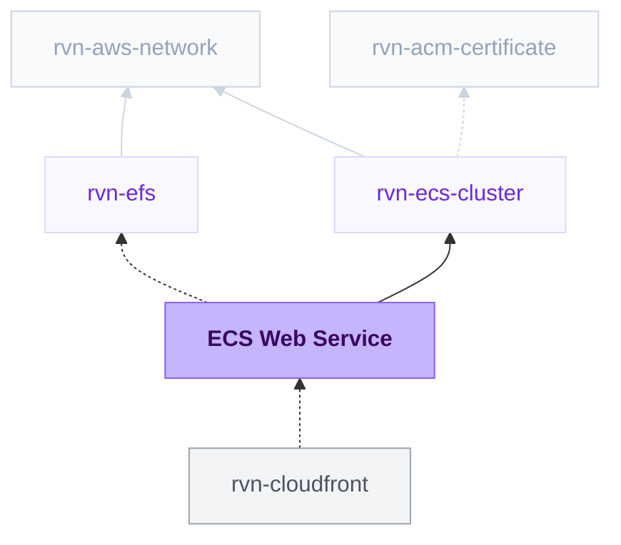

{/* Generated by scripts/sync-module-catalog.mjs from the Ravion module catalog. Do not edit by hand. */}

**Type:** `rvn-ecs-web` / **Latest version:** `2.4.0`

## Dependencies and consumers



_Every dependency input can be specified manually to reference existing external infrastructure rather than a Ravion module. Set the dependency input to `null` and set its mapped inputs directly; see [Use existing infrastructure instead of a module reference](/config-as-code/project-config-file#use-existing-infrastructure-instead-of-a-module-reference)._

## Readme

### Rolling deployment success

Rolling deploys always use AWS early success: by default, 100% of desired new tasks must be healthy and old tasks drain in the background. **Wait for old tasks to drain** selects blocking cleanup. Alarm bake time still applies. The success percentage must be at least **Minimum healthy percent**; lower the availability floor explicitly before choosing a lower threshold. Remaining tasks scale in the background and deployment rollback monitoring ends at ECS success.

Web server ECS service for running an HTTP application behind an ECS cluster load balancer.

### Overview

The ECS Web Server module creates an ECS service for HTTP traffic in an existing Ravion ECS cluster. Select an ECS cluster, choose how the container image is built or supplied, configure routing and health checks, and Ravion provisions the service, target group, listener rule, IAM roles, security group, ECR repository when needed, and autoscaling settings.

The module is intentionally focused on web services behind an Application Load Balancer. It uses the selected ECS cluster to inherit AWS account, region, VPC, subnets, capacity providers, load balancer listeners, and load balancer security groups.

Terraform source: [ravionhq/modules/compute/ecs_service](https://github.com/ravionhq/modules/tree/rvn-ecs-web@2.4.0/compute/ecs_service)

### Use cases

| Scenario                         | ECS Web Server helps by...                                      |
| -------------------------------- | --------------------------------------------------------------- |
| Deploying a public web app       | Routing host or path traffic through the public cluster ALB      |
| Hosting an internal HTTP service | Routing private traffic through the private cluster ALB          |
| Building from source             | Creating images with Railpack or a Dockerfile and pushing to ECR |
| Bringing an existing image       | Deploying a public or private registry image by tag or digest    |
| Managed ECR repository            | Letting a pipeline push images to an ECR repository managed by Ravion |
| Tuning production capacity       | Combining Fargate, Fargate Spot, or EC2 with autoscaling         |
| Running release tasks            | Running pre-deploy or post-deploy ECS tasks with the app image   |
| Debugging running tasks          | Enabling ECS Exec when shell access is needed                    |

### Cluster and networking

An ECS cluster is required. The cluster reference supplies the cluster ARN, VPC ID, public and private subnet IDs, load balancer listeners, load balancer security groups, capacity provider names, AWS account, region, and execution environment.

Use Public web service when the service should be reachable through the public Application Load Balancer. Turn it off for internal services that should use the private Application Load Balancer.

Use Run in private subnets for most production services. Private subnets keep tasks off the public internet and route outbound traffic through NAT or equivalent egress. Turning it off runs tasks in public subnets and assigns public IPs.

### Build and image options

| Build source    | When to use it                                                    |
| --------------- | ----------------------------------------------------------------- |
| Railpack        | Let Ravion detect the app stack and build an image from source with Railpack |
| Dockerfile      | Build from a Dockerfile in the selected repository                |
| Pull from image registry | Deploy an existing image from Docker Hub, GHCR, ECR, or registry |
| Managed ECR repository | Push an image from a pipeline to the ECR repository managed by Ravion |

For Railpack and Dockerfile builds, provide Git repository, Git branch, and optionally Base path. Ravion pushes built images to the service ECR repository and deploys by image digest.

Railpack settings let you optionally pin the Railpack version and override install, build, and start commands. Leave them blank to use Railpack defaults and autodetection.

For Pull from image registry, provide the image repository without the tag. At deploy time, provide the tag to use. Use Registry credentials secret ARN for private registries that require ECS repository credentials. Use Start command to override the image default CMD when the image needs a different service command.

For Managed ECR repository, Ravion creates and manages the service ECR repository. Push the image from a pipeline `build:image` step, then provide its tag or digest at deploy time.

### Routing and health checks

The service always attaches to an Application Load Balancer target group. Route traffic with Domain host rules, Path rules, or both.

If both host and path rules are empty, Ravion creates a default /* path rule so the listener rule has a valid condition. Use Listener rule priority only when you need a specific ALB rule order; otherwise AWS assigns the next available priority.

Health check settings control when the load balancer considers tasks healthy:

| Field                            | Default | Description                                                    |
| -------------------------------- | ------- | -------------------------------------------------------------- |
| Container port                   | 80      | Port the container listens on; PORT is added automatically     |
| Health check path                | /       | Lightweight HTTP endpoint the load balancer checks             |
| Success codes                    | 200-399 | Status codes treated as healthy                                |
| Interval (secs)                  | 5       | Seconds between checks                                         |
| Timeout (secs)                   | 4       | Seconds to wait for a response                                 |
| Healthy threshold                | 2       | Successful checks needed to mark a target healthy              |
| Unhealthy threshold              | 2       | Failed checks needed to mark a target unhealthy                |
| Health check grace period (secs) | 0       | Startup window where ECS ignores load balancer health failures |
| Deregistration delay (secs)      | 300     | Drain window for a task that is deregistering                   |

Increase the grace period for apps with slow boot times. Keep health check endpoints lightweight and unauthenticated.

### Capacity and runtime

Choose one primary Capacity provider:

| Capacity provider | Best for                                                       |
| ----------------- | -------------------------------------------------------------- |
| Fargate           | Simple serverless containers and predictable web services      |
| Fargate spot      | Lower-cost services that can tolerate task interruption        |
| EC2               | Workloads that need cluster EC2 capacity or host-level control |

You can add secondary providers with Also use Fargate, Also use Fargate spot, and Also use EC2. Mixed strategies can reduce cost or increase placement flexibility, but each enabled provider must exist on the selected cluster.

For Fargate and Fargate Spot, App size defaults to 2 vCPU and 4 GB memory. App ephemeral storage uses the AWS default of 20 GiB unless you increase it to 21-200 GiB. For EC2 capacity, App vCPU defaults to 1.5 and App memory in GB defaults to 3.5; leave spare CPU and memory on each EC2 instance for the ECS agent and system processes.

CPU architecture defaults to x86_64 for broad compatibility. Choose ARM64 only when the image and native dependencies support it.

### Autoscaling

Autoscaling is enabled by default with one minimum task and three maximum tasks. For production, start with at least two minimum tasks when availability matters. When autoscaling is disabled, Desired tasks controls how many web tasks the ECS service keeps running.

| Field                    | Default | Description                                    |
| ------------------------ | ------- | ---------------------------------------------- |
| Autoscaling              | true    | Enables ECS service target tracking            |
| Minimum tasks            | 1       | Lower bound for running tasks                  |
| Maximum tasks            | 3       | Upper bound for running tasks                  |
| Desired tasks            | 1       | Running tasks when autoscaling is disabled     |
| CPU target (%)           | 70      | Average CPU utilization target                 |
| Memory target (%)        | 80      | Average memory utilization target              |
| Requests per task target | blank   | Average ALB requests per task per minute (Rolling deployments only) |
| Scale-in cooldown (secs) | 300     | Delay before another scale-in action           |
| Scale-out cooldown (secs)| 300     | Delay before another scale-out action          |
| Scale-in disabled        | false   | Prevents autoscaling from reducing task count  |

### Application configuration

Use Runtime environment variables for plain container environment values. Ravion also sets PORT from Container port.

Use Runtime secrets for sensitive values. Secrets are injected into the ECS task from SSM Parameter Store or Secrets Manager using name and value_from objects.

Stop timeout (secs) controls how long ECS waits after sending SIGTERM to the app container before sending SIGKILL. The default is 30 secs; Fargate allows up to 120 secs.

Use Build environment variables for values needed during image builds. Values can be plain strings or references loaded from Parameter Store or Secrets Manager. For Dockerfile builds, enable Inject environment variables in Dockerfile to pass those values as Docker build arguments.

### Persistent storage

Enable the EFS file system setting, select a Ravion EFS module, and set the EFS mount path. Ravion adds the task volume, mounts it into the app container, attaches the file system's client security group to the service so NFS traffic is allowed, and mounts through the file system's access point when one is enabled. Sidecars mount the same file system through their Mount points setting with `efs` as the source volume.

EFS volumes work with Fargate and EC2 Linux tasks and keep data across task replacement. Transit encryption is enabled by default. Enable EFS IAM authorization to authorize file system access with the task role; the task role must allow elasticfilesystem:ClientMount, plus elasticfilesystem:ClientWrite or elasticfilesystem:ClientRootAccess as needed.

### Deployment

Deployment strategy defaults to Rolling. Blue/green, Linear, and Canary use the native ECS traffic-shift controller with production and alternate target groups. The deployment strategy can change between deploys without changing Terraform infrastructure.

Deployments update the ECS service task definition with the selected image, generated container definition, awslogs configuration, runtime platform, environment variables, secrets, and capacity-provider-compatible task settings.

The deploy-time Image value depends on the build source:

| Build source           | Deploy image value                                  |
| ---------------------- | --------------------------------------------------- |
| Railpack or Dockerfile | Image digest such as sha256:...            |
| Pull from image registry | Tag for the configured repository, such as latest   |
| Managed ECR repository | Tag or digest in the service ECR repository |
| Disabled               | Full image URI, ideally pinned by digest            |

Run pre-deploy command and Run post-deploy command start optional one-off ECS tasks before or after each deployment. These commands use the deployed app image, the app container name, the configured task role and execution role, the selected capacity provider strategy, service subnets, service security groups, runtime environment variables, and runtime secrets. Leave either toggle disabled to skip that hook and hide its settings.

Use pre-deploy commands for work that must complete before the service updates, such as database migrations. Use post-deploy commands for work that should happen after a successful deployment, such as cache warming. Commands are ECS command argument arrays. For shell behavior, use `/bin/sh`, `-lc`, and your shell command as separate arguments.

Hook-specific environment variables are appended to the app container override for the one-off task. Optional hook CPU, memory, ephemeral storage, and timeout settings let release tasks use different resources from the web service without changing the steady-state app task.

### Standby validation traffic

For Blue/green, Linear, and Canary deployments, Ravion creates a test listener rule on the same Application Load Balancer listener as the production rule. During the test traffic stage, requests that match the service's normal Domain host rules and Path rules and include the standby selector route to the standby, or green, task set on the alternate target group.

By default, the standby selector is the query parameter `__x-rvn-test__=1`. For example, if production traffic uses `https://app.example.com/health`, validate the standby service with:

```text
https://app.example.com/health?__x-rvn-test__=1
```

The alternate target group only has registered targets while ECS is running a traffic-shift deployment. Outside that window, the standby route may have no healthy targets.

Use Advanced Terraform variables to override the standby selector. Values in Advanced Terraform variables override the generated Terraform variables for the service.

To use a different query parameter:

```json
{
  "test_query_string_key": "preview",
  "test_query_string_value": "green"
}
```

Then validate standby traffic with `?preview=green`.

To use an HTTP header instead of a query parameter:

```json
{
  "test_traffic_condition_type": "header",
  "test_header_name": "X-Ravion-Test",
  "test_header_value": "1"
}
```

Then send requests with `X-Ravion-Test: 1`. A service can use either the query-string selector or the header selector, not both at once.

### Sticky sessions and traffic shifts

The module definition sets Sticky sessions to true by default. When that setting is enabled, Ravion configures target-group stickiness for the service's production and alternate target groups, so the load balancer keeps repeat requests on the same task when possible. With the default Load balancer cookie stickiness type, the target-level cookie is `AWSALB`; AWS may also set `AWSALBCORS` for CORS support. With Application cookie stickiness, the target-level cookie is the configured Application cookie name, and AWS may also set `AWSALBAPP-*` cookies.

During Blue/green, Linear, and Canary deployments, Ravion also enables ALB group stickiness on the production and standby listener rule forward actions when Sticky sessions is enabled. A client that first reaches the production target group or the alternate target group keeps using that same group for the stickiness cookie duration, even while the deployment's weighted traffic shift changes for new clients.

The ALB group stickiness cookie is `AWSALBTG`. For CORS requests, AWS may also set `AWSALBTGCORS`. Application cookie name applies only to `app_cookie` stickiness inside the selected target group; the ALB group stickiness cookie name is managed by AWS and cannot be changed.

To clear stickiness for a browser, open the browser developer tools, go to Application or Storage > Cookies for the service domain, and delete the relevant cookies: `AWSALBTG` and `AWSALBTGCORS` for ALB group stickiness; `AWSALB` and `AWSALBCORS` for the default target-level stickiness; and the configured Application cookie name plus any `AWSALBAPP-*` cookies when Application cookie stickiness is selected. For API clients, remove those cookie names from the cookie jar or stop sending them in the `Cookie` header. The next request can then enter the current traffic split like a new client. If Sticky sessions is turned off, Ravion does not enable target-group stickiness or ALB group stickiness for this behavior.

### Builder settings

Builder settings apply to Railpack and Dockerfile builds.

| Field                         | Default       | Description                                          |
| ----------------------------- | ------------- | ---------------------------------------------------- |
| Builder instance type         | ec2           | Use EC2 for normal builds or EC2 spot for lower cost |
| Builder instance size         | c7a.4xlarge   | EC2 instance size used for builds                    |
| Builder execution environment | Cluster value | Optional override for where image builds run         |
| Builder AMI                   | Default image | Optional AMI override for build runners              |

Start with the default builder size, then adjust based on build duration and resource usage.

### Compliance

The Compliance section holds log retention and CloudWatch alarms.

Log retention (days) defaults to the value configured on the ECS cluster's Compliance section, so one cluster setting keeps every service consistent. Set a value here to override it for this service. Use 0 to retain logs indefinitely.

CloudWatch alarms are enabled by default for average CPU utilization, average memory utilization, and running task count. Because the service owns its target group, it also alarms on unhealthy targets, target 5xx responses, and target response time for this service only. Load balancer level alarms live on the ECS cluster.

The running task alarm uses the Container Insights `RunningTaskCount` metric and stays silent when Container Insights is disabled on the cluster. Every alarm treats missing data as not breaching and must breach for the configured number of consecutive periods before it fires. Add SNS topic ARNs as Alarm actions and OK actions to be notified.

### Configuration

| Field                           | Required | Default                    | Description                                        |
| ------------------------------- | -------- | -------------------------- | -------------------------------------------------- |
| Public web service              | No       | true                       | Use the public ALB; turn off for the private ALB   |
| Run in private subnets          | No       | true                       | Run tasks in private subnets without public IPs    |
| Service name                    | Yes      | \{project\}-\{env\}-\{module\}   | Name for the ECS service and related resources     |
| ECS cluster                     | Yes      | -                          | Existing rvn-ecs-cluster module instance           |
| Build source                    | Yes      | dockerfile                 | Dockerfile, Railpack, Managed ECR repository, Pull from image registry, or Disabled |
| Git repository                  | Yes*     | -                          | Required for Railpack and Dockerfile builds |
| Git branch                      | Yes*     | -                          | Required for Railpack and Dockerfile builds |
| Source base path                | No       | .                          | Path from repository root to source code           |
| Railpack version                | No       | Ravion default             | Optional version for Railpack builds               |
| Image repository                | Yes*     | nginx                      | Required for image registry deployments            |
| Start command                   | No       | []                         | Command arguments that override an image default CMD |
| Container port                  | Yes      | 80                         | Port exposed by the app container                  |
| Health check path               | Yes      | /                          | HTTP path used by the target group health check    |
| Deregistration delay (secs)     | No       | 300                        | Drain window for a task that is deregistering      |
| Sticky sessions                 | No       | true                       | Keep clients on the same task, and on the same traffic-shift target group when enabled |
| Domain host rules               | No       | -                          | Hostnames such as app.example.com or *.example.com |
| Path rules                      | No       | -                          | Path patterns such as /*, /api/*, or /app/*        |
| Capacity provider               | Yes      | fargate                    | Primary service capacity provider                  |
| App size                        | No       | 2 vCPU, 4 GB               | Fargate task CPU and memory                        |
| App ephemeral storage (GiB)     | No       | 20                         | Fargate task ephemeral storage                     |
| App vCPU                        | Yes*     | 1.5                        | Required for EC2 capacity                          |
| App memory in GB                | Yes*     | 3.5                        | Required for EC2 capacity                          |
| CPU architecture                | No       | X86_64                     | x86_64 compatibility or ARM64 cost optimization    |
| ECS exec                        | No       | false                      | Enable ECS Exec for debugging containers           |
| Run pre-deploy command          | No       | false                      | Enable a task before each deployment               |
| Pre-deploy command arguments    | Yes*     | []                         | Command arguments run before each deployment       |
| Pre-deploy environment variables| No       | []                         | Extra environment variables for the pre-deploy task |
| Pre-deploy CPU                  | No       | App task CPU               | CPU override for the pre-deploy task               |
| Pre-deploy memory               | No       | App task memory            | Memory override for the pre-deploy task            |
| Pre-deploy ephemeral storage    | No       | Task definition default    | Ephemeral storage override for the pre-deploy task |
| Pre-deploy timeout (secs)       | No       | 1800                       | Maximum pre-deploy task wait time                  |
| Run post-deploy command         | No       | false                      | Enable a task after each successful deployment     |
| Post-deploy command arguments   | Yes*     | []                         | Command arguments run after each successful deployment |
| Post-deploy environment variables| No      | []                         | Extra environment variables for the post-deploy task |
| Post-deploy CPU                 | No       | App task CPU               | CPU override for the post-deploy task              |
| Post-deploy memory              | No       | App task memory            | Memory override for the post-deploy task           |
| Post-deploy ephemeral storage   | No       | Task definition default    | Ephemeral storage override for the post-deploy task |
| Post-deploy timeout (secs)      | No       | 1800                       | Maximum post-deploy task wait time                 |
| Autoscaling                     | No       | true                       | Enable CPU and optional memory target tracking     |
| Desired tasks                   | Yes*     | 1                          | Number of web tasks when autoscaling is disabled   |
| Deployment strategy             | Yes      | rolling                    | Rolling, Blue/green, Linear, or Canary             |
| EFS file system                 | No       | false                      | Mount an EFS file system into the app container   |
| EFS mount path                  | Yes*     | /mnt/efs                   | App container path for the referenced file system  |
| Log retention (days) | No | Cluster default | Overrides the CloudWatch log retention inherited from the cluster |
| Create CloudWatch alarms | No | true | Adds CPU, memory, running task, unhealthy host, target 5xx, and target response time alarms |
| Unhealthy hosts alarm threshold | No | 0 | Unhealthy targets in the service target group |
| Target 5xx alarm threshold | No | 10 | 5xx responses from this service per period |
| Target response time alarm threshold (seconds) | No | 1 | Average response time of this service |
| CPU alarm threshold (%) | No | 80 | Average service CPU utilization |
| Memory alarm threshold (%) | No | 80 | Average service memory utilization |
| Minimum running tasks | No | 1 | Alarms when fewer tasks are running |
| Alarm actions | No | [] | ARNs notified on ALARM, such as an SNS topic |
| Tags                            | No       | Standard Ravion tags       | Additional tags applied to resources               |
| Advanced Terraform variables    | No       | \{\}                         | Raw lower-level overrides for exceptional cases    |
| OpenTofu version override       | No       | Ravion default             | Override the OpenTofu version for the stack        |
| Ravion Terraform workspace name | No       | \{project\}-\{env\}-\{module\}   | Override the state backend workspace name          |

*Conditionally required based on the selected build source or capacity provider.

### Design decisions

- The module always models an HTTP web service behind an Application Load Balancer. NLB, worker, and service discovery patterns are intentionally outside this module definition.
- Tasks default to private subnets even for public web services. The ALB is public; the tasks remain private when the VPC has NAT or equivalent egress.
- Built images are pushed to an ECR repository created with the service stack. Managed ECR repository lets a pipeline push images to that repository without a module build config. Pull from image registry lets teams bring their own image pipeline.
- The service uses the autoscaling minimum when autoscaling is enabled and the Desired tasks input when autoscaling is disabled.
- Advanced Terraform variables exist for exceptional lower-level overrides. Prefer the typed Ravion fields whenever possible.

### Learn more

- [Amazon ECS services](https://docs.aws.amazon.com/AmazonECS/latest/developerguide/ecs_services.html)
- [Application Load Balancer listener rules](https://docs.aws.amazon.com/elasticloadbalancing/latest/application/listener-update-rules.html)
- [Amazon ECS capacity providers](https://docs.aws.amazon.com/AmazonECS/latest/developerguide/cluster-capacity-providers.html)
- [Amazon ECS service auto scaling](https://docs.aws.amazon.com/AmazonECS/latest/developerguide/service-auto-scaling.html)
- [Railpack documentation](https://railpack.com/)

## Inputs reference

All inputs for `rvn-ecs-web` version `2.4.0`. Use the `name` shown for each field as the input key in module config.

- [Inputs: ECS cluster to environment variables](/module-definitions/catalog/rvn-ecs-web/inputs-ecs-cluster) — ECS cluster, Web service, Domains, Build config, Docker, Railpack, Deployment, Health check, HTTP listener rules, Container resources, Autoscaling, Environment variables
- [Inputs: Pre and post deploy to terraform settings](/module-definitions/catalog/rvn-ecs-web/inputs-pre-and-post-deploy) — Pre and post deploy, Logging, IAM roles and policies, Networking and deployment, Persistent storage, Compliance, Builder config, Image registry lifecycle, Misc, Terraform settings
