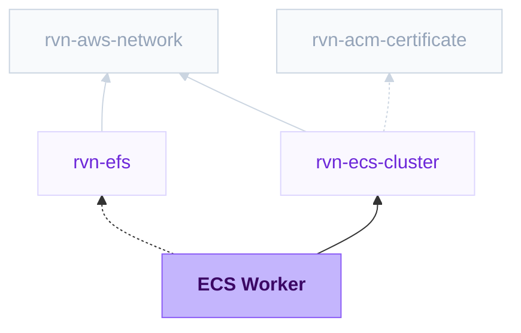

{/* Generated by scripts/sync-module-catalog.mjs from the Ravion module catalog. Do not edit by hand. */}

**Type:** `rvn-ecs-worker` / **Latest version:** `2.3.1`

## Dependencies and consumers

_Every dependency input can be specified manually to reference existing external infrastructure rather than a Ravion module. Set the dependency input to `null` and set its mapped inputs directly; see [Use existing infrastructure instead of a module reference](/config-as-code/project-config-file#use-existing-infrastructure-instead-of-a-module-reference)._

## Readme

### Rolling deployment success

Rolling deploys always use AWS early success: by default, 100% of desired new tasks must be healthy and old tasks drain in the background. **Wait for old tasks to drain** selects blocking cleanup. Alarm bake time still applies. The success percentage must be at least **Minimum healthy percent**; lower the availability floor explicitly before choosing a lower threshold. Remaining tasks scale in the background and deployment rollback monitoring ends at ECS success.

Background worker ECS service for running private container workloads without exposed ports.

### Overview

The ECS Worker module creates an ECS service for background jobs, queue consumers, event processors, and other private workloads in an existing Ravion ECS cluster. It uses the same ECS service Terraform module as ECS Web Server, but does not create or attach a load balancer target group and does not expose a primary container port.

Terraform source: [ravionhq/modules/compute/ecs_service](https://github.com/ravionhq/modules/tree/rvn-ecs-worker@2.3.1/compute/ecs_service)

### Use cases

| Scenario | ECS Worker helps by... |
| -------- | ---------------------- |
| Queue consumers | Running scalable workers for SQS, Kafka, Redis, or custom queues |
| Background jobs | Processing async work without public HTTP routing |
| Event processors | Running long-lived containers that consume streams or events |
| Private workloads | Keeping tasks off external load balancers and public ports |

### Networking

Workers do not expose a primary app port and are not registered with an Application Load Balancer. Run in private subnets is enabled by default so tasks stay private while using NAT or equivalent egress for outbound dependencies.

Sidecars may still define port mappings for task-local agents, proxies, or helper containers. Those sidecar ports are not exposed through a load balancer by this module.

### Build and deployment

Workers support Dockerfile, Railpack, Managed ECR repository, and Pull from image registry deployments. Deployments update the ECS service task definition with the selected image, generated container definition, logs, runtime environment variables, secrets, IAM roles, volumes, sidecars, and selected capacity provider settings. For Railpack builds, you can optionally pin the Railpack version and override install, build, and start commands. For Fargate and Fargate Spot, App ephemeral storage uses the AWS default of 20 GiB unless you increase it to 21-200 GiB. For image registry deployments, use Start command to override the image default CMD when the worker process uses a different command.

For Managed ECR repository, Ravion creates and manages the service ECR repository. Push the image from a pipeline `build:image` step, then provide its tag or digest at deploy time.

### Persistent storage

Enable the EFS file system setting, select a Ravion EFS module, and set the EFS mount path. Ravion adds the task volume, mounts it into the worker container, attaches the file system's client security group to the service so NFS traffic is allowed, and mounts through the file system's access point when one is enabled. Sidecars mount the same file system through their Mount points setting with `efs` as the source volume.

EFS volumes work with Fargate and EC2 Linux tasks and keep data across task replacement. Transit encryption is enabled by default. Enable EFS IAM authorization to authorize file system access with the task role; the task role must allow elasticfilesystem:ClientMount, plus elasticfilesystem:ClientWrite or elasticfilesystem:ClientRootAccess as needed.

### Autoscaling

Autoscaling is enabled by default with CPU and memory target tracking. Use custom metric scaling policies for queue depth, lag, backlog, or other workload-specific metrics that better represent worker demand. When autoscaling is disabled, Desired tasks controls how many worker tasks the ECS service keeps running.

### Compliance

The Compliance section holds log retention and CloudWatch alarms.

Log retention (days) defaults to the value configured on the ECS cluster's Compliance section, so one cluster setting keeps every service consistent. Set a value here to override it for this service. Use 0 to retain logs indefinitely.

CloudWatch alarms are enabled by default for average CPU utilization, average memory utilization, and running task count. Worker services have no load balancer, so only the service-level alarms apply.

The running task alarm uses the Container Insights `RunningTaskCount` metric and stays silent when Container Insights is disabled on the cluster. Every alarm treats missing data as not breaching and must breach for the configured number of consecutive periods before it fires. Add SNS topic ARNs as Alarm actions and OK actions to be notified.

### Configuration

| Field | Required | Default | Description |
| ----- | -------- | ------- | ----------- |
| Cluster | Yes | - | Existing rvn-ecs-cluster module instance |
| Service name | Yes | \{project\}-\{env\}-\{module\} | Name for the ECS service and related resources |
| Run in private subnets | No | true | Run tasks in private subnets without public IPs |
| Build source | Yes | dockerfile | Dockerfile, Railpack, Managed ECR repository, or Pull from image registry |
| Start command | No | [] | Command arguments that override an image default CMD |
| Capacity provider | Yes | fargate | Primary service capacity provider |
| App size | No | 2 vCPU, 4 GB | Fargate task CPU and memory |
| App ephemeral storage (GiB) | No | 20 | Fargate task ephemeral storage |
| Autoscaling | No | true | Enable CPU and optional memory target tracking |
| Desired tasks | Yes* | 1 | Number of worker tasks when autoscaling is disabled |
| Custom metric scaling policies | No | [] | Queue/backlog-oriented target tracking policies |
| Runtime environment variables | No | - | Environment variables passed to the worker container |
| Runtime secrets | No | - | Secrets injected from SSM Parameter Store or Secrets Manager |
| Stop timeout (secs) | No | 30 | Seconds between SIGTERM and SIGKILL when a worker task stops; Fargate allows up to 120 |
| Sidecars | No | [] | Additional containers in the worker task |
| EFS file system | No | false | Mount an EFS file system into the worker container |
| EFS mount path | Yes* | /mnt/efs | Worker container path for the referenced file system |
| Log retention (days) | No | Cluster default | Overrides the CloudWatch log retention inherited from the cluster |
| Create CloudWatch alarms | No | true | Adds CPU, memory, running task alarms |
| CPU alarm threshold (%) | No | 80 | Average service CPU utilization |
| Memory alarm threshold (%) | No | 80 | Average service memory utilization |
| Minimum running tasks | No | 1 | Alarms when fewer tasks are running |
| Alarm actions | No | [] | ARNs notified on ALARM, such as an SNS topic |

### Design decisions

- The module intentionally creates an ECS service without load balancer attachment or primary container port mappings.
- Sidecar port mappings are allowed for task-local communication, agents, and proxies.
- The service uses the autoscaling minimum when autoscaling is enabled and the Desired tasks input when autoscaling is disabled.
- Advanced Terraform variables exist for exceptional lower-level overrides. Prefer the typed Ravion fields whenever possible.

### Learn more

- [Amazon ECS services](https://docs.aws.amazon.com/AmazonECS/latest/developerguide/ecs_services.html)
- [Amazon ECS capacity providers](https://docs.aws.amazon.com/AmazonECS/latest/developerguide/cluster-capacity-providers.html)
- [Amazon ECS service auto scaling](https://docs.aws.amazon.com/AmazonECS/latest/developerguide/service-auto-scaling.html)

## Inputs reference

All inputs for `rvn-ecs-worker` version `2.3.1`. Use the `name` shown for each field as the input key in module config.

- [Inputs: ECS cluster to iAM roles and policies](/module-definitions/catalog/rvn-ecs-worker/inputs-ecs-cluster) — ECS cluster, Worker service, Build config, Dockerfile, Railpack, Container resources, Autoscaling, Environment variables, Pre and post deploy, Logging, IAM roles and policies
- [Inputs: Networking and deployment to terraform settings](/module-definitions/catalog/rvn-ecs-worker/inputs-networking-and-deployment) — Networking and deployment, Persistent storage, Compliance, Builder config, Image registry lifecycle, Misc, Terraform settings
