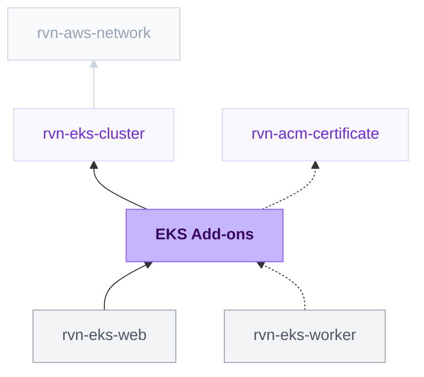

{/* Generated by scripts/sync-module-catalog.mjs from the Ravion module catalog. Do not edit by hand. */}

**Type:** `rvn-eks-addons` / **Latest version:** `1.1.0`

## Dependencies and consumers

_Every dependency input can be specified manually to reference existing external infrastructure rather than a Ravion module. Set the dependency input to `null` and set its mapped inputs directly; see [Use existing infrastructure instead of a module reference](/config-as-code/project-config-file#use-existing-infrastructure-instead-of-a-module-reference)._

## Readme

Selectable add-ons for an existing EKS cluster. Each add-on is toggled independently and brings its own IAM wiring, so the cluster module stays lean and clusters only carry what they use.

### Add-ons

| Add-on | Default | What it provides |
| ------ | ------- | ---------------- |
| **Karpenter** | On | Just-in-time node autoscaling: controller and node IAM roles, Pod Identity association, instance profile, SQS interruption queue, EventBridge rules, the controller Helm charts, and an optional default NodePool |
| **Load balancer controller** | With load balancers | Installed automatically when any shared load balancer is enabled; registers workload pods into their target groups (TargetGroupBinding) via the AWS Load Balancer Controller Helm chart wired to the cluster module's Pod Identity role. Opt in without shared load balancers via advanced Terraform variables to provision ALBs/NLBs directly from Ingress and LoadBalancer resources |
| **External Secrets Operator** | On | Reference-only secrets: workloads name a Secrets Manager secret or SSM parameter by ARN, and the operator materializes it into a Kubernetes secret using its own scoped Pod Identity role |
| **EBS CSI driver** | On | EBS-backed persistent volumes via the aws-ebs-csi-driver EKS add-on and its Pod Identity role, a default encrypted `gp3` StorageClass, and online growth of StatefulSet volumes |
| **Logs** | On (in-cluster store) | Container output collected on every node and delivered to the destinations you choose - an in-cluster store on S3 by default, plus CloudWatch Logs or a vendor on request |
| **Metrics** | On (Prometheus with S3) | Per-container CPU, memory, network, restart and scaling metrics, delivered to the destinations you choose - Prometheus in the cluster with Thanos keeping its history in S3 by default, plus Amazon Managed Prometheus, CloudWatch Container Insights or a vendor on request |
| **Traces** | On (Tempo with S3) | An OTLP receiver at an in-cluster Service, delivering workload traces to the destinations you choose - Tempo in the cluster with its blocks in S3 by default, plus AWS X-Ray or a vendor on request |
| **Ravion EKS Management** | On | Registers the cluster with the Ravion control plane and installs Ravion Operator, which reports workload and node state outbound over a single WebSocket and can run Ravion's deploys from inside the cluster |
| **Shared load balancers** | Public ALB on | Terraform-managed public/private ALBs and NLBs that web workloads attach to via the load balancer controller's TargetGroupBinding — the same shared-LB pattern the ECS Cluster module uses |

Load balancer controller CRDs upgrade with the selected chart version, including custom pins. Disabling or
removing the controller retains its CRDs and workload bindings; re-enabling it adopts them again. Delete
retained CRDs manually only after all their consumers have been removed.

**Zone-local DNS** is on by default and has no form field: the `kube-dns` Service is patched with `trafficDistribution: PreferClose`, so every DNS lookup goes to the CoreDNS pod in the caller's availability zone (the EKS Cluster module spreads those pods across zones). This removes cross-AZ data transfer charges from DNS, the one call every pod makes. It needs Kubernetes 1.31 or later and is switched off with `topology_aware_routing_enabled: false` under **Advanced Terraform variables**, which also clears the field again.

EBS CSI and the CloudWatch Observability add-on are native EKS add-ons installed purely through the AWS API. Karpenter, the load balancer controller, the External Secrets Operator, Ravion EKS Management, both observability pipelines, and the EBS storage defaults (the `gp3` StorageClass and volume growth) additionally install Helm charts into the cluster, which are the only parts that need Kubernetes API connectivity.

Karpenter's **Interruption queue age alarm** is enabled by default. It monitors the oldest unprocessed event with a 60-second threshold over one minute. Empty queues do not trigger it. Configure **Alert actions** and **Recovery actions** for direct notifications; both default to empty. Standard CloudWatch charges apply.

### Event-driven autoscaling

**KEDA** is optional and off by default. Enabling it installs the operator, external metrics API server, admission webhooks and CRDs in **KEDA namespace**. Components default to On-Demand EC2 placement. It does not create workload scaling triggers or change Karpenter capacity settings.

Install the add-ons before configuring workload ScaledObjects. Scaling from zero requires a signal that exists with no Spot application pods, such as an external backlog or shared ingress metric. Configure metric-source permissions and authentication separately; installation grants no AWS query permissions. Reference Secrets through TriggerAuthentication rather than putting credentials in trigger metadata or Helm values.

KEDA owns the external metrics API, so check for an existing adapter before installing. Remove dependent ScaledObjects and TriggerAuthentications before disabling it. CRDs are managed by the Helm chart; follow the selected version's upgrade and removal guidance.

**KEDA chart version** defaults to `2.20.2`. Its published Kubernetes test matrix covers 1.33–1.35; verify newer cluster versions, including 1.36, in staging before production adoption. Advanced chart settings can be supplied through `keda_helm_values` in **Advanced Terraform variables**.

### Certificates

**cert-manager** is optional and off by default. It is for TLS that ends inside the cluster, such as an nginx ingress, mTLS between pods, or charts that need webhook certificates. HTTPS on the shared load balancers doesn't use it: Ravion-managed domains and ACM certificates terminate TLS at the ALB. Enabling it installs the controller, webhook, CA injector and CRDs in **cert-manager namespace**. Components default to On-Demand EC2 placement so certificates keep renewing through Spot interruptions. It creates no Issuers or Certificates; define those alongside the workloads that use them.

The CRDs are kept when cert-manager is turned off, because deleting them would delete every Certificate and Issuer in the cluster and the Secrets they own. Check for an existing cert-manager installation before enabling: a cluster can run only one.

**cert-manager chart version** defaults to `v1.21.2`. Check the version's supported Kubernetes releases against your cluster before enabling or upgrading. Advanced chart settings, such as webhook replicas, can be supplied through `cert_manager_helm_values` in **Advanced Terraform variables**.

### Logs, metrics and traces destinations

Each signal is a list of destinations. **Loki, Prometheus with Thanos, and Tempo, each storing in S3, are the defaults**, so a new cluster's Logs and Metrics tabs work with nothing filled in, and its traces are in the in-cluster Grafana. CloudWatch log and metrics collectors are not installed unless selected. The interruption queue uses native SQS metrics independently of these collectors.

| Logs destination | What runs | In Ravion |
| ---------------- | --------- | --------- |
| **In-cluster log store (Loki)** - default | Alloy on every node, Loki in the cluster, chunks in an S3 bucket in your account | Renders in the Logs tab |
| **Amazon CloudWatch Logs** | An OpenTelemetry collector on every node, writing to `/ravion/eks/<cluster>` | Renders, and is read when the in-cluster agent is offline |
| **Grafana Cloud Logs** | The same Alloy agent, writing to your Grafana Cloud endpoint as well | Ships, plus an "Open in Grafana Cloud" link |
| **Datadog / New Relic / custom OTLP** | The OpenTelemetry collector, one exporter each | Ships, plus an "Open in ..." link |

| Metrics destination | What runs | In Ravion |
| ------------------- | --------- | --------- |
| **Prometheus in your cluster** - default | One collector scraping a curated metric set into Prometheus on its own volume, and Thanos keeping the history in S3 | Renders in the Metrics tabs, through Ravion Operator |
| **Amazon Managed Prometheus** | The same collector, remote-writing over SigV4 | Renders in the Metrics tabs, first when selected |
| **Amazon CloudWatch (Container Insights)** | The amazon-cloudwatch-observability add-on's metrics half | Renders, as the fallback behind the Prometheus stores |
| **Grafana Cloud / Datadog / New Relic / custom OTLP** | The same collector, one more exporter each | Ships, plus an "Open in ..." link |

**Traces.** **Traces** runs an OpenTelemetry collector of its own at an in-cluster Service on the OTLP ports (`otlp_grpc_endpoint`, `otlp_http_endpoint`), apart from the one that scrapes the cluster, so a burst of spans never competes with the scrape. Every trace goes to each destination card: Tempo in your cluster, AWS X-Ray (the cluster's region unless another is set), Grafana Cloud Traces, Datadog, New Relic, or any OTLP endpoint. A vendor selected for logs or metrics too shares that signal's site and credential. Spans carry the sending pod's namespace, pod and workload. Point a workload's OpenTelemetry exporter at those outputs: this module injects no agents and restarts no pods, and sampling stays the application's. While metrics are on, the same receiver takes workload metrics into the metrics destinations; the curated allow-list covers only what the collector scrapes, so every series a workload sends is billed. The receiver authenticates no sender: any pod that reaches its Service can send spans under any service name, and they reach the destinations as sent. Every workload in the cluster is trusted with the trace data; restrict who reaches the collector with a NetworkPolicy when that does not hold.

**Tempo in your cluster** is the traces counterpart of the in-cluster log store: Tempo in monolithic mode, reachable only inside the cluster and read by the in-cluster Grafana when that is on. Its blocks go to an S3 bucket in your account by default (30 days), or to Tempo's own volume. That volume is a persistent gp3 volume by default, so spans not yet in a block survive a restart, or a scratch volume that restarts empty. Its metrics generator can write service graphs and span metrics to Prometheus for Grafana's service map, and any other chart value can be set as JSON.

**Grafana.** Turn on **In-cluster Grafana** for one place to query the cluster's own stores: Loki, Prometheus through Thanos or Amazon Managed Prometheus, and Tempo, each as a data source when selected. Without **Access** Grafana is reachable only with a port-forward. **Access** serves Grafana over HTTPS at a hostname, through either of two methods:

- **Shared load balancer** routes the hostname on the HTTPS listener of the shared private or public ALB. The private ALB keeps Grafana inside the VPC and the networks connected to it, such as a VPN or a Tailscale subnet router; the public ALB puts its sign-in page on the internet. Point the hostname's DNS at `private_alb_dns_name` or `public_alb_dns_name`.
- **Kubernetes Ingress** gives Grafana an Ingress for the hostname with TLS, served by the controller of the ingress class you name, with any annotations it needs. With the Tailscale Kubernetes operator's `tailscale` class and a `<name>.<tailnet>.ts.net` hostname, Grafana becomes one device on the tailnet with a Let's Encrypt certificate, and nothing else in the VPC is reachable through it. Install the class's controller first: the AWS Load Balancer Controller refuses an Ingress whose class does not exist yet.

**Grafana sign-in** is Grafana's own: a list of sign-in providers, username and password for local users (the default) and any of Grafana's OAuth providers side by side (Google, GitHub, GitLab, Microsoft Entra ID, Okta, or any OpenID Connect provider through generic OAuth), each configured under Grafana's own setting names. Without username and password, Grafana has no login form and accepts no password, including the generated admin's. Each provider's client secret is a Secrets Manager ARN that External Secrets reads into the cluster. Register `https://<hostname>/login/<provider>` as the OAuth application's redirect URI.

**Several destinations that render are a fallback chain, not a merge.** Ravion reads the first one that can answer right now - the in-cluster store, then CloudWatch Logs; Amazon Managed Prometheus when selected, then Prometheus through Thanos, then Container Insights - and says which store it is showing. It never merges two of them for the same service, which would show every line twice.

**What each costs.** The in-cluster stores cost S3 storage and requests, the pods, and their EBS volumes, with no per-gigabyte ingestion charge; S3 does not replace their write-ahead logs on those volumes. Their single-replica defaults are not highly available. Amazon Managed Prometheus bills per metric sample - roughly $25-50 a month for a 20-service cluster. CloudWatch bills per gigabyte of logs ingested and per metric. Every vendor bills for what it receives, so choosing two of them ships - and pays for - the same lines twice. That is a choice the form makes visible rather than one it prevents.

**Vendor keys are references, never values.** Every API key, token and license key is a Secrets Manager ARN. The External Secrets Operator this module installs reads it in-cluster with its own IAM role and hands it to the collector; the value passes through neither Ravion nor Helm, and appears in no release history. Selecting a vendor with External secrets turned off fails the deployment rather than installing a collector that cannot authenticate.

**CloudWatch Container Insights** is one of these destinations now, not a section of its own. Choosing it installs the add-on with **Auto-Monitor off**: left at its default, that webhook injects the AWS OpenTelemetry agent into every workload in the cluster and restarts the pods to do it. Application Signals auto-instrumentation is a separate toggle, off unless asked for, with a namespace list.

### Metrics and traces in S3

**Metrics history in S3** is on by default. Prometheus keeps 15 days on a 50Gi volume; Thanos uploads its two-hour blocks to S3 and answers queries over both. **S3 retention** defaults to 365 days and is enforced by the single Thanos compactor, not by bucket object age. Turn S3 history off for a Prometheus that keeps only its own volume. An **Existing Prometheus URL** skips the managed Prometheus and Thanos entirely and must serve both queries and remote writes. **Prometheus storage class** and Tempo's **Storage class** default to the managed encrypted gp3 class, or the cluster default when the EBS CSI driver is off.

**Existing metrics bucket** and Tempo's **Existing S3 bucket** must name buckets dedicated to this cluster, in its region. The module does not manage their lifecycle, encryption settings or customer-managed KMS grants. Buckets the module creates are private and encrypted, but not versioned, and are deleted with what is in them when their destination is removed, when metrics history in S3 or Tempo's S3 storage is turned off, or when the stack is destroyed. Existing buckets are never deleted. Export what you need before any of those changes.

**Upgrading to 0.15** changes the defaults: metrics go to Prometheus with Thanos instead of Amazon Managed Prometheus, Traces is on with Tempo, and the EBS CSI driver is on. Destinations you selected explicitly stay as they are. To keep an existing Amazon Managed Prometheus workspace, keep it selected, alone or beside Prometheus: removing it destroys the workspace the module created and its history, which is not copied to S3. An existing Prometheus keeps its release and volume and gets a Thanos sidecar; blocks it compacted earlier are not uploaded. Review the plan before upgrading, keep any namespace overrides, and turn Traces off to defer installing it. Upgrading from 0.7.x also re-applies the CloudWatch add-on with Auto-Monitor off, so agents it had injected leave workloads on their next rollout.

### Ravion EKS Management

Ravion Operator is Ravion's in-cluster agent. It dials the control plane outbound over a single WebSocket and reports workload, rollout, and node state back — the control plane can never dial in, which is what makes a cluster with a private API endpoint observable from Ravion at all. Outbound 443 to the agent endpoint is the only egress a cluster has to allow.

Enabling the toggle does three things in one deployment: Ravion issues the agent's credential — server-side, authorized by the pipeline's own credentials, so there is no API key to paste — writes it into the agent's Kubernetes secret and mirrors it into a Secrets Manager secret **in your own AWS account**, and installs the agent's Helm chart. The plaintext is issued exactly once; rotating or revoking it is a redeploy, not an API call.

**Ravion EKS Management** controls both Operator installation and in-cluster deployments. Deployments follow this toggle, including when upgrading an installation that previously disabled the separate deployments flag. By default, it enables durable executor Jobs, HA Operator and full-cluster management.

Durable executor Jobs are enabled automatically, isolating deployments in Jobs; self-update stays on, so Ravion keeps the agent current. The module targets chart `0.5.11` from `public.ecr.aws/a8z1i1r2/operator` for execution-status watch RBAC and executor image prewarming; it must be published before this module version is released or applied. No image digest or chart version needs to be entered after the required chart is published. Execution mode customization is available only through **Advanced Terraform variables**.

**HA Operator** is enabled automatically with executor Jobs and requires a replica-aware gateway. It runs two coordinators placed the way Karpenter places itself: one per node, spread across zones, and never on a node Karpenter provisioned, so a coordinator can never keep an autoscaled node alive. They run on the system node group, which has two nodes by default. A replica with no eligible node stays Pending until one appears; nothing provisions nodes. With fewer system nodes than coordinators, the count is reduced to fit automatically. With a single system node, one coordinator runs without high availability, and so does one Karpenter controller. Set the cluster's system node minimum to 2 or more for high availability.

Each coordinator requests 500m CPU and 1Gi memory. Ravion's runtime policy always supplies resources for newly created executor Jobs; its current fleet defaults request 100m CPU, 128Mi memory and 1Gi ephemeral storage, with limits of 2 CPU, 2Gi memory and 20Gi ephemeral storage. Nodes still need free resources to schedule the pods. Executor resources are not Helm configuration and can be retuned without a chart or module release; existing Jobs remain immutable. Obsolete raw `executionJobs.resources` and `executionJobs.resourcesSource` Helm values are ignored. Coordinator resources, image-prewarm pod resources and warm-capacity placeholder resources remain independent and locally configurable.

For predictable start latency, **Warm capacity** creates immediately preemptible, zero-grace placeholder pods. The eight default slots are sized for six executor requests plus a 100% surge of the default two-pod web service. They guarantee schedulable capacity only when their node placement overlaps those workloads and the workloads have priority greater than the placeholder class's `-10`. They go to the default Karpenter node pool, on its On-Demand capacity when it has any; set the slot count and size here, and other placement through `ravion_operator_warm_capacity.placement` in **Advanced Terraform variables**. To cache executor images as well, set `prewarm.enabled=true` in `ravion_operator_helm_values` and match `prewarm.nodeSelector` and `prewarm.tolerations` to executor nodes. The elected coordinator updates this chart-owned DaemonSet to its running digest after self-updates. New nodes and new digests still require their first image pull; this optional feature requires coordinator mode and an Operator image at least 0.5.11.

**Full-cluster management** is enabled by default with Jobs and grants wildcard Kubernetes RBAC, including CRDs, RBAC, namespaces and custom resources. Different releases deploy in parallel, up to twelve at once by default; two versions of the same release never do, and management commands wait for running deploys. Ravion tunes capacity over the air without a module release. Pin it for this cluster with `ravion_operator_execution_max_concurrent` (1-64) through **Advanced Terraform variables**. Current Operators always serialize per release; namespace lane selection is not supported. To restrict deployments, set `ravion_operator_full_management_enabled=false` and provide `ravion_operator_deploy_namespaces` the same way. Drain existing ownership before changing management scope.

Web, worker and cron modules keep their existing Helm deployment definitions. Ravion selects Operator by the cluster ARN; the addons module passes its stable enrollment ID to the chart as the installation identity.

The project, environment, and AWS account this module belongs to are recorded on the agent automatically when its credential is issued; there is nothing to fill in.

Job mode keeps self-update on: the elected coordinator updates itself when Ravion assigns a version, and pins its executor Jobs to the image it is running. Self-update and deployment namespace settings are available through **Advanced Terraform variables**. Preserve the installation namespace, identity and retained execution Leases across upgrades. Other installation tuning is available through the same overrides:

| Terraform variable | Default | What it changes |
| ------------------ | ------- | --------------- |
| `ravion_operator_endpoint` | `wss://websockets.ravion.com/operator/v1/connect` | WebSocket endpoint; override for staging or a self-hosted control plane |
| `ravion_operator_namespace` | `ravion-operator` | Namespace the agent and its credential secret are installed into, created if missing; also the default for shared observability components |
| `ravion_operator_namespace_scope` | `[]` (cluster-wide read) | Namespaces the agent may observe. Naming namespaces renders no cluster-scoped read role at all, only one namespaced role per entry, so the restriction is enforced by Kubernetes rather than by the agent. A scoped agent cannot read nodes, so cluster node counts show as unknown |

In restricted mode, deployment namespaces fall back to `ravion_operator_namespace_scope` when empty.

Workload namespace creation is enabled by default. Apply creates missing configured deployment and observation namespaces before installing Operator permissions. Namespaces managed elsewhere are reused without changing ownership. Created namespaces are retained on removal or uninstall. Disable bootstrap with `ravion_operator_namespaces_creation_enabled=false` through **Advanced Terraform variables**. Operator itself can create namespaces only with full management enabled.

**Namespace migration:** the default shared namespace is `ravion-operator`. Moving existing releases replaces them and does not migrate PVCs or retained execution state. Keep an explicit existing namespace override when upgrading a running installation. Helm release names, resource selectors and credential Secret names retain their compatibility identities; the chart source and default connection path use Operator.

### External secrets

Kubernetes has no equivalent of the ECS task definition's `valueFrom` injection, so this add-on installs the External Secrets Operator as the bridge. A service references a secret **by ARN**; the operator reads it with its own IAM role and materializes it into a Kubernetes secret in the service's namespace. Values live only in AWS — they never pass through Ravion, Helm values, or Helm release history.

Two cluster-scoped stores are created for services to reference, one per AWS backend (the operator's AWS provider takes a single service per store):

| Backend | Store name | Kind |
| ------- | ---------- | ---- |
| AWS Secrets Manager | `ravion-aws` | `ClusterSecretStore` |
| AWS SSM Parameter Store | `ravion-aws-parameter-store` | `ClusterSecretStore` |

By default the operator may read every secret and parameter in the cluster's account and region. Add **readable secret ARNs** to scope it to specific secrets or prefixes, or to grant access in another region or account.

At rest, the Kubernetes secrets the operator writes are KMS envelope-encrypted in etcd — the EKS Cluster module enables that by default with a dedicated key per cluster.

### Persistent volumes

With the **EBS CSI driver** on, the module also sets up two storage defaults. Each can be turned off in the form.

**Default gp3 storage class.** The module creates a StorageClass named `gp3` and marks it as the cluster default. A chart that names no StorageClass gets gp3 volumes. EKS stopped creating a default class in Kubernetes 1.30, and without one those volumes stay Pending. The class encrypts volumes, allows them to grow, and creates each volume in the availability zone its pod was scheduled to. If your cluster already has a StorageClass named `gp3` that this module didn't create, the install fails. Delete that class or turn this option off.

**Online StatefulSet volume growth.** Kubernetes doesn't let a StatefulSet's volume size change after it is created. Raising a chart's volume size, for example `pvc.size` in a NATS chart, normally makes the deploy fail. With this option on:

1. The deploy goes through. An admission policy accepts a StatefulSet update whose only volume change is a larger size, records the new size on the StatefulSet (`ravion.com/volume-claim-template-sizes`), and leaves the stored template unchanged.
2. Within about 30 seconds, an in-cluster resizer grows each existing volume to the new size. It also grows volumes that the StatefulSet creates later, when it scales up.
3. The EBS CSI driver resizes the EBS volume and its filesystem while the pod keeps running. Pods aren't restarted and data isn't copied.

Other volume changes, such as a smaller size, a different StorageClass or a different access mode, are still rejected, and the deploy fails as before. Volumes can only grow. `kubectl get statefulset` keeps showing the original template size. The volumes themselves show the real size.

Some limits apply:

- This needs **Kubernetes 1.36** or newer, which is when MutatingAdmissionPolicy became generally available. On older clusters, only the StorageClass is installed.
- The volume's StorageClass must allow expansion. The `gp3` class does.
- AWS allows one modification per EBS volume every 6 hours. A second size increase within that window is applied once the window ends.
- If a deploy that raised the size fails and rolls back, the volumes may already have grown. They keep the larger size, because a volume can't shrink.

### Shared load balancers

Instead of letting each Ingress provision its own ALB, this module can create up to four shared load balancers (public/private ALB, public/private NLB) with Terraform. Workload modules then create a target group and listener rule, and bind pods to the target group in-cluster with the load balancer controller's `TargetGroupBinding` CRD — so one load balancer is shared across many services, exactly like the ECS Cluster module's shared load balancers.

- Public load balancers require **public subnet IDs**, inherited from the cluster reference (set them on the EKS Cluster module, where they flow in from its network reference).
- Private load balancers are placed in the cluster's node subnets.
- Each load balancer's security group is automatically allowed to reach pods through the EKS cluster security group (all TCP ports).
- Because `TargetGroupBinding` depends on the controller, enabling any load balancer automatically installs the **load balancer controller** - there is nothing extra to configure.

Terraform source: [ravionhq/modules/compute/eks/addons](https://github.com/ravionhq/modules/tree/rvn-eks-addons@1.1.0/compute/eks/addons)

### Prerequisites

- An **EKS Cluster** module.
- When a Helm-installed add-on runs (**Karpenter**, the **External Secrets Operator**, **Ravion EKS Management**, the **EBS CSI driver**'s storage defaults, or any **shared load balancer** - which installs the **load balancer controller**): a **Terraform execution environment** in the cluster VPC for private endpoints. The add-ons pipeline automatically attaches the cluster's **Ravion Runner security group** for each run. The other add-ons need no cluster connectivity.

The Helm installs authenticate by assuming the cluster's **Ravion Runner role** (inherited automatically from the cluster reference) — a stable IAM role the EKS Cluster module registers as an access entry with cluster-admin. Per-run pipeline roles never appear in the cluster's access configuration.

For the load balancer controller to place load balancers automatically, VPC subnets must carry the standard discovery tags: `kubernetes.io/role/elb = 1` on public subnets and `kubernetes.io/role/internal-elb = 1` on private subnets (alternatively, specify subnets per Ingress via annotation).

### Configuration

| Field                  | Required | Default              | Description                                            |
| ---------------------- | -------- | -------------------- | ------------------------------------------------------ |
| EKS cluster            | Yes      | -                    | Existing EKS Cluster module                            |
| Karpenter              | No       | `true`               | Autoscaling end to end (IAM, queue, controller, NodePool) |
| Chart version          | No       | `1.14.1`             | Karpenter and karpenter-crd Helm chart version         |
| Default NodePool       | No       | `true`               | General-purpose NodePool and EC2NodeClass              |
| Minimum warm Spot instances | No    | `0`                | Optional static Spot NodePool floor; zero removes it   |
| KEDA                   | No       | `false`              | Event-driven workload autoscaler and its CRDs          |
| KEDA namespace         | No       | `keda`               | Namespace for the KEDA components                     |
| KEDA chart version     | No       | `2.20.2`             | Pinned official Helm chart                            |
| cert-manager           | No       | `false`              | TLS certificate controller and its CRDs                |
| cert-manager namespace | No       | `cert-manager`       | Namespace for the cert-manager components              |
| cert-manager chart version | No   | `v1.21.2`            | Pinned official Helm chart                            |
| Capacity types         | Yes*     | On-demand and Spot   | Capacity Karpenter may provision                       |
| EC2 instance categories | Yes*   | `c`, `m`, `r`        | Instance-family categories Karpenter may choose        |
| CPU architectures      | Yes*     | x86_64               | Architectures Karpenter may provision                  |
| CPU limit              | Yes*     | `100`                | Maximum vCPUs provisioned through the default NodePool |
| Node lifetime          | Yes*     | `720h`               | Maximum age before Karpenter replaces a node           |
| Load balancer controller chart version | No | `3.5.0`     | aws-load-balancer-controller Helm chart version (controller installed automatically with any load balancer) |
| External Secrets Operator | No    | `true`               | Reference-only secrets, ClusterSecretStores, and a scoped Pod Identity role |
| Readable secret ARNs   | No       | Account + region     | Scopes which Secrets Manager secrets and SSM parameters the operator may read |
| EBS CSI driver         | No       | `true`               | EBS persistent volumes add-on and Pod Identity role    |
| Default gp3 storage class | No    | `true`               | Encrypted, expandable `gp3` StorageClass as the cluster default (with EBS CSI) |
| Online StatefulSet volume growth | No | `true`         | Grow StatefulSet volumes in place when a deploy raises their size (with EBS CSI, Kubernetes 1.36+) |
| Logs                   | No       | `true`               | Collect container logs at all                          |
| Logs providers         | No       | In-cluster store     | Any combination of the log destinations above           |
| Metrics                | No       | `true`               | Collect workload metrics at all                        |
| Metrics providers      | No       | Prometheus in your cluster | Any combination of the metric destinations above |
| Metrics history in S3  | No       | `true`               | Thanos keeps Prometheus's history in S3                |
| S3 retention (days)    | No       | `365`                | How long Thanos keeps metrics history in S3            |
| Traces                 | No       | `true`               | Receive workload OTLP traces at an in-cluster Service  |
| Trace destinations     | No       | Tempo in your cluster | Cards for Tempo, AWS X-Ray, Grafana Cloud, Datadog, New Relic or any OTLP endpoint, each with its own settings |
| Existing workspace ID  | No       | Creates one          | Write into an existing AMP workspace instead of creating `ravion-<cluster>` |
| Retention (days)       | No       | `30`                 | How long logs stay searchable before they are deleted from the bucket |
| Application Signals    | No       | `false`              | CloudWatch auto-instrumentation: injects the AWS agent into the named namespaces and restarts their pods |
| Existing log bucket    | No       | Creates one          | Store logs in an existing bucket instead of `ravion-loki-<cluster>-<account>` |
| In-cluster Grafana     | No       | `false`              | Grafana in the cluster, wired to the selected logs, metrics and traces stores |
| Access                 | No       | `false`              | Grafana over HTTPS at a hostname, on the private (default) or public ALB, or through a Kubernetes Ingress |
| Sign-in providers      | No       | Username and password | Username and password, and any of Google, GitHub, GitLab, Microsoft Entra ID, Okta and generic OAuth |
| Grafana read access    | No       | `false`              | Read-only IAM role for Amazon Managed Grafana over the AMP workspace |
| Ravion EKS Management  | No       | `true`               | Registers the cluster, installs Operator, and enables in-cluster deployments |
| Public ALB             | No       | `true`               | Shared internet-facing ALB (HTTPS with ACM certificate) |
| Private ALB            | No       | `false`              | Shared internal ALB                                    |
| Public / private NLB   | No       | `false`              | Shared Network Load Balancers for TCP/UDP workloads    |
| Load balancer deletion protection | No | `true`         | Prevent accidental deletion of the shared load balancers |
| Tags                   | No       | Ravion defaults      | Tags on created resources and Karpenter-launched instances |

### Default NodePool

The default NodePool provisions Linux nodes from the selected instance categories and CPU architectures. Capacity types default to both On-demand and Spot, allowing Karpenter to use lower-cost Spot capacity while retaining On-demand as an availability fallback. Restrict the list when workloads require one capacity type. The pool defaults to 100 vCPUs and a 30-day node lifetime. Disable it and bring your own NodePool manifests for full control.

*Default NodePool fields are required only when Karpenter and the default NodePool are enabled.*

### Static Spot warm nodes

Set **Minimum warm Spot instances** above zero to add a `spot-warm` static NodePool with that desired floor.
This alpha Karpenter capacity feature requires version 1.8 or newer. It creates whole Spot nodes, not a CPU
or memory reservation, and the count is a desired floor rather than a guarantee that nodes are available.
Static nodes are outside the default NodePool CPU limit and may add EC2 and Spot interruption costs.
Workloads must tolerate and select Spot capacity to use this pool. Warm-capacity placeholders pinned to the
`default` NodePool do not consume `spot-warm`; the reservations are independent. Setting the count to zero
removes the static NodePool through the normal owner-reference lifecycle, draining and deleting those nodes,
which can disrupt workloads; validate that transition on a live cluster first.

### Learn more

- [Karpenter](https://karpenter.sh/docs/) - Just-in-time node autoscaling
- [Karpenter NodePools](https://karpenter.sh/docs/concepts/nodepools/) - Customizing provisioning behavior
- [AWS Load Balancer Controller](https://kubernetes-sigs.github.io/aws-load-balancer-controller/) - Ingress and Service load balancing
- [External Secrets Operator](https://external-secrets.io/) - Referencing AWS secrets from Kubernetes workloads
- [Amazon EBS CSI driver](https://docs.aws.amazon.com/eks/latest/userguide/ebs-csi.html) - Persistent volumes on EKS
- [Container Insights](https://docs.aws.amazon.com/AmazonCloudWatch/latest/monitoring/ContainerInsights.html) - Cluster observability in CloudWatch
- [CloudWatch Application Signals](https://docs.aws.amazon.com/AmazonCloudWatch/latest/monitoring/CloudWatch-Application-Signals-Enable-EKS.html) - What auto-instrumentation does to a workload
- [OpenTelemetry Collector](https://opentelemetry.io/docs/collector/) - The collector carrying every non-Loki destination
- [External Secrets Operator](https://external-secrets.io/) - How vendor credentials reach the collectors
- [Amazon Managed Prometheus](https://docs.aws.amazon.com/prometheus/latest/userguide/what-is-Amazon-Managed-Service-Prometheus.html) - Managed Prometheus workspaces and pricing
- [Querying an AMP workspace from Grafana](https://docs.aws.amazon.com/grafana/latest/userguide/prometheus-data-source.html) - Configuring the data source
- [Thanos sidecar](https://thanos.io/tip/components/sidecar.md/) - Prometheus history in object storage
- [Grafana Tempo](https://grafana.com/docs/tempo/latest/) - The in-cluster trace store
- [Tailscale Kubernetes operator Ingress](https://tailscale.com/kb/1439/kubernetes-operator-cluster-ingress) - Serving a cluster Service on a tailnet
- [Grafana Loki](https://grafana.com/docs/loki/latest/) - The in-cluster log store
- [Grafana Alloy](https://grafana.com/docs/alloy/latest/) - The log collection agent

## Inputs reference

All inputs for `rvn-eks-addons` version `1.1.0`. Use the `name` shown for each field as the input key in module config.

- [Inputs: Inputs to logs](/module-definitions/catalog/rvn-eks-addons/inputs-inputs) — Inputs, Ravion EKS Management, Application load balancers, Network load balancers, Load balancer settings, Karpenter, Event-driven autoscaling, Certificates, EBS CSI driver, Logs
- [Inputs: Metrics to terraform settings](/module-definitions/catalog/rvn-eks-addons/inputs-metrics) — Metrics, Traces, Grafana, Grafana sign-in, External secrets, Misc, Terraform settings
