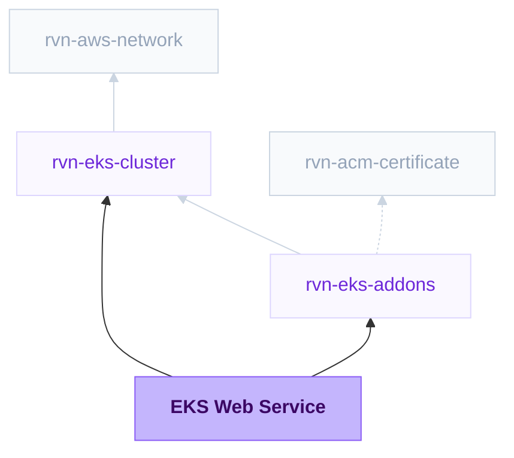

{/* Generated by scripts/sync-module-catalog.mjs from the Ravion module catalog. Do not edit by hand. */}

**Type:** `rvn-eks-web` / **Latest version:** `1.18.0`

## Dependencies and consumers

_Every dependency input can be specified manually to reference existing external infrastructure rather than a Ravion module. Set the dependency input to `null` and set its mapped inputs directly; see [Use existing infrastructure instead of a module reference](/config-as-code/project-config-file#use-existing-infrastructure-instead-of-a-module-reference)._

## Readme

Web server on EKS for running any HTTP application on your Kubernetes cluster behind a shared load balancer, with no Kubernetes manifests or Helm charts to write.

### Overview

EKS Web Service deploys a web app - any HTTP application in a container - to an existing Ravion EKS cluster. Point it at a Git repository or an image you already have, set the port, routing rules, health checks, and scaling in a form, and Ravion builds the image, deploys it, and routes traffic to it through the cluster's shared load balancer. There are no Kubernetes manifests to write and no Helm charts to maintain.

Under the hood, each deploy installs a Helm chart that Ravion maintains - a packaged template of the Kubernetes resources a web service needs. The `rvn-eks-web` chart renders the Deployment that runs your pods, the Service in front of them, a ServiceAccount, an optional HorizontalPodAutoscaler, and the `TargetGroupBinding` that puts your pods behind the load balancer. Each release runs `helm upgrade --install --atomic`, so a failed deploy rolls back to the previous revision on its own.

The module has three parts that update independently:

| Part | Owns | Changes when |
| ---- | ---- | ------------ |
| Terraform stack | Load balancer target group, listener rule, optional ECR repository, optional EKS Fargate profile, and the service address outputs | You change routing, health checks, the container port, build source, or compute target |
| Build | The container image, from a Dockerfile or Railpack | Every build, unless the build source is an existing registry image |
| Helm deploy | Deployment, Service, HPA, secrets wiring | Every release, and whenever runtime settings change |

Terraform owns the `aws_lb_target_group` and `aws_lb_listener_rule` against a shared load balancer, and the AWS Load Balancer Controller registers pod IPs into that target group. The chart does not create an Ingress, so no per-service load balancer is provisioned. This is the same routing shape as ECS Web Server, so a service moving from ECS keeps its routing model.

Chart source: [ravionhq/modules/charts/rvn-eks-web](https://github.com/ravionhq/modules/tree/rvn-eks-web@1.18.0/charts/rvn-eks-web)

Terraform source: [ravionhq/modules/compute/eks_service](https://github.com/ravionhq/modules/tree/rvn-eks-web@1.18.0/compute/eks_service)

### Use cases

| Scenario | EKS Web Service helps by... |
| -------- | --------------------------- |
| Running a public web app on Kubernetes | Routing host or path traffic through the shared public ALB |
| Hosting an internal HTTP API | Routing private traffic through the shared private ALB |
| Building from source | Creating images with a Dockerfile or Railpack and pushing to ECR |
| Moving a service from ECS to EKS | Keeping the same routing, health check, and `{name, value_from}` secret shape |
| Adopting Kubernetes without writing charts | Deploying a maintained chart you configure through a form |
| Handling variable traffic | Scaling pods with a HorizontalPodAutoscaler on CPU and optionally memory |

### Prerequisites

- An **EKS Cluster** module.
- An **EKS Add-ons** module attached to that same cluster. Enable the selected public or private ALB for load-balanced traffic, and enable KEDA before using Spot burst.
- The **External Secrets Operator** add-on, if the service uses Runtime secrets.

Both references must point at the same cluster. Ravion does not cross-check them, and a listener from a different cluster's VPC produces a target group that never reports a healthy pod.

### Cluster and load balancer

The EKS cluster reference supplies the AWS account, region, VPC, cluster ARN, cluster endpoint, certificate authority data, and the Ravion Runner role the deploy assumes to reach the Kubernetes API. The EKS add-ons reference supplies the shared ALB listeners.

Set **Load balancer** to **Public ALB** when the service should be reachable from the internet, or **Private ALB** for internal services on the shared private ALB. Either way, Ravion prefers the HTTPS listener when the selected ALB has one and falls back to HTTP. Choose **Cluster only** for an internal service that only other pods call: no target group or listener rule is created, and pods reach it at `<service name>.<namespace>`.

### Routing, readiness, and recovery

Route traffic with **Domain host rules**, **Path rules**, or both. If both are empty, Ravion creates a default `/*` path rule so the listener rule has a valid condition. Use **Listener rule priority** only when you need a specific rule order; otherwise AWS assigns the next available priority.

**Health check path** is the main application-health setting. It should be a lightweight, unauthenticated endpoint that succeeds only when the app can receive requests. Ravion uses it for both Kubernetes traffic readiness and the load balancer health check, so users configure that decision once even though both systems enforce it.

| Health checks | Default | Description |
| ------------- | ------- | ----------- |
| Container port | 8080 | Port the application listens on, also set as `PORT`; used by the Service and the target group |
| Health check path | / | Endpoint shared by Kubernetes readiness and the load balancer |
| Success codes | 200-399 | Status codes treated as healthy |
| Interval (secs) | 5 | Seconds between load balancer checks |
| Timeout (secs) | 4 | Seconds to wait for a response; must be lower than the interval |
| Healthy threshold | 2 | Successful checks before a target is healthy |
| Unhealthy threshold | 2 | Failed checks before a target is unhealthy |
| Readiness check interval (secs) | 1 | Seconds between Kubernetes readiness checks; a pod leaves traffic after about 30 seconds of failed checks |
| Initial delay (secs) | 0 | Seconds before the first readiness or liveness check |

**Startup and recovery** are optional and independent. Enable **Enforce startup timeout** to restart a container that never finishes starting; its **Maximum startup time** defaults to 150 seconds. A bad startup path or a timeout shorter than the app's real boot time causes a restart loop. Enable **Restart unresponsive containers** to restart a process that remains running but stops answering. Processes that exit are restarted automatically even when this setting is off.

The startup check can use its own **Startup health path**. When blank, it uses the liveness path if one is configured, otherwise the health check path. The optional **Liveness health path** should only confirm that the process itself is responsive; do not include database or external-service checks, because an outage in a dependency should not restart every pod.

| Traffic behavior | Default | Description |
| ---------------- | ------- | ----------- |
| Wait for load balancer health | true | Pods count as ready only once healthy in the target group (see Graceful shutdown) |
| Deregistration delay (secs) | 300 | Drain window for a pod that is shutting down |
| Slow start duration (secs) | 0 | Ramp window for newly registered pods; 0 disables, otherwise 30-900 |
| Sticky sessions | false | Load balancer cookie stickiness to the same pod |

### Build and image options

| Build source | When to use it |
| ------------ | -------------- |
| Dockerfile | Build from a Dockerfile in the selected repository |
| Railpack | Let Ravion detect the app stack and build an image from source with Railpack |
| Pull from image registry | Deploy an existing image from Docker Hub, GHCR, ECR, or another registry |

For Dockerfile and Railpack builds, provide **Git repository** and optionally **Source base path**. The stack creates an ECR repository named after the service, Ravion pushes each build to it, and the chart deploys the resulting digest. Nothing else needs configuring: the repository URL reaches the chart from the stack output, and nodes pull from same-account ECR with their own credentials, so no pull secret is involved.

**Railpack** settings optionally pin the Railpack version and override the install, build, and start commands. Leave them blank for Railpack's own detection.

Use **Build environment variables** for values the build itself needs - a private registry token, a source map upload key, a `NODE_ENV` that changes what gets compiled. Values can be plain strings or references loaded from Parameter Store or Secrets Manager. For Dockerfile builds, turn on **Inject environment variables in Dockerfile** to pass them to the build as Docker build arguments; without it they are visible to the builder but not to `docker build`.

These are separate from **Runtime environment variables** further down, and deliberately so: a credential needed to install dependencies has no business being in the running pod's environment, and a value the build bakes in does not need re-supplying at runtime. Anything both halves need has to be set in both places.

For **Pull from image registry**, provide the **Image repository** without a tag, such as `123456789012.dkr.ecr.us-east-1.amazonaws.com/api`, and use **Image pull secret names** for a private registry - each entry names a Kubernetes Secret of type `kubernetes.io/dockerconfigjson` that already exists in the release namespace.

Whichever source you choose, the deploy takes an **Image tag or digest**. A value beginning with `sha256:` is used as a digest and everything else as a tag. Pinning by digest is what makes a redeploy reproducible, and it is what a Dockerfile or Railpack build passes automatically.

Use **Start command** to override the image entrypoint and **Start command arguments** to override its default arguments. Both apply to built and pulled images alike.

### Builder settings

Builder settings apply to Dockerfile and Railpack builds only.

| Field | Default | Description |
| ----- | ------- | ----------- |
| Builder instance type | ec2 | Use EC2 for predictable availability or EC2 spot for lower cost |
| Builder instance size | c7a.4xlarge | EC2 instance size used for builds |
| Builder execution environment | Cluster value | Optional override for where image builds run |
| Builder AMI | Default image | Optional AMI override for build runners |

Start with the default builder size, then adjust based on build duration and the resource usage report at the end of a build.

**Scan images on push** asks ECR to run its basic vulnerability scan on every pushed image. **Force delete image repository** lets the repository be destroyed while it still holds images; without it, destroying the module fails until the repository is emptied.

### Resources and scaling

Kubernetes schedules on requests and enforces on limits. CPU is measured in cores or millicores: 1 is one vCPU and 100m is a tenth of one. Memory uses binary units: 256Mi, 1Gi (1024Mi).

| Field | Default | Description |
| ----- | ------- | ----------- |
| CPU request | 100m | CPU reserved for the pod; the autoscaler's CPU target is a percentage of this |
| Compute target | Automatic | Let Kubernetes choose, require EC2 on-demand or EC2 Spot, or create a dedicated EKS Fargate profile |
| CPU limit | - | Optional CPU ceiling. Leaving it blank lets a pod burst into spare node CPU |
| Memory request | 256Mi | Memory reserved for the pod |
| Memory limit | 512Mi | Memory ceiling; exceeding it terminates the container with OOMKilled |

**Fargate** creates a dedicated profile matching this service's namespace and standard app instance label. Fargate pods launch only in the selected cluster's private subnets and use on-demand capacity; EKS Fargate does not offer Spot pricing. Choose an EC2 target when you need Spot savings or node-level capabilities unavailable on Fargate.

Set the memory request close to steady-state usage and the limit above the worst legitimate spike. Because the CPU target is a percentage of the CPU request, a request set far above real usage keeps the autoscaler from ever scaling out.

Autoscaling is on by default with 2 minimum and 3 maximum pods, tracking 70% CPU. Add a **Memory target (%)** to scale on memory as well; the autoscaler then takes whichever metric asks for more pods. When autoscaling is off, **Pods** sets a fixed pod count.

#### KEDA Spot burst

**Spot burst** is optional and off by default. Enable it only with **Compute target** set to **EC2 on-demand**; configure **Baseline pods** (default 2, minimum 1), **Minimum Spot pods** (default 0), **Maximum Spot pods** (default 8, minimum 1), **Polling interval (secs)** (default 30), **Cooldown period (secs)** (default 300), and the required **KEDA triggers** array. The On-Demand baseline remains fixed while a separate Spot Deployment starts at the configured minimum. If that minimum is zero, CPU- or memory-only triggers cannot wake the pool; choose a signal that reports demand with no Spot application pods running, and set thresholds with baseline capacity in mind.

Select **KEDA** in the EKS add-ons module and apply the add-ons before enabling burst mode. Authentication resources and any referenced Kubernetes Secrets must be provisioned separately in the appropriate namespace or cluster scope. Put references, not credentials, in the trigger configuration; this module does not create trigger IAM permissions. KEDA 2.20.2's published Kubernetes test matrix covers versions 1.33–1.35; verify compatibility with newer clusters, including 1.36, in staging.

The Spot Deployment reuses the same image and pod configuration, while the web Service admits both pools when burst mode is active. Review application concurrency and request handling before enabling it; no application code or configuration is migrated automatically. Each active Spot pod and the KEDA controllers add cost, and Spot capacity may be interrupted or unavailable. A new Spot Deployment starts at the configured minimum. On Helm upgrades, its live replica count is preserved unless below that minimum; counts above the maximum are left for KEDA to reconcile. Offline renders show the configured minimum, and the deployment identity needs permission to read Deployments in the namespace. When the minimum is zero, no Spot image is exercised until KEDA activates it; verify readiness separately in staging. Validate permissions, trigger behavior, and scaling before production.

#### Zone-local routing

Pods are spread across the cluster's availability zones (a soft `topology.kubernetes.io/zone` spread constraint, so a small cluster never leaves pods pending), and the service's Kubernetes Service is created with `trafficDistribution: PreferClose`. Other workloads in the cluster that call this service by its Service name reach a pod in their own zone whenever one exists, and fall back to every zone otherwise, which keeps AWS cross-AZ data transfer charges off service-to-service traffic. Load balancer traffic is unaffected: the ALB registers pod IPs directly. To fully benefit, run at least as many pods as the cluster has zones. Needs Kubernetes 1.31 or later; older API servers ignore the field.

#### Service addresses

The stack publishes where this service can be reached, so other workloads can be pointed at it without assembling hostnames by hand.

| Output | Value | Notes |
| ------ | ----- | ----- |
| `service_host` | `{name}.{namespace}.svc.cluster.local` | In-cluster DNS name of the Kubernetes Service |
| `service_port` | Container port | Port the Service listens on |
| `service_url` | `http://{service_host}:{port}` | In-cluster URL; prefer it for service-to-service calls |
| `load_balancer_url` | `https://{host}` | URL through the shared load balancer |

Prefer `service_url` when the caller runs in the same cluster: traffic never leaves the VPC, skips the load balancer hop, and reaches same-zone pods first (see Zone-local routing above). The in-cluster values are derived from the service name, namespace, and port and do not depend on the load balancer, so they are known on the first apply, but the name resolves only after the first successful deploy creates the Service.

`load_balancer_url` is for callers outside the cluster. Its scheme and port follow the listener the service is attached to, HTTPS when the selected ALB has an HTTPS listener. Its host is the first **Domain host rule** without a wildcard when one is set, because a request to the bare load balancer hostname would not match a host-scoped rule; otherwise it is the load balancer's DNS name. For a public web service that is the public ALB, and for a private one the private ALB, which is reachable only from inside the VPC.

### Application configuration

Use **Runtime environment variables** for plain values, as an array of `{name, value}` objects.

Use **Deploy-provided environment variables** to allow a pipeline deploy step to set selected plain values. They cannot replace a Runtime environment variable or Runtime secret, and `PORT` is reserved for the web service.

Use **Runtime secrets** for sensitive values, as an array of `{name, value_from}` objects - the same shape as ECS, so a service migrating from ECS Web Server carries its secret configuration unchanged. `value_from` must be a full Secrets Manager or SSM Parameter Store ARN, including the JSON-key extraction suffix when you want a single key out of a JSON secret.

Ravion never reads these values. The ARNs travel to the chart as references, the chart renders an `ExternalSecret`, and the External Secrets Operator materializes the Kubernetes Secret in the cluster. No secret value reaches Ravion, the Helm values document, or the Helm release history.

### Deployment

Every deploy runs `helm upgrade --install --atomic`, so a release either lands completely or leaves the cluster on the previous revision. Pods roll with zero unavailable. **Maximum rollout surge (%)** defaults to 100%, allowing a full replacement set to start together when enough matching capacity is already available. Lower this advanced setting to limit temporary capacity. Existing explicitly configured surge values are retained.

### Graceful shutdown

A pod stops during every rollout, scale-in and node drain. The defaults make that invisible to clients of an ordinary HTTP service: at least two pods, spread across zones and nodes; a 10-second pre-stop delay; a load balancer readiness gate; a disruption budget; and a 30-second grace period. Services that hold long-lived connections, such as WebSockets or streaming responses, usually need a longer grace period to hand clients over to other pods. Four inputs control how a stop happens:

- **Stop timeout** sets how long a pod has after SIGTERM before it is killed. Size it to the longest drain the application performs.
- **Pre-stop delay** keeps the container running and serving for a few seconds before SIGTERM. Removing a pod from the load balancer target group happens asynchronously; without a delay, the application can start shutting down while the load balancer still routes new connections to it. The default is 10 seconds. It uses the Kubernetes native preStop sleep action, so the image needs no shell; on Kubernetes older than 1.30, which lacks the action, no hook is rendered. The delay counts against the grace period and must be shorter than it, or the deploy fails at render time.
- **Wait for load balancer health** adds the AWS Load Balancer Controller's pod readiness gate, one per target group binding, so a new pod counts as ready only once the target group reports it healthy. A rolling update then keeps old pods serving until their replacements actually receive traffic. The gate is declared on the pod itself, so the namespace needs no injection label; the controller the EKS Add-ons module installs sets the condition. On by default. Registration time depends on controller and target state, and initial registration can succeed after one successful load balancer check rather than healthy threshold multiplied by interval. A pod that never passes the check never becomes ready, so the deploy rolls back.
- **Disruption budget** renders a PodDisruptionBudget that keeps at least **Minimum available pods** running while nodes are drained, consolidated or upgraded. It is skipped while the minimum pod count (Minimum pods with autoscaling, Pods without) is not above that number, because such a budget allows no evictions and would block every drain. Pods that are not ready can always be evicted, so a crash-looping pod never holds a node. On by default. The budget does not affect rolling updates.

**Deregistration delay** still applies once the pod leaves the target group: it is how long the load balancer keeps in-flight requests to that pod open. Connections still open when the pod exits are closed regardless, so the effective drain window is the shorter of the deregistration delay and the stop timeout.

Deployments collapse: if several are queued, only the newest runs.

### Alarms

Load-balanced services get a CloudWatch alarm on `UnHealthyHostCount` for their own target group, on by default, named `<target group name>-unhealthy-hosts`. It fires when more targets than **Unhealthy hosts alarm threshold** (default 0) fail the load balancer health check for **Alarm evaluation periods** consecutive periods, using the period maximum. Periods with no data, such as before the first pod registers, do not breach. Add an SNS topic ARN under **Alarm actions** to be notified; without one the alarm only changes state. Load balancer wide alarms (ELB 5xx, response time) belong to the EKS add-ons module. Cluster-only services have no target group and get no alarm.

### Metrics and logs

The Metrics and Logs tabs follow the providers selected on the EKS add-ons module. You configure observability once, on that module, and every workload attached to it follows; there is nothing to set here.

Where several providers can serve the same signal they form a **fallback chain**, not a merge. The tab reads the first store that can answer right now and moves to the next when it cannot, saying which store it ended up using. Reading two stores at once would draw every line twice.

| Signal | Chain order |
| ------ | ----------- |
| Logs | In-cluster store (Loki) -> Amazon CloudWatch Logs |
| Metrics | Amazon Managed Prometheus -> Prometheus in your cluster -> CloudWatch Container Insights |

The practical effect is that the in-cluster store's one weakness stops being fatal. Loki is reached through the Ravion Operator, so with the agent offline those logs are unavailable - but if CloudWatch Logs is also selected, the tab shows CloudWatch and says so, then switches back when the agent returns.

Charts are the same five golden signals whichever store answers: CPU, memory working set, container restarts, network in, and network out, plus replicas available and desired. Two things differ on the CloudWatch link of the chain, and are worth knowing before you read a number off it:

- **CPU uses different units by provider.** Prometheus shows usage as a percentage of the running pods' CPU requests, matching the autoscaler's CPU target; CloudWatch reports cores. Other Prometheus charts sum across pods; CloudWatch averages across them.
- **It needs enhanced observability**, which the add-ons module turns on with CloudWatch by default. Without it, CPU and memory come back empty.

Replicas available falls back to Container Insights' running-pod count for this module's Kubernetes Service. Replicas desired has no CloudWatch equivalent, so with CloudWatch as the only metrics provider that one chart is empty.

The load balancer charts below the pod charts - request count, 4xx, 5xx, response time, healthy and unhealthy pods - come from the ALB this module's Terraform stack owns, not from the cluster's observability stack, so they are always present regardless of which providers are selected.

A provider that ships to a vendor rather than rendering in Ravion - Datadog, Grafana Cloud, New Relic, OpenSearch, Splunk, or a custom OTLP endpoint - adds an **Open in ...** action to the tab, pointing at this workload rather than at the vendor's front page.

Turning a signal off on the add-ons module empties the matching tab here.

### Configuration

| Field | Required | Default | Description |
| ----- | -------- | ------- | ----------- |
| Cluster | Yes | - | Existing rvn-eks-cluster module instance |
| EKS add-ons | Yes | - | Existing rvn-eks-addons module instance on the same cluster; enable KEDA there before using Spot burst |
| Service name | Yes | \{project\}-\{env\}-\{module\} | Helm release name and name of the Kubernetes and load balancer objects |
| Namespace | Yes | \{project\}-\{env\} | Kubernetes namespace the release installs into |
| Create namespace | No | true | Create the namespace if it does not exist |
| Load balancer | Yes | public | `public` or `private` for the shared ALBs, `kubernetes_service` for no load balancer |
| Build source | Yes | dockerfile | Dockerfile, Railpack, or Pull from image registry |
| Git repository | Yes* | - | Required for Dockerfile and Railpack builds |
| Source base path | No | . | Repository-relative source and build root |
| Dockerfile path | No | Dockerfile | Path to the Dockerfile, for Dockerfile builds |
| Docker build context path | No | . | Docker build context, for Dockerfile builds |
| Build environment variables | No | - | Values available during Dockerfile and Railpack builds |
| Inject environment variables in Dockerfile | No | false | Pass build environment variables to `docker build` as build arguments |
| Railpack version | No | Ravion default | Optional pin for Railpack builds |
| Install command | No | Railpack default | Optional Railpack dependency install command |
| Build command | No | Railpack default | Optional Railpack build command |
| Start command (Railpack) | No | Railpack default | Optional Railpack start command |
| Image repository | Yes* | - | Image repository without a tag; required for Pull from image registry |
| Image pull secret names | No | [] | Existing dockerconfigjson Secrets in the namespace, for Pull from image registry |
| Start command | No | [] | Overrides the image entrypoint |
| Start command arguments | No | [] | Overrides the image default arguments |
| Container port | Yes | 8080 | Port the application listens on |
| Health check path | Yes | / | Endpoint shared by Kubernetes readiness and the load balancer |
| Readiness check interval (secs) | No | 1 | Kubernetes readiness period; about 30 seconds of failed checks remove a pod from traffic |
| Initial delay (secs) | No | 0 | Delay before the first readiness or liveness check |
| Success codes | Yes | 200-399 | Health check status code matcher |
| Sticky sessions | No | false | Keep repeat requests on the same pod |
| Enforce startup timeout | No | false | Restart an app that does not finish starting in time |
| Maximum startup time (secs) | No | 150 | Startup time allowed before restarting the container |
| Startup health path | No | Health check or liveness path | Optional endpoint used while the app starts |
| Restart unresponsive containers | No | false | Restart a process that remains running but stops answering |
| Liveness health path | No | Health check path | Optional process-only health endpoint |
| Domain host rules | No | - | Hostnames such as app.example.com or *.example.com |
| Path rules | No | - | Path patterns such as /*, /api/*, or /app/* |
| Listener rule priority | No | Auto | Explicit ALB rule order |
| CPU request | Yes | 100m | CPU reserved per pod, in cores or millicores |
| Compute target | Yes | Automatic | Automatic, EC2 on-demand, EC2 Spot, or on-demand EKS Fargate placement |
| Spot burst | No | false | Optional KEDA-scaled Spot pool; available with EC2 on-demand and KEDA enabled |
| CPU limit | No | - | Optional CPU ceiling |
| Memory request | Yes | 256Mi | Memory reserved per pod |
| Memory limit | Yes | 512Mi | Memory ceiling per pod |
| Autoscaling | No | true | Scale pods with a HorizontalPodAutoscaler |
| Minimum pods | No | 2 | Lower bound when autoscaling; two keeps a pod stop from being an outage |
| Maximum pods | No | 3 | Upper bound when autoscaling |
| CPU target (%) | No | 70 | Average CPU utilization target |
| Memory target (%) | No | - | Optional average memory utilization target |
| Maximum rollout surge (%) | No | 100 | Extra pods during rolling updates; lower to limit temporary capacity |
| Pods | No | 2 | Fixed pod count when autoscaling is disabled |
| Baseline pods | No | 2 | Fixed On-Demand replicas during Spot burst; minimum 1 |
| Minimum Spot pods | No | 0 | Lower bound for the KEDA-managed Spot pool |
| Maximum Spot pods | No | 8 | Maximum Spot replicas during burst; minimum 1 |
| KEDA triggers | Yes (when Spot burst is enabled) | - | If Minimum Spot pods is zero, a trigger must work with zero Spot replicas; CPU or memory alone cannot wake the pool |
| Polling interval (secs) | No | 30 | KEDA trigger polling interval |
| Cooldown period (secs) | No | 300 | Delay before KEDA scales Spot replicas down |
| Stop timeout (secs) | No | 30 | Time a pod has after SIGTERM before it is killed, including the pre-stop delay |
| Pre-stop delay (secs) | No | 10 | Time a stopping pod keeps serving before SIGTERM, so the load balancer deregisters it first; must be less than the grace period |
| Disruption budget | No | true | Render a PodDisruptionBudget limiting voluntary evictions |
| Minimum available pods | No | 1 | Pods kept running during a node drain when the disruption budget is on |
| Runtime environment variables | No | - | Array of \{name, value\} objects |
| Runtime secrets | No | - | Array of \{name, value_from\} ARN references |
| Deploy-provided environment variables | No | - | Names a pipeline deploy step may set to plain values |
| Create IAM role | No | false | Create an IAM role for the workload and bind it to its pods through EKS Pod Identity |
| IAM role name | No | \{service\}-task | Explicit role name, for a service whose ECS task role already holds the default |
| IAM policy ARNs | No | [] | Managed policy ARNs attached to the workload role |
| IAM inline policies | No | - | Inline policy documents keyed by name, the ECS task role shape |
| Builder instance type | No | ec2 | EC2 or EC2 spot capacity for builds |
| Builder instance size | No | c7a.4xlarge | EC2 instance size used for builds |
| Builder execution environment | No | Cluster value | Optional override for where builds run |
| Builder AMI | No | Default image | Optional AMI override for build runners |
| Scan images on push | No | true | ECR basic vulnerability scan on every push |
| Force delete image repository | No | false | Allow destroying the repository while it holds images |
| Create CloudWatch alarms | No | true | Alarm on unhealthy targets in this service's target group |
| Unhealthy hosts alarm threshold | No | 0 | Unhealthy targets (period maximum) above which the alarm fires |
| Alarm evaluation periods | No | 2 | Consecutive periods that must breach |
| Alarm period | No | 300 | Seconds per period: 60, 300, 900 or 3600 |
| Alarm actions / OK actions | No | [] | ARNs notified on alarm and recovery, such as an SNS topic |
| Tags | No | Standard Ravion tags | Additional tags applied to the load balancer and ECR resources |
| Advanced Terraform variables | No | \{\} | Raw lower-level overrides for exceptional cases |
| OpenTofu version override | No | Ravion default | Override the OpenTofu version for the stack |
| Ravion Terraform workspace name | No | \{project\}-\{env\}-\{module\} | Override the state backend workspace name |

### Design decisions

- **The chart emits no Ingress.** Terraform owns the target group and listener rule so one shared load balancer serves many services, matching ECS Web Server. An Ingress-driven ALB per service would be simpler to configure and considerably more expensive.
- **One target group, no blue/green.** ECS Web Server keeps a production and an alternate target group so the ECS controller can shift traffic between them. EKS releases roll through the Kubernetes Deployment controller instead, so there is no alternate target group and no traffic-shift strategy to choose.
- **`helm upgrade --atomic`.** A failed release reverts rather than leaving the cluster half-updated. The tradeoff is that a failing deploy takes the full rollout timeout before it reports failure.
- **One ECR repository per module, created only when Ravion builds.** A build needs somewhere to push, and a per-module repository keeps image lifecycle and access scoped to the service. On the Pull from image registry path nothing is built, so no repository is created.
- **One Fargate profile per Fargate workload.** The profile selects only this release's namespace and app instance label, while an explicit pod label chooses it when profiles overlap. Automatic and EC2 targets create no profile.
- **No Nixpacks.** ECS still carries a Nixpacks build source for services created before Railpack existed. EKS has no such history, so Dockerfile and Railpack are the only builders.
- **Service name and container port are fixed after creation.** Both feed target group identity; changing them would orphan the existing target group and its registrations.
- **Pod Identity, not IRSA.** The chart emits a stable ServiceAccount name and no role annotation. With **Create IAM role** on, the stack creates the role and an `aws_eks_pod_identity_association` binding it to that ServiceAccount by namespace and name; the trust policy is pinned to this cluster and account. No IAM OIDC provider is involved.

### Learn more

- [Amazon EKS](https://docs.aws.amazon.com/eks/latest/userguide/what-is-eks.html)
- [AWS Fargate profile](https://docs.aws.amazon.com/eks/latest/userguide/fargate-profile.html)
- [Kubernetes Deployments](https://kubernetes.io/docs/concepts/workloads/controllers/deployment/)
- [Configure liveness, readiness and startup probes](https://kubernetes.io/docs/tasks/configure-pod-container/configure-liveness-readiness-startup-probes/)
- [HorizontalPodAutoscaler](https://kubernetes.io/docs/tasks/run-application/horizontal-pod-autoscale/)
- [AWS Load Balancer Controller TargetGroupBinding](https://kubernetes-sigs.github.io/aws-load-balancer-controller/latest/guide/targetgroupbinding/targetgroupbinding/)
- [External Secrets Operator](https://external-secrets.io/)

## Inputs reference

All inputs for `rvn-eks-web` version `1.18.0`. Use the `name` shown for each field as the input key in module config.

- [Inputs: EKS cluster to networking and deployment](/module-definitions/catalog/rvn-eks-web/inputs-eks-cluster) — EKS cluster, Web service, Domains, Build config, Dockerfile, Railpack, Image, Health check, Startup and liveness, HTTP listener rules, Container resources, Autoscaling, Environment variables, IAM roles and policies, Networking and deployment
- [Inputs: Alarms to terraform settings](/module-definitions/catalog/rvn-eks-web/inputs-alarms) — Alarms, Builder config, Image registry lifecycle, Misc, Terraform settings
