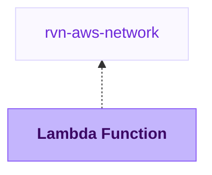

{/* Generated by scripts/sync-module-catalog.mjs from the Ravion module catalog. Do not edit by hand. */}

**Type:** `rvn-lambda` / **Latest version:** `2.3.0`

## Dependencies and consumers

_Every dependency input can be specified manually to reference existing external infrastructure rather than a Ravion module. Set the dependency input to `null` and set its mapped inputs directly; see [Use existing infrastructure instead of a module reference](/config-as-code/project-config-file#use-existing-infrastructure-instead-of-a-module-reference)._

## Readme

AWS Lambda function with zip or container image deployments, alias-based releases, IAM, logs, and optional function URLs.

### Overview

The Lambda Function module creates an AWS Lambda function, execution role, CloudWatch log group, optional artifact bucket, and a live alias that Ravion updates during deployments. Terraform provisions the long-lived function infrastructure with either a bootstrap zip package or a bootstrap container image. Deployments publish a new function version and move the live alias.

Terraform source: [ravionhq/modules/compute/lambda](https://github.com/ravionhq/modules/tree/rvn-lambda@2.3.0/compute/lambda)

### Deployment and rollback

Rollbacks move the live alias to an existing published version, restoring its code and function configuration without rebuilding. Function URLs and event source mappings invoke that alias. Terraform does not reset the live alias version after deployment or rollback; other aliases remain Terraform-managed. Only invocations through the deployment alias follow rollback; unqualified invocations use $LATEST.

AWS_IAM function URL callers need lambda:InvokeFunctionUrl and lambda:InvokeFunction on the live alias ARN. Public (NONE) URLs receive alias-qualified permissions restricted to URL invocations.

Image rollback targets must have a recorded digest that still exists in ECR. Keep rollback images outside destructive ECR lifecycle rules.

### Use cases

| Scenario | Lambda Function helps by... |
| -------- | --------------------------- |
| Event handlers | Running code from queues, streams, schedules, or custom invoke permissions |
| Lightweight APIs | Exposing a function URL when API Gateway is not required |
| Background tasks | Running short-lived compute without managing servers or containers |
| Zip deployments | Building a package from Git and promoting it through a stable alias |
| Container image deployments | Building or deploying Lambda-compatible images from Amazon ECR |

### Build and deployment

Lambda type and package type are immutable after creation. Lambda@Edge functions must be created in us-east-1, and AWS Lambda does not support changing an existing function between zip packages and container images.

For zip package functions, builds use a Dockerfile to produce Lambda package contents from the selected Git repository. The build uploads a zip file to the module-managed code bucket. Deployments take an S3 object key, update the Lambda function code, publish a new version, and move the live alias to that version.

If Build source is Pull from S3 for zip packages, Ravion skips the build step and you provide an existing S3 object key at deploy time.

For container image functions, Nixpacks and Dockerfile builds produce a Lambda-compatible container image, push it to a module-managed ECR repository, and deployments promote a tag or digest from that repository. Pull from image registry skips the build step and promotes a tag or digest from the ECR repository configured on the module. Image start command, entry point, and working directory overrides are optional; leave them empty to use the image defaults.

Terraform creates image package functions by pushing a small Lambda-compatible bootstrap image into a module-managed ECR repository during the same apply. For Pull from image registry, that bootstrap image lets the function be created before the first deployment promotes the configured ECR image tag or digest.

### Function configuration

Runtime, handler, memory, timeout, architecture, environment variables, layers, tracing, image config, and ephemeral storage are managed by the stack. Handler, runtime, layers, code signing, SnapStart, Lambda@Edge constraints, and the code bucket apply only to zip package functions. Change these settings through a stack change so Terraform remains the source of truth for function configuration. The deploy step focuses on code promotion.

### Networking and integrations

Connect to a VPC when the function needs private subnet access to databases, caches, or internal services. Invoke permissions let AWS services or accounts call the function. Event source mappings connect queues and streams directly to the function. File systems mount EFS access points under /mnt paths.

### Configuration

| Section | Field | Required | Default | Notes |
| ------- | ----- | -------- | ------- | ----- |
| AWS account & region | AWS account | Yes | none | Account where Lambda resources are created |
| AWS account & region | Region | Yes | none | Region for the Lambda function and code bucket |
| Lambda function | Function name | Yes | Generated from project, environment, and module IDs | Immutable AWS function name |
| Lambda function | Lambda type | Yes | Regional Lambda | Immutable because Lambda@Edge must be created in us-east-1 |
| Lambda function | Package type | Yes | Zip package | Immutable AWS package type |
| Lambda function | Handler | Zip only | index.handler | Zip package entrypoint |
| Lambda function | Runtime | Zip only | nodejs24.x | Lambda runtime string |
| Lambda function | Memory | Yes | 128 MB | Also affects CPU allocation |
| Lambda function | Timeout | Yes | 5 seconds | Maximum invocation runtime |
| Build config | Build source | Yes | Dockerfile | Zip packages support Dockerfile, Nixpacks, or Pull from S3. Container images support Dockerfile, Nixpacks, or Pull from image registry |
| Build config | Git repository | Required for builds | none | Source repository for Nixpacks and Dockerfile builds |
| Build config | Image repository | Pull from image registry only | none | Existing ECR repository URI without a tag or digest |
| Build config | Start command | No | Image default | Optional image CMD override |
| Build config | Package output directory | Required for zip builds | /app | Directory zipped and uploaded |
| Networking | Connect to a VPC | No | false | Shows subnet and security group fields |
| IAM role | Create IAM role | No | true | Use an existing role by turning this off |
| Logs | Create log group | No | true | Creates /aws/lambda/\{function name\} by default |
| Logs | Log retention days | No | 365 | CloudWatch retention; 0 retains logs indefinitely |
| Function URL | Enable function URL | No | false | Creates an HTTPS endpoint for direct invokes |
| IAM permissions | Invoke permissions | No | [] | Allows services or accounts to invoke the function |
| Event sources and aliases | Event source mappings | No | [] | Connects queues or streams to the function |
| Image registry lifecycle | Scan images on push | No | true | ECR basic vulnerability scanning for the module-managed repository |
| Terraform settings | Advanced Terraform variables | No | \{\} | Escape hatch for uncommon Terraform inputs |

### Design decisions

- Lambda type is immutable. Create a new Lambda module/function to migrate between Regional Lambda and CloudFront Lambda@Edge, especially when the existing function is outside us-east-1.
- Package type is immutable. Create a new Lambda module/function to migrate between zip packages and container images.
- Zip package functions use the Lambda build pipeline to upload zip packages to S3 and the Lambda deploy manager to promote those packages.
- Container image functions use the image build pipeline to push Dockerfile or Nixpacks builds to ECR. Pull from image registry promotes tags or digests from an existing ECR repository.
- Terraform creates a bootstrap zip package for zip functions and creates image package functions with a bootstrap image in the module-managed ECR repository.
- Runtime configuration stays in Terraform to avoid deploy-time configuration drift.
- The zip code bucket is versioned, but the build output currently passes the S3 key as the primary deploy input.

### Error-rate monitoring

Invocation error-rate alarms are enabled by default in Ravion. The default is at least 1% failed invocations over one 5-minute period. Idle functions do not alert. Configure notification action ARNs or an external EventBridge relay to receive alerts.

For Lambda@Edge, select every additional execution region and provide regional action ARN overrides. The origin-region alarm is always included; it alone does not cover worldwide traffic. Add regions as traffic expands. These alarms monitor invocation failures, not HTTP status codes returned by application code or throttled requests.

### Learn more

- [AWS Lambda developer guide](https://docs.aws.amazon.com/lambda/latest/dg/welcome.html)
- [Configuring Lambda functions](https://docs.aws.amazon.com/lambda/latest/dg/configuration-function-common.html)
- [Lambda function URLs](https://docs.aws.amazon.com/lambda/latest/dg/urls-configuration.html)
- [Lambda event source mappings](https://docs.aws.amazon.com/lambda/latest/dg/invocation-eventsourcemapping.html)

## Inputs reference

All inputs for `rvn-lambda` version `2.3.0`. Use the `name` shown for each field as the input key in module config.

- [Inputs: AWS account & region to builder config](/module-definitions/catalog/rvn-lambda/inputs-aws-account-region) — AWS account & region, Lambda function, Zip package, Build config, Dockerfile, Nixpacks, Runtime configuration, Environment variables, VPC config, IAM permissions, CloudWatch alarms, Logs, Function URL, Event sources and aliases, Advanced Lambda settings, Builder config
- [Inputs: Image registry lifecycle to terraform settings](/module-definitions/catalog/rvn-lambda/inputs-image-registry-lifecycle) — Image registry lifecycle, Misc, Terraform settings
