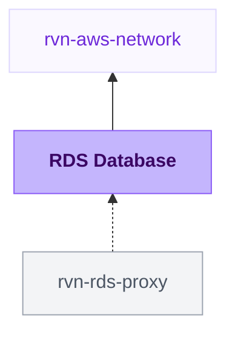

{/* Generated by scripts/sync-module-catalog.mjs from the Ravion module catalog. Do not edit by hand. */}

**Type:** `rvn-rds` / **Latest version:** `1.4.1`

## Dependencies and consumers

_Every dependency input can be specified manually to reference existing external infrastructure rather than a Ravion module. Set the dependency input to `null` and set its mapped inputs directly; see [Use existing infrastructure instead of a module reference](/config-as-code/project-config-file#use-existing-infrastructure-instead-of-a-module-reference)._

## Readme

Creates and manages an Amazon RDS database. Supports PostgreSQL, MySQL, MariaDB, Oracle, and SQL Server engines.

### Overview

Use this module when an application needs a managed relational database in AWS. It provisions an RDS instance with subnet placement, security group access, backups, monitoring, optional read replicas, and CloudWatch alarms.

The module supports PostgreSQL, MySQL, MariaDB, Oracle, and SQL Server engines. Aurora uses a different AWS resource model and is not configured by this module.

### Use cases

| Scenario | Benefit |
| --- | --- |
| Application database | Create a private RDS instance attached to an existing Ravion VPC network. |
| Production database | Enable Multi-AZ, deletion protection, automated backups, performance insights, and CloudWatch alarms. |
| Read-heavy workload | Add read replicas for supported engines. |
| Sensitive data | Keep public access disabled, use encryption, manage credentials in Secrets Manager, and restrict ingress. |

### Networking

Select a VPC network first. Ravion maps the network's AWS account, region, VPC ID, and private subnet IDs into this module. The database subnet group uses the selected private subnets by default.

Public access is disabled by default. Keep it disabled for normal application databases and allow access through security group IDs from application services or controlled CIDR blocks.

### Database engine and sizing

Choose the engine, optional engine major version, optional engine minor version, instance class, and allocated storage. If engine major version is blank, AWS selects the latest available version for that engine.

Storage type defaults to gp3. Max allocated storage controls RDS storage autoscaling; keep it at 0 to disable autoscaling. AWS supports increasing allocated storage after creation, but not reducing it in place.

### Credentials and security

Manage password in Secrets Manager is enabled by default, so AWS creates and stores the master password for the database. Before importing a database whose existing password is managed outside Secrets Manager, disable password management and enable Preserve existing master password. Leaving password management enabled causes AWS to generate a new master password. Preservation verifies that the named database already exists in AWS, preventing a new database from reaching AWS without any source of master credentials.

Storage encryption is enabled by default. Provide a storage KMS key ARN when you need a customer-managed key for storage. IAM database authentication is shown only for MySQL and PostgreSQL.

### Availability, backups, and maintenance

Multi-AZ creates a standby in another availability zone for failover. The single availability zone field is hidden when Multi-AZ is enabled. Read replicas are shown only for engines that support RDS read replicas and are hidden for SQL Server.

Automated backups default to 7 days. You can set the backup window and control final snapshot behavior. Deletion protection is enabled by default.

Automatic minor engine version upgrades are configured next to the engine version fields and, when enabled, happen during the configured maintenance window. Major version upgrades and immediate changes are opt-in.

### Observability

Performance insights is enabled by default with 7 days of retention. Enhanced monitoring can be enabled by setting a monitoring interval.

CloudWatch alarms are optional. When enabled, the module can alarm on CPU utilization, free storage space, database connections, and read/write IOPS on the primary instance. Tune the default 1000 IOPS thresholds to the workload and storage capacity. IOPS alarm periods are at least 1 minute. Supply alarm action ARNs to receive notifications. The free storage alarm threshold is entered in GiB in Ravion and converted to bytes for Terraform. The Ravion UI also shows RDS CloudWatch metrics for CPU, free storage, connections, read IOPS, and write IOPS.

### Connection pooling

Enable RDS Proxy to place a managed connection pool in front of the database. The proxy authenticates with the Secrets Manager master user secret by default, requires TLS, and allows the same security group and CIDR sources configured for the database. Pool sizing, idle timeouts, session pinning, IAM authentication, and custom auth secrets are configurable in the Connection pooling section. RDS Proxy is not available for Oracle engines.

Creating the proxy does not change how applications reach the database. Update your application connection string to the proxy endpoint output to route traffic through the pool.

### Configuration

| Field | Required | Default | Notes |
| --- | --- | --- | --- |
| VPC network | Yes | None | Supplies AWS account, region, VPC ID, and private subnet IDs. |
| Name slug | Yes | Project and environment given IDs | Prefix for RDS resources. |
| Engine | Yes | postgres | PostgreSQL, MySQL, MariaDB, Oracle, and SQL Server variants are supported. |
| Engine major version | Yes | None | Sets the RDS major engine version, such as 15 for PostgreSQL or 8.0 for MySQL. |
| Engine minor version | No | Blank | Appended to the major version when an exact version is required. |
| Auto minor version upgrades | No | true | Applies minor engine upgrades during the configured maintenance window. |
| Instance class | Yes | db.t4g.micro | Use a larger RDS class such as db.r6g.large for production workloads. |
| Allocated storage | Yes | 20 | Storage in GiB. |
| Master username | Yes | dbadmin | Master database user. Do not use reserved engine words such as admin. |
| Storage KMS key ARN | No | Blank | Uses a customer-managed KMS key for storage encryption. |
| Initial database name | No | Blank | Creates an initial database when supported by the engine. Reserved RDS engine words such as database are blocked. |
| Publicly accessible | No | false | Leave disabled unless public database access is intentional. |
| Security group creation | No | true | Creates ingress rules from allowed security groups and CIDRs. |
| Multi-AZ | No | false | Enables high availability standby. |
| Read replicas | No | false | Creates read replicas when supported by the engine. |
| Manage password in Secrets Manager | No | true | Stores generated master credentials in AWS Secrets Manager. Disable before importing an externally managed password. |
| Preserve existing master password | No | false | Verifies the database exists in AWS and leaves its externally managed password unchanged. |
| Backup retention days | No | 7 | Set to 0 to disable automated backups. |
| Deletion protection | No | true | Helps prevent accidental deletion. |
| Performance insights | No | true | Enables AWS Performance Insights. |
| CloudWatch alarms | No | true | Adds CPU, free storage, connection, and read/write IOPS alarms. |
| Free storage alarm threshold | No | 5 GiB | Converted to bytes before Terraform runs. |
| RDS Proxy | No | false | Creates an RDS Proxy connection pool in front of the database. Not available for Oracle engines. |
| Tags | No | Blank | Merged with Ravion standard tags. |

### Advanced configuration

Use parameter group settings for engine parameters. Oracle settings and SQL Server settings are shown in separate engine-specific sections. Option group settings are shown only for Oracle and SQL Server engines; blue/green updates are shown only for MySQL and MariaDB. Use advanced Terraform variables for one-off overrides not represented directly in the UI. Values in advanced Terraform variables override generated variables.

Terraform settings let you override the OpenTofu version, Terraform execution environment inherited from the VPC network, and Ravion state backend workspace name.

### Design decisions

RDS instances are placed in private subnets by default through the VPC network reference. Secrets Manager password management, encryption at rest, performance insights, and deletion protection default on because they are safer defaults for long-lived databases.

The module keeps primary database choices visible and tucks optional engine, engine-specific, storage, backup, monitoring, maintenance, parameter group, and option group details behind collapsible controls. Source repository and stack plumbing remain managed by Ravion.

### Learn more

- [Amazon RDS documentation](https://docs.aws.amazon.com/rds/)
- [RDS DB instance classes](https://docs.aws.amazon.com/AmazonRDS/latest/UserGuide/Concepts.DBInstanceClass.html)
- [RDS security](https://docs.aws.amazon.com/AmazonRDS/latest/UserGuide/UsingWithRDS.html)
- [RDS monitoring](https://docs.aws.amazon.com/AmazonRDS/latest/UserGuide/CHAP_Monitoring.html)
- [Terraform source](https://github.com/ravionhq/modules/tree/rvn-rds@1.4.1/database/rds)

## Inputs reference

All inputs for `rvn-rds` version `1.4.1`. Use the `name` shown for each field as the input key in module config.

- [Inputs](/module-definitions/catalog/rvn-rds/inputs) — Inputs, Database, Version, Size & Storage, Network access, Connection pooling, Availability & replicas, Credentials & authentication, SQL Server settings, Oracle settings, Backups, Maintenance, Monitoring, CloudWatch alarms, Parameter group, Option group, Blue/green deployments, Misc, Terraform settings
