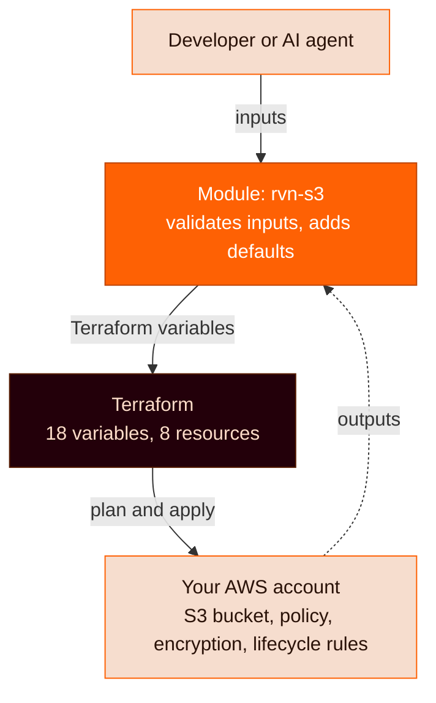
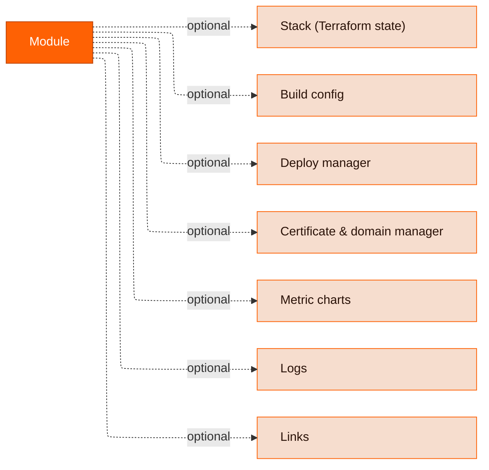
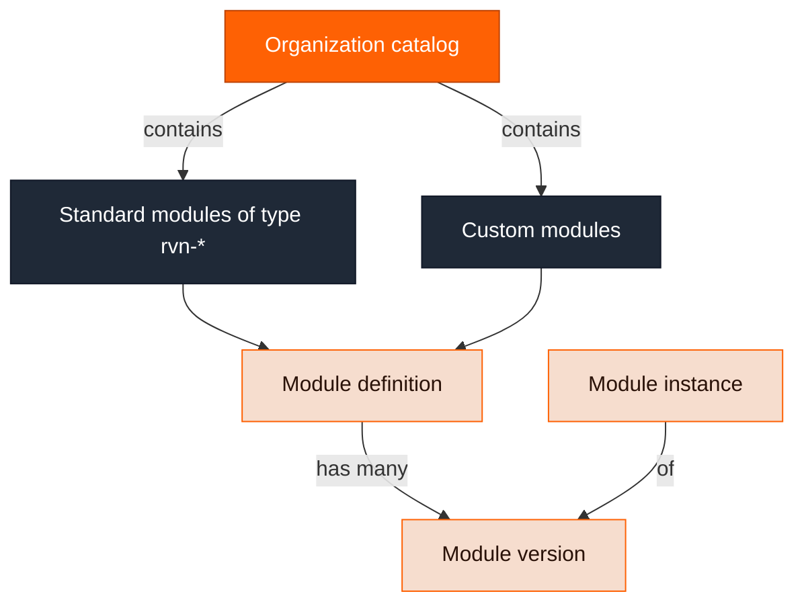

A module is the core primitive in Ravion for both tracking and managing your services and supporting infrastructure.

## A module is an abstraction layer over Terraform

Developers and AI agents shouldn't work with Terraform directly. It's too easy to get a resource wrong, drift from your standards, or break production. Instead, they describe what they need in a simple YAML file or form. Ravion translates that into pre-vetted Terraform modules that your platform team controls, and runs them in your cloud account.



Here's what happens when someone creates an S3 bucket with the [`rvn-s3`](/module-definitions/catalog/rvn-s3) module:

1. **The developer configures.** They pick **S3 Bucket** from the catalog and fill in a short form: a bucket name, versioning, and maybe a lifecycle rule. The same inputs work from the dashboard, the [project config file](/config-as-code/project-config-file), the CLI, the API, or an AI agent.
2. **The module translates.** The module definition validates the inputs, fills in secure defaults (private, encrypted, versioned), and maps each input to a Terraform variable with a [template expression](/module-definitions/definition-schema/template-expressions) such as `<< module.input.name >>`.
3. **Terraform provisions.** Ravion runs plan, approval, and apply against the module's Terraform code in a [stack](/modules/stack) change pipeline. For `rvn-s3`, that's 18 variables and 8 AWS resources the developer never has to write.
4. **Resources land in your cloud account.** The stack's outputs, such as the bucket name and ARN, flow back to the module, where you see them and where [other modules can reference them](/modules/output-references).

### What each layer looks like

The same setting, versioning, appears at every layer. Each layer is written by a different person:

<CodeGroup>

```yaml ravion.yaml (developer)
environments:
  - givenId: production
    name: Production
    moduleInstances:
      - givenId: uploads
        name: Uploads bucket
        type: rvn-s3
        version: 2.1.0
        input:
          aws_account_id: acme-prod
          aws_region: us-east-1
          name: acme-prod-uploads
          versioning_enabled: true
```

```yaml rvn-s3-definition.yml (module author)
module:
  inputs:
    - id: versioning_enabled
      label: Versioning
      description: Keep multiple versions of objects in the bucket.
      type: boolean
      default: true
  stack:
    type: opentofu
    pipelines:
      defaults:
        input:
          # Other pipeline inputs (repo, base_path, tool, ...) omitted
          terraform_variables:
            name: << module.input.name >>
            versioning_enabled: << module.input.versioning_enabled >>
```

```hcl variables.tf (Terraform)
variable "versioning_enabled" {
  type        = bool
  description = "Whether to enable versioning for the S3 bucket."
  default     = true
}

resource "aws_s3_bucket_versioning" "this" {
  # ...
}
```

</CodeGroup>

### Who works at which layer

| Layer                 | Who works here                                                       | What they care about                                                    |
| --------------------- | -------------------------------------------------------------------- | ----------------------------------------------------------------------- |
| **Module instance**   | Developers and AI agents                                             | "I need a private bucket for uploads." Inputs, status, outputs, logs.   |
| **Module definition** | Your platform team, or Ravion for the [standard library](/module-definitions/standard-library) | Which inputs to expose, defaults, validation, and versioning.           |
| **Terraform code**    | Your platform team, or Ravion for the standard library               | Providers, resources, and state.                                        |

A developer only needs the first layer. A platform team can work at all three.

### Why put a layer between developers and Terraform

- **Self-service without Terraform expertise.** Developers create infrastructure from a form or a few lines of YAML. They don't need to know which eight resources make up a secure S3 bucket.
- **Guardrails you control.** The module definition decides which inputs exist, what values are valid, and what the defaults are. Inputs that fail the definition's validation rules are rejected before Terraform runs.
- **One path for every change.** Every change runs through a stack pipeline that plans and applies Terraform, with approval following that pipeline's rules. Nobody needs to run `terraform apply` from a laptop.
- **Improve once, roll out everywhere.** Module definitions are versioned with semver. Fix or improve a module once, then upgrade each instance to the new version.
- **More than infrastructure.** The same module also carries the build, deploy, logs, metrics, and links for the service it creates.

### It's not a black box

The abstraction hides Terraform from developers who don't need it, not from people who do:

- Every module with a stack shows the full Terraform plan, the provisioned resources, and the state history. See [Stack](/modules/stack).
- Most standard-library modules, including `rvn-s3`, include an **Advanced Terraform variables** input (`advanced_terraform_variables`) that overrides generated Terraform variables for one-off cases. [`rvn-stack`](/module-definitions/catalog/rvn-stack) is the exception: it takes Terraform variables directly through its `tf_variables` input.
- You can [write your own module definitions](/module-definitions/definition-schema) around your own Terraform, or [run existing Terraform as-is](/migrate/existing-terraform-stack) with the `rvn-stack` module.

## Module capabilities

A module's definition determines which **capabilities** its instances have — a Terraform stack, build config, deploy manager, and so on:



For example, our **VPC Network** module has only a stack. But the **ECS Web Server** module has _all_ of the above capabilities.

For how modules relate to stacks, deploys, and pipelines, see [Core concepts](/concepts/core-concepts).

By default, you have access to the Ravion [standard library](/module-definitions/standard-library) of module definitions. You can see the available module definitions via the _Catalog_ page in the dashboard or via the `/module-definitions` endpoint.

You can also create your own module definitions.

## Module hierarchy

_Catalog_ is used to refer to the module definitions available to your organization. These include the Ravion [standard library](/module-definitions/standard-library) of modules with type `rvn-*` and any custom modules you've added.

Module definitions are versioned with semver, and each module instance is an instance of a specific version.


