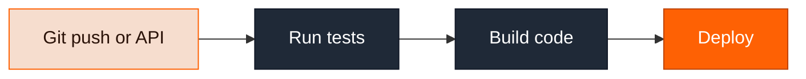
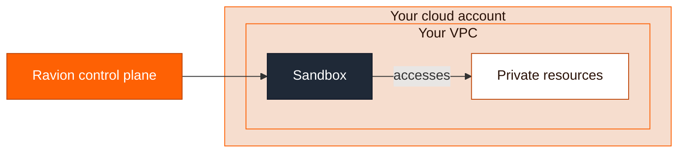

Ravion CI pipelines are a full CI/CD system that runs in your AWS account. Use them to replace CircleCI, GitHub Actions, or another CI/CD service for builds, tests, deployments, and other automation — not just deployments to Ravion modules.

If you want to keep your existing GitHub Actions workflows, you can run their jobs on [Ravion's GitHub Actions runners](/github-actions/runners) instead.

## Choose how to run CI/CD

| Option | Who manages the workflow? | Choose it when |
| --- | --- | --- |
| **Ravion CI pipelines** | Ravion orchestrates the steps you define in a [pipeline config](/config-as-code/pipeline-config-file). | You want to replace your CI/CD service and manage builds, tests, and deploys in Ravion. |
| **[GitHub Actions on Ravion](/github-actions/runners)** | GitHub Actions orchestrates your existing workflows; Ravion provides the runners in your AWS account. | You want to keep GitHub Actions workflows and actions while moving job execution to Ravion. |

[Stack pipelines](#stack-pipelines) automate Terraform or OpenTofu changes for your modules. They run alongside either CI/CD option, rather than replacing your build and test workflows.

## Ravion CI pipelines

Define your workflow as a sequence of [steps](/pipelines/step-types), then trigger it from a git push, the [API](/api-reference/overview), or manually. You can:

- Run tests, lint checks, scripts, or other commands with [custom steps](/pipelines/step-types#custom).
- Build container images or static assets and publish them to ECR or S3 with [CI steps](/pipelines/step-types#ci-steps).
- Build and deploy [Ravion modules](/concepts/modules) using their existing configuration.
- Add [approval gates](/pipelines/step-types#approval), run dependent work in sequence, and run independent steps in [parallel](/pipelines/step-types#blocks).

Use [sandboxes](/concepts/sandboxes) for pipeline steps and module builds by default. Choose native EC2 only when you need features such as a custom AMI.

A build, test, and deploy workflow can look like this:



### Why use Ravion CI pipelines?

- Manage builds, tests, deployments, and infrastructure through one dashboard, [CLI](/cli/overview), and [API](/api-reference/overview).
- Run steps in your own VPC so they can reach private databases and image registries without exposing them publicly.
- Keep module build configuration alongside runtime configuration and reuse it in your pipelines.

## GitHub Actions on Ravion

Keep your GitHub Actions workflow files, jobs, and actions. Change a job's `runs-on` label to run it on a Ravion runner in your AWS account. GitHub Actions still controls the workflow; Ravion starts and removes the runner for each job.

Sandbox jobs use the same sandbox fleet as Ravion CI pipeline steps. For jobs that need ARM or a whole instance, you can use [EC2 runners](/github-actions/runners#ec2) instead, without disk caching. Neither option requires rewriting your workflow as a Ravion pipeline.

<Note>
  GitHub Actions runners are in private preview. See [GitHub Actions runners](/github-actions/runners) for setup and how to request access, and [Caching](/github-actions/caching) for disk and Actions cache support.
</Note>

## Stack pipelines

A [stack](/modules/stack) holds the Terraform or OpenTofu state behind a module instance. Every stack has two pipelines attached:

| Pipeline | What it does | Runs when |
| --- | --- | --- |
| **Change** | Plan infrastructure changes, evaluate approval rules, and apply the plan. | Infrastructure configuration changes or you trigger a stack run. |
| **Destroy** | Plan infrastructure removal, request approval, and apply the destroy plan. | You delete the module. |

Ravion provides managed system pipelines by default. Your platform team can [substitute custom pipelines](/modules/stack#system-pipelines-and-customization) to add policy checks, notifications, or different approval rules.

Stack pipelines use the same pipeline engine as your CI workflows, with steps, logs, and results in your run history. A **stack change pipeline run** is an infrastructure workflow, not your application's build or test pipeline. You can use stack pipelines whether your CI runs in Ravion, GitHub Actions, or another service.

See [Stacks change through pipelines](/modules/stack#stacks-change-through-pipelines) for approval behavior and the full lifecycle.

## Organize your Ravion CI pipelines

### One pipeline, many environments

A pipeline describes a workflow, not an environment. Don't create a "Production pipeline" and a "Staging pipeline" — create one pipeline named after what it does, like **Build & Deploy**, and add a [variant](/pipelines/variants) per environment. Steps reference module instances through `<< pipeline.variant.id >>`, so the same steps deploy to whichever environment a run targets:

```yaml
variants:
  - id: production
    name: Production
  - id: staging
    name: Staging
steps:
  - id: deploy_web_app
    type: deploy
    # resolves to production.web-app or staging.web-app
    module_instance: << pipeline.variant.id >>.web-app
```

### One workflow per pipeline

A pipeline should contain steps that depend on each other. If two sets of steps never consume each other's outputs and never need to wait on each other, they are separate workflows — make them separate pipelines, not parallel groups in one pipeline.

The common mistake is a pipeline shaped like this:

```yaml
# Anti-pattern: independent workflows packed into one pipeline
steps:
  - parallel:
      - group: API
        steps:
          - id: build_api
            type: build
            module_instance: << pipeline.variant.id >>.api
          - id: deploy_api
            type: deploy
            module_instance: << pipeline.variant.id >>.api
            input:
              image_ref: << steps.build_api.output.image_digest >>
      - group: Marketing site
        steps:
          - id: build_site
            type: build
            module_instance: << pipeline.variant.id >>.marketing-site
          - id: deploy_site
            type: deploy
            module_instance: << pipeline.variant.id >>.marketing-site
            input:
              image_ref: << steps.build_site.output.image_digest >>
```

Nothing in the **API** branch reads from the **Marketing site** branch. Packing them together only couples them: a failing site build marks the whole run failed, every trigger runs both even when only one changed, and you can't re-run one without re-running the other. Split them into an **API** pipeline and a **Marketing site** pipeline, each with its own trigger and its own build → deploy steps.

Keep steps in the same pipeline when they share a dependency:

- A deploy that pins the image digest from a build.
- One image build that several module instances deploy.
- A test or `terraform:plan` step that gates a deploy or apply.
- An approval that several deploys wait on.
- Services that must roll out together, in a fixed order, because of a schema or API contract.

Use `parallel` for steps that can overlap *inside* one of these workflows — build two images before a shared deploy stage, or fan a single build out to several deploys. Reach for `group` only occasionally: it labels a nested sequence in the UI and can carry a concurrency key for the block as a whole, so it's useful to hold a multi-step branch inside a `parallel` block. A pipeline whose top level is nothing but parallel groups is almost always several pipelines. See [Blocks](/pipelines/step-types#blocks) for the semantics.

For limits on overlapping runs, see [Pipeline concurrency](/pipelines/concurrency).

To see what each pipeline and step costs, open the execution environment's **Usage** tab in [**Settings / Execution environments**](https://app.ravion.com/org/settings/execution-environments). See [Track cost and hosts](/concepts/sandboxes#track-cost-and-hosts).

## Run in your own cloud



Start with the [pipeline examples](/pipelines/examples), then see [Pipeline configuration](/pipelines/config-reference) for the detailed config schema.
