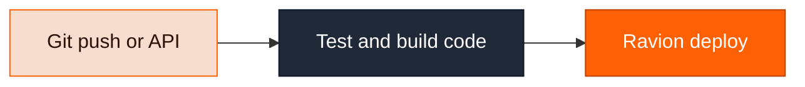
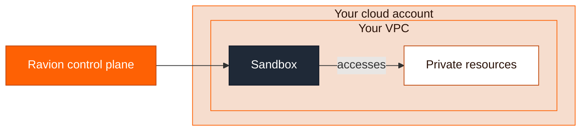

Ravion pipelines are a full CI/CD system that runs in your cloud account. Use them to run tests, build images and static sites, deploy, apply Terraform, and gate releases on approvals. They replace GitHub Actions, CircleCI, Buildkite, and similar CI services.

Every Ravion deploy needs a pipeline _somewhere_ that builds your code, stores the artifact, and starts the deploy. You choose where that pipeline runs.



## Ways to run CI/CD with Ravion

| Option                                                                 | What it is                                                                                         | Use it when                                                                         |
| ---------------------------------------------------------------------- | -------------------------------------------------------------------------------------------------- | ----------------------------------------------------------------------------------- |
| [Ravion pipelines](#ravion-pipelines)                                  | Ravion-native CI/CD. You define triggers and steps in YAML, and steps run in sandboxes in your AWS account. | You want one system for CI, builds, deploys, and infrastructure.                    |
| [GitHub Actions on Ravion runners](#github-actions-on-ravion-runners) | Your existing GitHub Actions workflows, with jobs running on Ravion sandboxes instead of GitHub-hosted runners. | You want to keep your workflows but get faster, cheaper runners inside your VPC.    |
| [External CI](#external-ci)                                            | Any CI system builds the artifact, then calls the Ravion CLI or API to deploy it.                  | You want to keep CircleCI, Buildkite, or another CI system as it is.                |

You can mix these options. For example, run tests in GitHub Actions on Ravion runners, and build and deploy with a Ravion pipeline.

Separately, [stack pipelines](#stack-pipelines) apply infrastructure changes for every module. They run no matter which option you choose for your code.

<CardGroup cols={3}>
  <Card title="Ravion pipelines" icon="diagram-project" href="/pipelines/examples">
    Example pipeline configs for build, test, and deploy.
  </Card>
  <Card title="GitHub Actions runners" icon="github" href="/github-actions/runners">
    Run GitHub Actions jobs on sandboxes in your AWS account.
  </Card>
  <Card title="Stack pipelines" icon="layer-group" href="/modules/stack#stacks-change-through-pipelines">
    Plan, approve, and apply Terraform for each module.
  </Card>
</CardGroup>

## Ravion pipelines

Ravion pipelines cover everything you use a hosted CI service for:

- **Triggers** — GitHub events such as `push`, `pull_request`, and `release`, GitLab events, schedules, generic webhooks, the API, or a manual run. See [Triggers](/pipelines/config-reference/triggers).
- **CI steps** — run tests, linters, and scripts with [`custom`](/pipelines/step-types#custom) steps, build images with [`build:image`](/pipelines/step-types#buildimage), and build static sites with [`build:static`](/pipelines/step-types#buildstatic).
- **Deploy steps** — [build, deploy, and roll back](/pipelines/step-types#module-steps) Ravion modules, and run [`terraform:plan` and `terraform:apply`](/pipelines/step-types#terraformplan).
- **Flow control** — `needs` dependencies, matrix steps, [`parallel` and `group` blocks](/pipelines/step-types#blocks), [approvals](/pipelines/step-types#approval), and [`trigger:pipeline`](/pipelines/step-types#triggerpipeline) to chain pipelines.
- **GitHub checks** — runs report their status to the commit in GitHub, so you can require them on pull requests. See [GitHub checks](#github-checks).
- **Fast, cheap compute** — steps run in [sandboxes](/concepts/sandboxes) that boot in seconds and keep their whole disk as a cache between runs.

This pipeline runs tests and builds the image in parallel on every push to `main`, then deploys only if both succeed:

```yaml ravion-pipeline.yaml
pipeline:
  givenId: build-and-deploy
  project: demo
triggers:
  - id: github_push
    type: webhook:github
    event: push
    repo: https://github.com/my-org/my-repo
    filter:
      branch: main
    run:
      production:
        input:
          branch: << trigger.payload.branch >>
          commit: << trigger.payload.commit >>
inputs:
  - id: branch
    type: string
    default: main
  - id: commit
    type: string
    required: false
variants:
  - id: production
    name: Production
steps:
  - parallel:
      - id: run_tests
        name: Run tests
        type: custom
        source:
          type: git
          repo: https://github.com/my-org/my-repo
          branch: << pipeline.input.branch >>
        commands:
          - npm ci
          - npm test
        infrastructure:
          type: sandbox
          cpu: 4
          memory: 8
          execution_environment_id: ci-builders
      - id: build_web_app
        name: Build web-app
        type: build
        module_instance: << pipeline.variant.id >>.web-app
        input:
          branch: << pipeline.input.branch >>
          ref: << pipeline.input.commit >>
  - id: deploy_web_app
    name: Deploy web-app
    type: deploy
    module_instance: << pipeline.variant.id >>.web-app
    input:
      image_ref: << steps.build_web_app.output.image_digest >>
```

Commit the file to a repository connected through the Ravion GitHub App, and Ravion applies changes to it automatically. See [Pipeline config file](/config-as-code/pipeline-config-file).

### GitHub checks

When a pipeline run is connected to a GitHub commit, Ravion reports the run to that commit as a GitHub check. The check shows on the commit and on any pull request that contains it, just like a GitHub Actions or CircleCI check.

A run is connected to a commit when either of these is true:

- A [GitHub trigger](/pipelines/config-reference/triggers#githubpipelinetrigger) started it, such as a `push` or `pull_request` event.
- One of its steps builds or checks out a specific commit from a repository connected through the Ravion GitHub App, however the run started.

The check follows the run live: **Queued**, **Running**, **Waiting for approval**, then **Succeeded**, **Failed**, **Timed out**, **Cancelled**, or **Skipped**. Its summary lists the steps that ran on the commit, each linked to its logs in Ravion. When a run fails, the summary shows the failing step and its error. When a run waits for approval, it links to the approval step.

Each check is named `<project> / <pipeline> (<variant>)`, for example `demo / Build & Deploy (Production)`. Use that name to make the check required in a GitHub branch protection rule or ruleset. Runs started another way, such as manually, from the API, or on a schedule, add a suffix like `· manual`. They don't replace the check that a trigger started.

Every run attempt gets its own check, so a retry posts a fresh check.

### Coming from GitHub Actions or CircleCI

| GitHub Actions                     | CircleCI                    | Ravion pipelines                                                                                  |
| ---------------------------------- | --------------------------- | ------------------------------------------------------------------------------------------------- |
| Workflow                           | Workflow                    | Pipeline                                                                                          |
| Job or step                        | Job or step                 | [Step](/pipelines/step-types)                                                                     |
| `on:`                              | Triggers and filters        | [`triggers`](/pipelines/config-reference/triggers)                                                |
| `workflow_dispatch` inputs         | Pipeline parameters         | [`inputs`](/pipelines/config-reference/inputs)                                                    |
| `needs:`                           | `requires:`                 | `needs`                                                                                           |
| `strategy.matrix`                  | Matrix jobs                 | `matrix`                                                                                          |
| `runs-on:`                         | Executor and resource class | [`infrastructure`](/pipelines/config-reference/step-infrastructure)                               |
| Environments                       | Contexts                    | [Variants](/pipelines/variants)                                                                   |
| `concurrency:`                     | Serial groups               | [`concurrency`](/pipelines/concurrency)                                                           |
| `actions/cache`                    | `save_cache` / `restore_cache` | Sandbox [disk cache](/concepts/sandboxes#disk-cache)                                          |
| Secrets                            | Environment variables       | `environment_variables` with AWS secret references                                                |
| Status checks                      | Status checks               | [GitHub checks](#github-checks)                                                                   |
| `${{ }}` expressions               | Pipeline values             | [`<< >>` template expressions](/pipelines/templating)                                             |

### Why use Ravion pipelines

<Steps>
  <Step>
    You get **a single pane of glass and CLI/API surface area** to see all your tests, builds, deploys, and infrastructure.
  </Step>

  <Step>
    You get **enhanced security and control** because you no longer have to open up your database or
    image registries to a hosted CI service. Ravion pipelines execute entirely in your cloud account.
  </Step>

  <Step>
    You can **define all your build configuration in the module** alongside your runtime config.
  </Step>
</Steps>



## GitHub Actions on Ravion runners

<Note>
  GitHub Actions runners are in private preview. [Contact support](/contact-support) to request access.
</Note>

Keep your GitHub Actions workflows and run their jobs on Ravion instead. Change a job's `runs-on` to a Ravion label, and Ravion starts a fresh sandbox for that job in your AWS account:

```yaml .github/workflows/test.yml
jobs:
  test:
    runs-on: ravion/ee=github-actions/type=sandbox/cpu=4/memory=16/id=${{ github.run_id }}-${{ github.run_attempt }}-test-${{ strategy.job-index || 0 }}
    steps:
      - uses: actions/checkout@v4
      - run: npm ci
      - run: npm test
```

Jobs run inside your VPC, so they can reach private resources without exposing them to GitHub. Sandboxes keep their whole disk between runs, so dependency installs and builds stay warm.

See [GitHub Actions runners](/github-actions/runners) and [GitHub Actions caching](/github-actions/caching).

## External CI

Keep building in CircleCI, Buildkite, GitHub-hosted runners, or any other CI system. Your CI builds and pushes the artifact, then starts the deploy with the Ravion CLI:

```bash
ravion deploy create --module-instance-id <mi-id> \
  --description "Release v1.4.2" \
  --inputs '{"image_ref": "<digest-pinned-image-uri>"}'
```

See [Building outside Ravion](/modules/build#building-outside-ravion) and [CLI authentication](/cli/authentication) to create an API key for your CI system.

## Stack pipelines

Every module [stack](/modules/stack) has a change pipeline and a destroy pipeline. They run Terraform plan → approval → apply whenever a module's infrastructure config changes or the module is deleted. You don't author these to ship code. They run alongside whichever CI option you pick.

By default, stacks use Ravion-managed system pipelines. Your platform team can replace them with custom pipelines, for example to add policy checks. See [System pipelines and customization](/modules/stack#system-pipelines-and-customization).

Stack pipeline runs appear in your run history next to the pipelines you author. When other docs mention a "stack change pipeline run", they mean a normal pipeline run that a config change started instead of a git push.

## Design your pipelines

### One pipeline, many environments

A pipeline describes a workflow, not an environment. Don't create a "Production pipeline" and a "Staging pipeline" — create one pipeline named after what it does, like **Build & Deploy**, and add a [variant](/pipelines/variants) per environment. Steps reference module instances through `<< pipeline.variant.id >>`, so the same steps deploy to whichever environment a run targets:

```yaml
variants:
  - id: production
    name: Production
  - id: staging
    name: Staging
steps:
  - id: deploy_web_app
    type: deploy
    # resolves to production.web-app or staging.web-app
    module_instance: << pipeline.variant.id >>.web-app
```

### One workflow per pipeline

A pipeline should contain steps that depend on each other. If two sets of steps never consume each other's outputs and never need to wait on each other, they are separate workflows — make them separate pipelines, not parallel groups in one pipeline.

The common mistake is a pipeline shaped like this:

```yaml
# Anti-pattern: independent workflows packed into one pipeline
steps:
  - parallel:
      - group: API
        steps:
          - id: build_api
            type: build
            module_instance: << pipeline.variant.id >>.api
          - id: deploy_api
            type: deploy
            module_instance: << pipeline.variant.id >>.api
            input:
              image_ref: << steps.build_api.output.image_digest >>
      - group: Marketing site
        steps:
          - id: build_site
            type: build
            module_instance: << pipeline.variant.id >>.marketing-site
          - id: deploy_site
            type: deploy
            module_instance: << pipeline.variant.id >>.marketing-site
            input:
              image_ref: << steps.build_site.output.image_digest >>
```

Nothing in the **API** branch reads from the **Marketing site** branch. Packing them together only couples them: a failing site build marks the whole run failed, every trigger runs both even when only one changed, and you can't re-run one without re-running the other. Split them into an **API** pipeline and a **Marketing site** pipeline, each with its own trigger and its own build → deploy steps.

Keep steps in the same pipeline when they share a dependency:

- A deploy that pins the image digest from a build.
- One image build that several module instances deploy.
- A test or `terraform:plan` step that gates a deploy or apply.
- An approval that several deploys wait on.
- Services that must roll out together, in a fixed order, because of a schema or API contract.

Use `parallel` for steps that can overlap *inside* one of these workflows — build two images before a shared deploy stage, or fan a single build out to several deploys. Reach for `group` only occasionally: it labels a nested sequence in the UI and can carry a concurrency key for the block as a whole, so it's useful to hold a multi-step branch inside a `parallel` block. A pipeline whose top level is nothing but parallel groups is almost always several pipelines. See [Blocks](/pipelines/step-types#blocks) for the semantics.

For limits on overlapping runs, see [Pipeline concurrency](/pipelines/concurrency).

## Track cost

To see what each pipeline and step costs, open the execution environment's **Usage** tab in [**Settings / Execution environments**](https://app.ravion.com/org/settings/execution-environments). See [Track cost and hosts](/concepts/sandboxes#track-cost-and-hosts).

See [Pipeline configuration](/pipelines/config-reference) for the detailed config schema.
